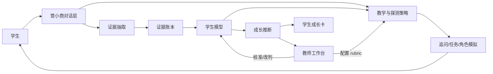

# 营小商：商科能力成长评价
## 需求拆解文档 v0.1

> **定位：长远评价需求参考，不是当前 MVP 实现依据。**  
> 本文覆盖商科评价的完整问题、证据模型、rubric、申诉与教师校准。  
> 当前 MVP 只实现 4 维能力、形成性反馈、对话证据与成长卡；以
> [`../00-mvp/营小商-MVP-v2.0.md`](../00-mvp/营小商-MVP-v2.0.md) 为准。

| 项 | 内容 |
|---|---|
| 版本 | v0.1 |
| 日期 | 2026-10-17 |
| 状态 | 长远评价需求参考；当前 MVP 只做 4 维/形成性 |
| 适用范围 | 商科本科/研究生课程，形成性评价优先 |
| 目标读者 | 课程负责人、教研、产品/技术、评价专家 |

---

## 0. 摘要

本项目要做的不是“会聊天的商科助教”，而是：

> 在课程周期内，通过陪伴式互动持续采集可解释的证据，推断学生在商科核心能力维度上的水平与成长，并让结论可追溯、可申诉、可被教师校准。

商科评价的特殊性决定了三件事：

1. **不能以“答案对错”为主证据**，要以判断质量、假设质量、取舍质量为主证据。
2. **不能只看最终成品**，要看追问链、修订过程、口头答辩和跨情境迁移。
3. **不能只用团队总分**，要有个人证据和贡献归因。

MVP 建议：1 门案例密集型商科核心课、1 个班、12 周、4 个能力维度、3 类评价任务、形成性反馈、不计入高利害成绩。

---

## 1. 为什么商科难评价

### 1.1 商科的学习对象

| 特征 | 含义 | 对评价的挑战 |
|---|---|---|
| 劣构问题 | 问题边界、目标、约束常常不清晰 | 无法用唯一答案判分 |
| 情境依赖 | 同一框架换行业、换阶段就失效 | 单案例表现不能代表能力 |
| 多利益相关者 | 股东、员工、客户、监管、社会目标冲突 | 需要评价权衡与伦理判断 |
| 无唯一正确答案 | 专家之间也常分歧 | 需要“条件性正确”而非“标准答案” |
| 过程重于结论 | 推理、假设、证据使用藏在过程中 | 最终报告可能被模板和 AI 美化 |
| 团队协作普遍 | 小组报告、路演、模拟经营 | 个体贡献难归因 |
| 软技能核心 | 谈判、说服、领导、伦理 | 评分主观、难量化 |
| 知识更新快 | 框架和工具不断变化 | 考知识点很快过时 |
| 学生背景差异大 | 工作经验、家庭资源、实习机会不同 | 容易把背景优势误判为能力 |

### 1.2 传统评价的失效点

| 评价方式 | 能测什么 | 测不到什么 | 主要副作用 |
|---|---|---|---|
| 闭卷考试 | 概念、框架记忆、计算 | 判断、取舍、迁移、沟通 | 鼓励背诵，抑制深度理解 |
| 案例分析报告 | 结构化分析、书面表达 | 真实推理过程、临场判断 | 模板化、AI 代写、评分者偏差 |
| 小组作业 | 团队产出 | 个人贡献、个人能力 | 搭便车、归因争议 |
| 课堂参与 | 表达意愿、临场反应 | 准备质量、深度思考 | 奖励外向，惩罚沉默 |
| 实习/项目 | 真实表现 | 可比性、可控性 | 机会不均、成本高 |
| 自评/量表 | 自我认知、态度 | 实际能力 | 自报偏差、讨好 |

### 1.3 对智能体的六条设计含义

1. **评判断，不评答案**：看学生如何在不确定下形成有条件的主张。
2. **评过程，不评成品**：看追问链、假设变化、修订理由、答辩表现。
3. **评迁移，不评记忆**：看换行业、换情境、换约束后是否仍能工作。
4. **评个体，不评团队平均**：个人证据与团队产出分开记录。
5. **评成长，不评排名**：看水平移动与稳定性，不做公开横向比较。
6. **评可行动性，不评框架熟练度**：建议是否能落地，是否考虑资源、组织、风险与伦理。

---

## 2. 商科要评什么：能力构念

### 2.1 三层能力模型

| 层级 | 内容 | 评价方式 |
|---|---|---|
| 领域判断 | 问题建构、证据与假设、决策与取舍 | 案例诊断、备忘录、答辩 |
| 商业实践 | 市场/财务/运营/战略等具体分析 | 任务表现、模型审查、数据解读 |
| 通用素养 | 沟通影响、团队协作、伦理责任、元认知 | 答辩、模拟、项目复盘 |

MVP 不建议铺满三层，先选 4 个可观察、可训练的维度。

### 2.2 MVP 四个核心维度

| 维度 | 定义 | 核心问句 | 不测什么 |
|---|---|---|---|
| 问题建构 | 能否定义真正的问题、边界、约束与利益相关者 | “你要解决的到底是什么问题？为什么不是另一个？” | 是否记住框架名称 |
| 证据与假设 | 能否区分事实/假设/观点，选择证据，识别偏差 | “你这个判断依赖哪些假设？什么证据能推翻它？” | 资料堆砌数量 |
| 决策与取舍 | 能否形成有条件的主张，比较替代方案，处理风险与伦理 | “在什么条件下选 A 而不是 B？失败模式是什么？” | 结论是否“听起来正确” |
| 沟通与影响 | 能否针对受众组织论证、回应质疑、推动行动 | “决策者最关心什么？你怎么回应反对意见？” | 口才、术语、PPT 美观度 |

可选第五维：**元认知与适应性**——能否根据反馈调整、识别自身盲区、说明自己不确定什么。

### 2.3 四级表现描述

以“问题建构”为例：

| 水平 | 表现描述 |
|---|---|
| L1 复述题目 | 把案例中的现象直接当问题；边界模糊；未识别关键利益相关者。 |
| L2 框架套用 | 能用 SWOT/5C/波特等拆解，但框架与情境匹配度低，遗漏关键约束。 |
| L3 情境化建构 | 能区分症状与根因；界定决策边界、时间尺度、资源约束；识别主要利益相关者及其诉求。 |
| L4 批判性建构 | 能质疑题目预设；提出替代问题框架；说明框架适用边界与盲区；预判不同建构会导致的不同决策。 |

其余三维的简表：

| 维度 | L1 | L2 | L3 | L4 |
|---|---|---|---|---|
| 证据与假设 | 观点堆砌，事实/假设混用 | 有证据意识，但选择标准不清 | 证据链完整，区分事实/假设/推断，做基本估算 | 主动寻找反证，做敏感性/情景分析，说明证据缺口 |
| 决策与取舍 | 单一建议，无条件、无替代、无风险 | 能列选项比较，但停留在优缺点清单 | 明确标准与权重，给出条件性建议，考虑风险与实施 | 设计触发条件/退出机制，处理利益相关者冲突与伦理张力 |
| 沟通与影响 | 信息倾倒，无受众意识 | 结构清晰，但未针对受众调整 | 受众适配，能回应质疑，语言克制 | 能处理反对意见，建立可信度，明确下一步与责任 |

> 注意：rubric 必须由任课教师和评价专家共同定稿，不能由技术团队单独写。否则后面所有评分都不可信。

---

## 3. 什么叫“进步”

### 3.1 操作定义

> 在**可比任务**上，学生**独立表现**所处的水平发生了移动。

三个时间尺度：

| 尺度 | 看什么 | 证据 |
|---|---|---|
| 微观（单次会话） | 是否从卡住到能自己走一步 | 提示梯度、修订理由 |
| 中观（单元/3–4 周） | 同一能力换情境后是否仍成立 | 平行案例、口头答辩 |
| 宏观（整门课） | 水平移动 + 稳定性 + 证据密度 | 证据账本、检查点、教师复核 |

必须允许三种结论：**进步、停滞、证据不足**。

### 3.2 商科进步的六种典型位移

| 从 | 到 | 可观察证据 |
|---|---|---|
| 套框架 | 选框架、改框架、说明框架边界 | 能解释“为什么不用 SWOT” |
| 给答案 | 给有条件的主张 | 能说出“在 X 假设下选 A，否则选 B” |
| 做分析 | 做可执行决策 | 有资源、组织、时间、风险安排 |
| 单点思维 | 系统/利益相关者思维 | 能识别二阶效应与冲突 |
| 回避不确定性 | 量化/管理不确定性 | 有情景分析、敏感性、触发条件 |
| 自我表达 | 受众适配与影响 | 能回应决策者关切与反对意见 |

### 3.3 报告结构

不建议输出单一分数，建议输出“能力证据卡”：

> **能力：决策与取舍**
> 当前水平：L3（中等置信）
> 变化：L2 → L3，主要发生在第 6–9 周
> 支持证据：第 4 周案例 A 备忘录（L2）；第 8 周案例 B 口头答辩（L3）；第 10 周反事实追问（L3）
> 反例/待验证：在资源约束下仍未给出退出条件；尚未观察到跨行业迁移
> 建议：下一次练习“触发条件与失败模式”
> 证据强度：中（3 条独立证据，1 次人工复核）

如果课程必须给分，分数只作为辅助字段，并附置信度与证据链接。

---

## 4. 证据体系

### 4.1 商科可用证据

| 证据类型 | 能说明什么 | 局限 | 采集方式 |
|---|---|---|---|
| 案例诊断对话 | 问题建构、假设、推理链 | 受表达能力和性格影响 | 营小商追问日志 |
| 决策备忘录 | 结构化论证、取舍、实施 | 可能模板化、AI 代写 | 提交物 + 修订历史 |
| 口头答辩 | 独立理解、临场判断、诚实边界 | 成本高、评分者偏差 | 现场/远程答辩 |
| 模拟谈判 | 信息使用、让步策略、伦理 | 角色与对手影响大 | 模拟平台 + 观察量表 |
| 路演/投资人质询 | 沟通影响、抗压、论证 | 表演性可能掩盖思维 | 现场质询记录 |
| 财务模型审查 | 假设合理性、敏感性、错误 | 只覆盖量化能力 | 模型文件 + 追问 |
| 数据解读 | 指标选择、因果谨慎、洞察 | 依赖数据质量 | 仪表盘任务 |
| 伦理困境 | 价值权衡、利益相关者、披露 | 易受社会赞许影响 | 情境题 + 追问 |
| 团队贡献记录 | 个体归因 | 自报偏差、记录不全 | 版本历史、贡献日志 |
| 反思日志 | 元认知、校准 | 自报偏差 | 结构化反思 |
| 教师观察 | 外部锚点 | 主观、时间成本 | 极简量表 |

### 4.2 证据强度分级

| 级别 | 定义 | 例子 |
|---|---|---|
| A | 独立、跨情境、有追问/答辩的表现性任务 | 新案例 + 口头答辩 |
| B | 有过程记录的复杂任务 | 备忘录 + 修订历史 + 一次追问 |
| C | 单次对话、课堂发言 | 一次案例讨论 |
| D | 参与度、出勤、自评 | 不作为能力证据 |

原则：**D 级证据不能单独支撑任何能力结论；C 级证据只能作为线索，不能作为定论。**

### 4.3 无效证据与反证据

以下内容不能作为能力证据：

- 出勤率、发言次数、聊天时长、字数、PPT 页数。
- 框架名称的堆砌数量。
- 只有结论、没有假设与推理的文本。
- 经过 AI 重度润色、无法追溯学生本人思考的成品。
- 学生自报的“我学会了”“我进步了”。
- 团队总分直接分配给个人。

反证据同样重要：**能指出自己结论的边界、失败模式、反例，往往比多给一个正确结论更能说明能力。**

---

## 5. 营小商互动设计

### 5.1 角色设定

| 角色 | 用途 | 边界 |
|---|---|---|
| 营小商 | 日常提问、澄清、陪练 | 不替学生完成作业 |
| 魔鬼代言人 | 挑战假设、找反例、压力测试 | 不为了刁难而刁难 |
| 客户/投资人/监管者 | 模拟真实质询 | 角色透明，不伪装真人 |
| 教练 | 复盘、元认知、学习策略 | 不进行心理治疗 |

角色可以切换，但必须让学生知道当前在哪种模式、是否在采集评价证据。

### 5.2 对话策略

| 学生行为 | 营小商动作 | 证据价值 |
|---|---|---|
| 问事实/概念 | 直接答 + 追问“你会怎么用” | 应用能力 |
| 问“标准答案” | 说明没有唯一答案 + 要求给条件与取舍 | 判断质量 |
| 给结论 | 追问假设、反例、替代方案 | 证据与假设 |
| 套框架 | 追问“为什么用这个框架、它漏了什么” | 框架选择 |
| 卡住 | 诊断卡点，给最小提示 | 最近发展区 |
| 答错 | 错误归因 + 对比案例 | 迷思概念 |
| 团队分歧 | 要求复述对方观点、找共同标准 | 协作与沟通 |
| 反思 | 元认知 prompts | 校准与计划 |
| 情绪 | 共情 + 调难度 | 参与与坚持 |

三条底线：

1. **不替学生完成**：可以给提示、给反例，不直接给成品。
2. **不伪装人类**：人格可以温暖，身份必须透明。
3. **不把模型观点当标准答案**：商科没有唯一解，模型只提供质询与对照。

### 5.3 一次 30 分钟案例诊断会话示例

> **营小商**：这家公司连续两个季度利润下滑，管理层认为是营销投入不够。你怎么看？
>
> **学生**：应该加大投放，提升品牌曝光。
>
> **营小商**：你的建议依赖哪个关键假设？
>
> **学生**：假设需求还在，只是触达不够。
>
> **营小商**：如果需求结构变了呢？你会找什么证据区分这两种解释？
>
> **学生**：看复购率、客单价、分渠道转化……还有竞品价格。
>
> **营小商**：好。现在给你一个反例：复购率稳定，但新客获取成本翻倍。你的建议会怎么变？
>
> **学生**：那可能不是曝光问题，是渠道效率或产品匹配问题。
>
> **营小商**：把你的判断写成一句有条件的主张，并说明什么证据会推翻它。
>
> **学生**：如果复购稳定且 CAC 上升，优先优化渠道结构而不是加预算；如果分渠道转化都下降，则重新评估产品市场匹配。
>
> **营小商**：这句话里，哪些是事实，哪些是假设，哪些是推断？

这段对话产生的证据：问题建构（从“加预算”到“区分需求/渠道”）、证据与假设（复购、CAC、转化）、决策与取舍（条件性主张）、元认知（区分事实/假设/推断）。

### 5.4 会话结构建议

| 阶段 | 目的 | 时长 |
|---|---|---|
| 开场 | 明确目标、角色、是否采集评价证据 | 2 分钟 |
| 诊断 | 学生先给判断，营小商追问假设与证据 | 10–15 分钟 |
| 压力测试 | 反例、约束变化、利益相关者冲突 | 8–10 分钟 |
| 收束 | 学生复述有条件的主张与待验证点 | 3–5 分钟 |
| 反思 | 3 个元认知问题 | 2–3 分钟 |

---

## 6. 评价任务库

| 任务 | 评什么 | 主要证据 | 时长 | 成本 | MVP |
|---|---|---|---|---|---|
| 案例诊断对话 | 问题建构、假设、推理 | 追问日志 | 30 min | 低 | ✅ |
| 决策备忘录 | 论证、取舍、实施 | 提交物 + 修订 | 48 h | 中 | ✅ |
| 口头答辩 | 独立理解、临场判断 | 答辩记录 + 评分 | 15 min/人 | 高 | ✅ |
| 模拟谈判 | 信息使用、让步、伦理 | 观察量表 + 结果 | 45–60 min | 中 | 后续 |
| 投资人质询/路演 | 沟通影响、抗压 | 质询记录 | 20 min | 中 | 后续 |
| 财务模型审查 | 假设、敏感性、错误 | 模型 + 追问 | 60 min | 中 | 后续 |
| 数据解读 | 指标选择、因果谨慎 | 仪表盘任务 | 30 min | 低 | 后续 |
| 伦理困境 | 价值权衡、披露 | 情境题 + 追问 | 30 min | 低 | 后续 |
| 危机响应 | 优先级、沟通、决策 | 模拟记录 | 45 min | 中 | 后续 |
| 客户发现访谈 | 提问质量、倾听、综合 | 访谈记录 | 30 min | 中 | 后续 |
| 团队项目复盘 | 协作、归因、学习 | 贡献图 + 复盘 | 30 min | 低 | 后续 |
| 竞品/市场进入分析 | 系统思维、证据 | 提交物 + 答辩 | 1–2 周 | 高 | 后续 |

MVP 只做前三类：**对话、备忘录、答辩**。这三类已经能覆盖四个能力维度，且成本可控。

---

## 7. 评分与校准

### 7.1 多答案问题怎么评

商科不能设“唯一标准答案”。建议采用：

1. **rubric + 锚例**：每个水平配 2–3 个真实学生样例（高分、中分、低分），先由专家标定。
2. **条件性正确**：结论只在给定假设下成立；评分看假设是否明确、证据是否支持、边界是否说明。
3. **专家评分分布**：允许专家分歧；记录分歧点，不追求虚假共识。
4. **比较判断（comparative judgement）**：让专家两两比较学生表现，降低绝对评分漂移。
5. **论证质量优先**：结论方向不等于质量；错误结论但推理严谨，可能高于正确结论但无推理。

### 7.2 评分流程

```text
学生表现
  → 证据抽取（引用原文/片段）
  → LLM 按 rubric 初评（维度分开，不合成总分）
  → 教师抽样复核
  → 分歧仲裁
  → 更新锚例与校准集
  → 版本化记录
```

### 7.3 一致性与漂移

| 指标 | 用途 | 建议目标 |
|---|---|---|
| 加权 kappa | 专家-系统、专家-专家一致性 | ≥ 0.70 |
| ICC | 连续评分一致性 | ≥ 0.75 |
| G-theory | 评分者/任务/时间方差分解 | 识别主要误差来源 |
| 推翻率 | 教师复核推翻系统结论的比例 | < 15% |
| 漂移监控 | 换模型/换 prompt 后分数分布变化 | 无系统性偏移 |

### 7.4 版本化

必须版本化的对象：rubric、锚例、prompt、模型、任务库、评分脚本。

否则第 4 周和第 10 周的“L3”可能不是同一个 L3，成长结论不成立。

---

## 8. 团队作业与个体归因

这是商科评价最痛的点之一。建议采用“**团队产出 + 个人证据**”双轨：

| 证据 | 能说明 | 不能说明 |
|---|---|---|
| 个人与营小商的对话 | 个人推理、假设、反思 | 团队协作质量 |
| 贡献日志 | 谁在哪个决策点做了什么 | 贡献的真实价值 |
| 版本历史 | 编辑量、修改位置 | 思考深度 |
| 口头答辩（随机抽人） | 是否理解整份工作 | 日常贡献 |
| 同伴互评（校准后） | 协作行为 | 能力水平 |
| 教师观察 | 过程表现 | 可规模化 |

设计原则：

1. **个人答辩随机抽题**：任何成员都可能被问到任何部分，倒逼真实理解。
2. **贡献图而非贡献百分比**：记录“谁负责什么决策/证据/交付”，避免虚假精确。
3. **同伴互评只作辅助**：不能单独决定个人成绩。
4. **团队分与个人分分开**：团队分评产出，个人分评证据。
5. **争议可申诉**：保留日志与答辩记录。

---

## 9. 效度、公平与风险

| 风险 | 商科表现 | 缓解 |
|---|---|---|
| 工作经验/资源差异 | 有实习/家庭商业资源的学生表现更好 | 任务提供背景材料；评“推理质量”而非“行业熟悉度”；子群体分析 |
| 语言表达混淆 | 把口才/写作当思维能力 | 维度分开评分；提供书面+口头多种通道 |
| 文化资本 | 案例中的隐性规则、精英表达 | 明确评分标准；提供范例；避免奖励“像咨询顾问”的腔调 |
| AI 代写 | 成品无法反映本人能力 | 过程证据、口头答辩、AI 使用声明、现场任务 |
| 案例熟悉度 | 做过类似案例的学生占优 | 平行案例、锚题、跨情境任务 |
| 专家分歧 | 同一表现评分差异大 | 锚例、比较判断、分歧记录、多评者 |
| 分数膨胀 | 商科给分普遍偏高，区分度低 | 水平描述而非分数；校准；外部锚点 |
| 团队搭便车 | 个人贡献被平均 | 个人证据、随机答辩、贡献图 |
| 伦理价值冲突 | 模型强加单一价值观 | 评理由质量与利益相关者分析，不评立场 |
| 隐私与未成年人 | 行为、情绪数据敏感 | 最小化采集、同意、可删除 |
| 过度依赖 | 学生把营小商当唯一支持 | 边界设计、转介教师/真人 |

---

## 10. 产品形态与 MVP

### 10.1 用户流程

**学生**

1. 进入课程，完成基线任务（案例诊断 + 备忘录）。
2. 每周与营小商互动 1–2 次：提问、被追问、做小任务。
3. 每 3 周一次检查点：平行案例 + 口头答辩。
4. 查看成长地图与证据卡，设定下一步目标。
5. 期末做迁移任务与复盘。

**教师**

1. 配置能力维度、rubric、任务与检查点。
2. 查看班级热力图、迷思概念聚类、证据不足学生。
3. 抽样复核系统评分，改判并填写理由。
4. 导出证据包，用于课程改进与认证材料。

### 10.2 MVP 范围

**做：**

- 1 门商科核心课（建议战略管理/市场营销/财务管理等案例密集型课程）。
- 1 个班，30–60 人，12 周。
- 4 个能力维度，每维 4 级。
- 中文文本对话（Web/LMS）。
- 3 类任务：案例诊断对话、决策备忘录、口头答辩。
- 每 3 周一次检查点；锚定案例复用。
- 学生成长卡 + 教师工作台 + 证据抽样复核。
- 形成性反馈，不计入高利害成绩；与教师评分并行做效度对比。

**不做：**

- 全商科通用能力框架。
- 自动高利害评分/认证。
- 语音、多模态、情感计算。
- 全自动谈判/路演评分。
- 跨校排名、家长端。
- 用聊天时长/发言次数作为能力指标。

### 10.3 12 周试点设计

| 周 | 动作 | 产出 |
|---|---|---|
| W1 | 基线：案例诊断 + 备忘录 | 初始水平 |
| W2–W5 | 每周 1 次营小商互动；教师正常教学 | 过程证据 |
| W6 | 检查点 1：平行案例 + 口头答辩 | 中观水平 |
| W7–W10 | 营小商互动 + 团队项目（个人证据） | 过程证据、贡献图 |
| W11 | 检查点 2：新情境迁移任务 | 迁移证据 |
| W12 | 后测 + 教师评分 + 学生访谈 | 成长报告、效度数据 |

### 10.4 技术架构（简）



关键工程要求：

- 每条证据可回溯到原始对话/文件片段。
- 学生模型允许“未知”，不强行补全。
- 关系记忆（兴趣、称呼）与评价记录（能力证据）分离。
- 所有评分与报告带版本号。

---

## 11. 成功指标

| 维度 | 指标 | 建议目标（需校准） |
|---|---|---|
| 效度 | 专家-系统评分一致性（加权 kappa） | ≥ 0.70 |
| 效度 | 与独立口头答辩/专家评分相关 | ≥ 0.60 |
| 区分度 | 能稳定区分 L2/L3/L4 | 层级间差异显著 |
| 信度 | 同一证据重复评分一致性 | ≥ 0.75 |
| 成长敏感性 | 能检出预期内的水平移动 | 显著优于随机 |
| 公平性 | 子群体差异 / DIF | 无系统性偏差 |
| 可信度 | 教师复核推翻率 | < 15% |
| 证据充分性 | “证据不足”比例 | < 20% |
| 学生体验 | 认为“比考试更能反映能力” | ≥ 70% |
| 教师体验 | 每周节省评阅时间 | ≥ 2 小时/班 |
| 团队归因 | 个体贡献争议数量 | 较传统小组作业下降 |

---

## 12. 待决策问题

| 决策 | 选项 | 推荐 | 影响 |
|---|---|---|---|
| 试点课程 | 战略/营销/财务/运营 | **案例密集、已有 rubric 的核心课** | 决定任务库与能力维度 |
| 利害级别 | 形成性/计入过程分/终结性认证 | **形成性先行** | 高利害会放大效度与申诉问题 |
| 能力框架 | 自建/校本/AACSB AoL 裁剪 | **AACSB AoL + 校本裁剪到 4 维** | 影响认证对齐与教师接受度 |
| 任务形态 | 纯文本/文本+口头/多模态 | **文本 + 异步口头答辩** | 成本与证据强度 |
| 团队作业 | 不纳入/团队产出+个人证据 | **团队产出+个人证据** | 归因复杂度 |
| 评分分工 | 全自动/教师复核/人机共评 | **人机共评** | 可信度与责任边界 |
| 产出形态 | 单一分数/画像+轨迹/证书 | **画像+轨迹，分数辅助** | 直接回应“比分数更好” |

---

## 13. 参考方向

### 13.1 商科评价框架

- **AACSB Assurance of Learning (AoL)**：课程学习目标、直接/间接证据、闭环改进。适合作为能力框架与认证对齐的起点。
- **EFMD EQUIS / AMBA**：商科教育质量与项目认证，可参考其学习成果与持续改进逻辑。
- **专业认证**：会计（AICPA）、金融（CFA）、营销（CIM）等能力框架，可作为领域能力维度的参考。
- **校本课程学习目标**：最终必须落到本校课程，不能直接照搬认证条款。

### 13.2 评价方法

- 表现性评价（performance assessment）、档案袋评价（portfolio）。
- Rubric 设计与锚例标定。
- 比较判断（comparative judgement）。
- 模拟/游戏化评价（business simulation）。
- 口头答辩与结构化访谈。
- LLM 辅助评分：rubric-based grading、automated essay scoring、conversational assessment。
- 纵向测量：growth model、longitudinal IRT、generalizability theory。

### 13.3 系统与资源

- 商业模拟：Capsim、Marketplace、Cesim。
- 案例库：Harvard Business Publishing、Ivey Publishing、中国管理案例共享中心。
- 学习分析/评价平台：可参考其教师看板与证据链设计。
- 国内实践：商科实践教学、经管类实验教学、案例教学评价。

### 13.4 检索关键词

英文：

```text
"assurance of learning" business education assessment
"case-based assessment" OR "performance assessment" business school
"comparative judgement" higher education assessment
"simulation-based assessment" business education
"LLM" AND "rubric" AND assessment
"conversational assessment" OR "dialogue-based assessment"
"team contribution" OR "individual accountability" group work assessment
"longitudinal" AND "competency" AND assessment
```

中文：

```text
商科 过程性评价 能力测评
经管类 案例教学 评价改革
商科 增值评价 学习成果
表现性评价 商科 课程
AACSB 学习保障 商科
团队作业 个体贡献 评价
大模型 商科 教学评价
```

### 13.5 参考筛选清单

看一篇参考时，优先确认它是否回答：

1. **构念**：评什么能力？如何定义？
2. **证据**：什么表现算证据？如何抽取？
3. **测量**：水平如何判定？纵向如何比较？
4. **效度/公平**：是否验证？是否有子群体分析？
5. **落地**：多大规模、多长时间、教师如何使用？

只有产品演示、没有证据模型和效度验证的参考，价值有限。

---

## 附录 A：证据账本字段

| 字段 | 类型 | 说明 |
|---|---|---|
| evidence_id | string | 唯一标识 |
| student_id | string | 学生 |
| course_id | string | 课程 |
| competency | enum | 能力维度 |
| task_id | string | 任务 |
| timestamp | datetime | 采集时间 |
| source_type | enum | 对话/提交物/答辩/观察/反思 |
| raw_ref | string | 原始片段引用 |
| rubric_level | int | 1–4 |
| confidence | float | 0–1 |
| scorer | enum | LLM/教师/同伴 |
| human_reviewed | bool | 是否人工复核 |
| version | string | rubric/prompt/模型版本 |
| notes | text | 反例、分歧、待验证 |

---

## 附录 B：MVP 页面清单

**学生端**

- 对话页：角色切换、目标、证据提示。
- 成长卡：能力维度、水平、趋势、证据、下一步。
- 任务页：案例、备忘录、答辩安排。
- 反思页：结构化问题、目标设定。

**教师端**

- 班级热力图：能力维度 × 学生。
- 学生详情：证据链、反例、置信度。
- 复核队列：待复核、已改判、分歧。
- Rubric 配置：维度、水平、锚例。
- 导出：证据包、课程改进报告。

---

## 附录 C：下一步

1. **选课**：确定 1 门案例密集型商科核心课与任课教师。
2. **定构念**：用 2–3 次工作坊把 4 个维度、4 级描述、锚例写出来。
3. **手工验证**：拿 10–15 段真实学生案例讨论，让 2–3 位教师独立评分，看能否稳定区分水平。
4. **再决定**：如果人工都判不出，先改 rubric/任务，不要急着上模型；如果人工能判出，再设计自动化与证据抽取。

这三步决定项目是否成立，比先选模型/框架更重要。
