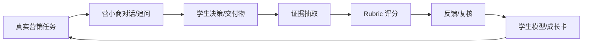
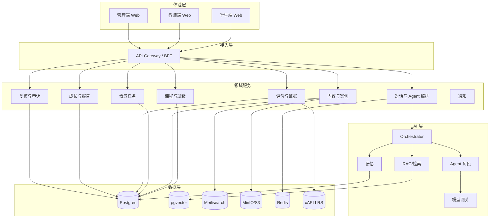
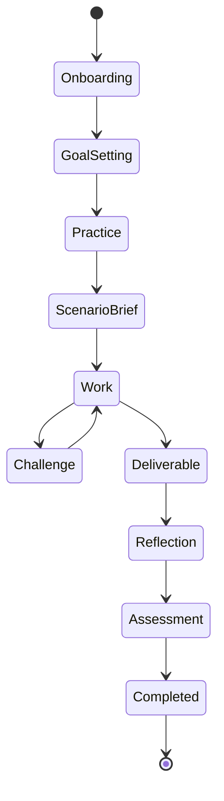
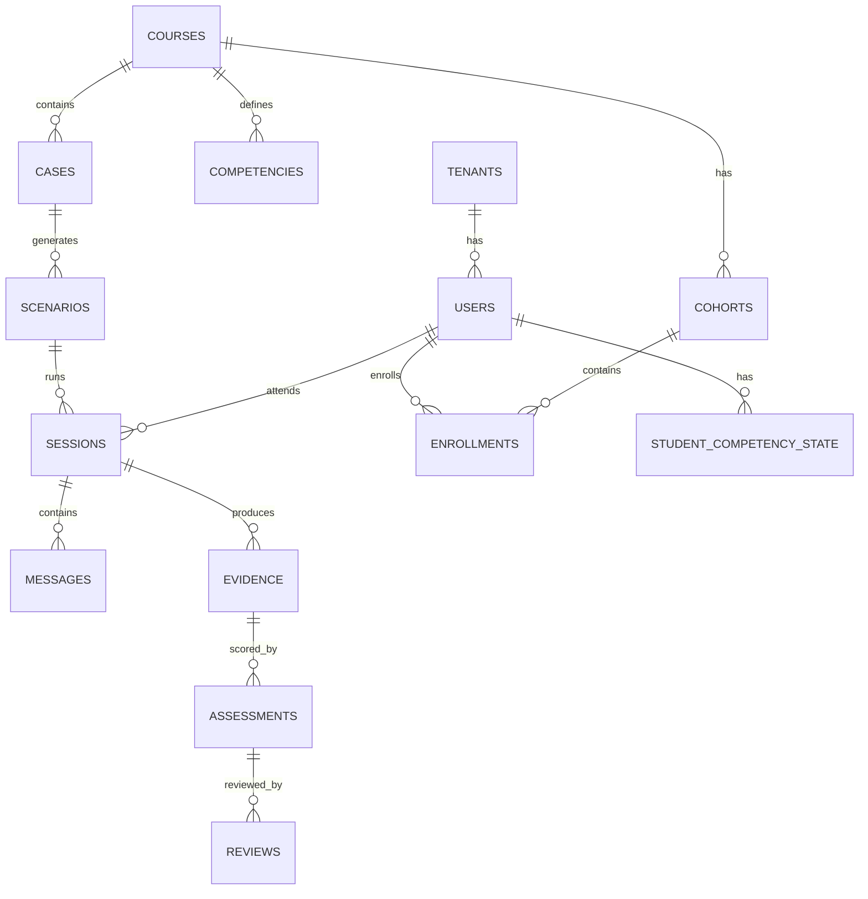

# 营小商 · 系统拆解
## 系统拆解文档 v0.1

> **定位：长远设计参考，不是当前 MVP 实现依据。**  
> 本文保留完整系统分层（多角色、多租户、教师端、Web 优先、6 维能力）。  
> 当前 MVP 已收敛为：单学生本地 SQLite、桌面端、4 维能力、聊天优先单说话人、提示词 + 工具 + 输出。  
> 以 [`../00-mvp/营小商-MVP-v2.0.md`](../00-mvp/营小商-MVP-v2.0.md) 为准。

| 项 | 内容 |
|---|---|
| 版本 | v0.1 |
| 日期 | 2026-10-17 |
| 状态 | 长远设计参考；当前 MVP 以 `../00-mvp/` 为准 |
| 适用 | 高校营销/品牌/消费者行为/数字营销课程 |
| 关联文档 | `../10-long-term/营小商-商科能力评价-需求拆解-v0.1.md`、`../20-features/商科真实案例库-数据与项目方案-v0.1.md` |
| 目标 | 把“营小商 + 能力成长评价”拆成可实现的前端、后端、AI、数据与评价系统 |

---

## 0. 文档目的与范围

本文档回答四个问题：

1. **这个系统到底由哪些部分组成？**
2. **前端有哪些页面、组件、状态和交互？**
3. **后端有哪些服务、接口、任务、表和权限？**
4. **营小商、评价引擎、案例库、数据层怎么协同？**

范围：

- 一门营销课程的陪伴式学习与评价。
- Web 端优先，文本交互优先。
- 形成性评价优先，不直接做高利害自动评分。
- 单机构、单课程 MVP，架构预留多课程/多租户。

不在本文档范围：

- 具体视觉稿。
- 具体模型选型结论（只给推荐与约束）。
- 详细排期与报价。
- 法律意见。

---

## 1. 产品定义

### 1.1 一句话

> **营小商**是一个面向营销课程的陪伴式智能体：学生在真实营销任务中与多个 AI 角色对话、做决策、交交付物、被追问、做反思；系统持续采集证据，评价学生在营销洞察、策略、品牌、数据、沟通、伦理六个维度上的成长。

### 1.2 目标用户

| 角色 | 核心诉求 | 关键动作 |
|---|---|---|
| 学生 | 被理解、知道怎么进步、看到成长 | 对话、做任务、交交付物、看成长卡 |
| 教师 | 降低过程性评价成本、有证据可复核 | 配置课程、编案例、看班级诊断、复核评分 |
| 助教 | 处理日常答疑与复核 | 看看板、抽样复核、回复学生 |
| 课程负责人 | 课程质量与认证材料 | 看 cohort 报告、导出证据包 |
| 管理员 | 账号、权限、合规、成本 | 配 SSO、模型、审计、数据保留 |

### 1.3 核心闭环



### 1.4 不做什么

- 不做通用聊天机器人。
- 不做“一键生成营销方案”的代写工具。
- 不做监考/作弊检测系统。
- 不做无人工复核的高利害自动评分。
- 不做全商科通用平台（MVP 只做营销）。

---

## 2. 营销能力模型

### 2.1 六个能力维度

| 维度 | 定义 | 可观察行为 | 不应当作主证据 |
|---|---|---|---|
| 市场与消费者洞察 | 能否理解市场结构、消费者行为、研究数据 | 提出假设、选择研究方式、解读消费者数据、识别偏差 | 复述 4P/STP 定义 |
| 品牌与定位 | 能否建立差异化价值主张与品牌联想 | 写定位 statement、做品牌架构、解释取舍 | 堆品牌术语 |
| 营销策略与组合 | 能否在约束下做 STP、产品/价格/渠道/推广决策 | 给条件性方案、比较替代、说明预算与优先级 | 只列框架 |
| 数据与效果 | 能否选择指标、读漏斗、做归因、设计实验 | 解释 CAC/CLV/ROI、识别因果陷阱、设计 A/B | 只报数字 |
| 创意与沟通 | 能否形成 campaign 概念并向受众/客户表达 | insight → idea、pitch、回应质疑、适配渠道 | PPT 美观度、口才 |
| 伦理与可持续 | 能否识别隐私、暗黑模式、消费者保护、社会责任 | 说明利益相关者冲突、披露风险、给替代方案 | 喊口号 |

### 2.2 四级表现（以“市场与消费者洞察”为例）

| 水平 | 表现 |
|---|---|
| L1 复述 | 能复述市场/消费者概念，但把现象当结论，未区分事实与假设。 |
| L2 套用 | 能套用 STP/4P/用户画像，但洞察停留在人口统计，未解释行为动因。 |
| L3 情境化 | 能结合品类、渠道、竞争与消费者旅程提出可检验假设，选择合适数据。 |
| L4 批判性 | 能质疑研究口径与样本偏差，提出替代解释，说明洞察的边界与反证。 |

其余维度用同样的四级结构，由教师工作坊定稿。

### 2.3 营销任务类型

| 任务 | 评什么 | 交付物 | 典型时长 |
|---|---|---|---|
| 客户 brief 诊断 | 洞察、问题建构 | 问题重述 + 研究计划 | 30–45 min |
| 新品上市方案 | 策略、组合、预算 | 一页纸 GTM + 预算表 | 2–4 h |
| 品牌定位 | 品牌、洞察、沟通 | 定位 statement + 理由 | 45–60 min |
|  Campaign 创意 | 创意、沟通、洞察 | Big idea + 渠道适配 | 2–3 h |
| 媒介组合 | 数据、策略、预算 | 媒介计划 + 预期效果 | 2–4 h |
| 定价决策 | 策略、数据、伦理 | 定价建议 + 敏感性分析 | 60–90 min |
| 渠道冲突 | 策略、协作、伦理 | 决策备忘录 | 60 min |
| 数据解读 | 数据、洞察 | 诊断 + 下一步实验 | 45 min |
| 危机公关 | 沟通、伦理、策略 | 24 小时响应方案 | 60 min |
| 伦理困境 | 伦理、洞察、沟通 | 决策 + 披露方案 | 45 min |
| 营销复盘 | 数据、策略、反思 | 复盘报告 | 60–90 min |
| 客户 pitch | 沟通、策略、品牌 | 10 分钟路演 + 答辩 | 20 min |

---

## 3. 总体架构

### 3.1 系统全景



### 3.2 分层职责

| 层 | 职责 | 不做什么 |
|---|---|---|
| 体验层 | 对话、任务、交付物、成长卡、教师看板 | 不直接拼 prompt |
| 接入层 | 鉴权、路由、限流、SSE 代理、BFF 聚合 | 不承载领域逻辑 |
| 领域服务 | 课程、案例、任务、评价、复核 | 不直接调用模型供应商 |
| AI 层 | 编排、角色、记忆、RAG、模型路由 | 不直接写业务库 |
| 数据层 | 事务、向量、搜索、对象、缓存、证据 | 不承担业务规则 |

### 3.3 推荐技术栈

| 层 | 推荐 | 备选 | 理由 |
|---|---|---|---|
| 前端 | Next.js + TypeScript + Tailwind + shadcn/ui | Remix、Vue/Nuxt | 服务端渲染、路由、生态成熟 |
| 状态 | TanStack Query + Zustand | Redux Toolkit | 服务端状态与客户端状态分离 |
| 表单 | React Hook Form + Zod | Formik | 类型安全、校验清晰 |
| 编辑器 | Tiptap | Lexical | 富文本交付物、可扩展 |
| 图表 | Recharts / Visx | ECharts | 成长卡、教师看板 |
| 后端 | FastAPI + SQLAlchemy 2 + Pydantic | NestJS、Django | AI 生态、异步、类型 |
| 任务队列 | Celery + Redis | Arq、BullMQ | 成熟、可重试 |
| 数据库 | Postgres 16 + pgvector | MySQL + 独立向量库 | 事务 + 向量一体 |
| 搜索 | Meilisearch | Elasticsearch | 轻量、易运维 |
| 对象存储 | MinIO/S3 | 本地盘 | 原始文件、导出 |
| 证据账本 | Learning Locker / lrsql | 自建 xAPI 表 | 标准、可审计 |
| 模型网关 | LiteLLM | 自研 provider 层 | 多模型、降级、计量 |
| 编排 | LangGraph 或自研状态机 | CrewAI、AutoGen | 可控、可观测 |
| 观测 | OpenTelemetry + Langfuse + Sentry | 自建 | LLM trace 与业务 trace |
| 部署 | 单机进程（MVP）→ Docker Compose → K8s | 云托管 | 先简后繁 |

**架构原则：模块化单体优先。** 先用一个 API 服务 + 一个 worker 服务，按领域分模块；等团队和流量需要时再拆微服务。不要一开始上 10 个服务。

---

## 4. 前端拆解

### 4.1 学生端

| 页面 | 目的 | 核心内容 | 关键交互 |
|---|---|---|---|
| 登录/同意 | 身份与授权 | SSO、隐私说明、数据用途 | 同意/拒绝、查看详情 |
| 课程首页 | 知道学什么、在哪 | 课程目标、能力地图、当前任务、最近证据 | 进入任务、查看成长 |
| 能力地图 | 看见成长 | 六维雷达/条形、当前水平、趋势、证据数 | 点开维度看证据 |
| 营小商对话 | 主交互 | 消息流、角色切换、引用、工具卡 | 发消息、追问、要提示、切换角色 |
| 情景任务 | 做真实任务 | Brief、数据室、约束、交付物、rubric | 读材料、记笔记、提交 |
| 交付物编辑器 | 产出 | 备忘录/定位/媒介计划/复盘 | 编辑、版本、AI 只给反馈不代写 |
| 反馈页 | 知道差在哪 | 维度评分、证据引用、反例、下一步 | 接受/申诉/加入目标 |
| 成长卡 | 看长期变化 | 水平、趋势、置信度、证据、建议 | 导出、分享（可选） |
| 反思页 | 元认知 | 3–5 个结构化问题 | 提交反思 |
| 通知 | 任务与复核 | 截止、反馈、教师回复 | 已读、跳转 |

### 4.2 教师端

| 页面 | 目的 | 核心内容 |
|---|---|---|
| 课程设置 | 定义教什么、怎么评 | 能力维度、四级描述、任务、权重 |
| Rubric 管理 | 统一评分标准 | 维度、水平、锚例、版本 |
| 案例库 | 选/编案例 | 案例卡、来源、难度、适用维度 |
| 情景题编辑 | 出题 | 角色、约束、隐藏信息、交付物、评分点 |
| 班级看板 | 看整体 | 能力热力图、迷思概念、证据不足学生 |
| 学生详情 | 看个体 | 证据链、水平、趋势、对话片段 |
| 复核队列 | 校准 AI | 待复核、分歧、改判、理由 |
| 申诉处理 | 回应学生 | 申诉、证据、裁决 |
| 分析报告 | 课程改进/认证 |  cohort 报告、导出、版本 |
| AI 设置 | 控制行为 | 角色、护栏、模型、成本上限 |

### 4.3 管理端

| 页面 | 目的 |
|---|---|
| 租户/组织 | 多学院/多项目隔离 |
| 用户与角色 | 学生、教师、助教、管理员 |
| SSO/LMS 集成 | OIDC/SAML、LTI、xAPI |
| 模型与供应商 | 模型路由、配额、降级 |
| 数据与合规 | 同意、保留、删除、导出 |
| 审计日志 | 谁看了什么、改了什么 |
| 成本与用量 | token、会话、课程成本 |

### 4.4 路由表

```text
/                         落地页
/login                    登录
/s/courses                学生课程列表
/s/courses/[courseId]     课程首页
/s/courses/[courseId]/map 能力地图
/s/sessions/[sessionId]   营小商对话
/s/scenarios/[scenarioId] 情景任务
/s/deliverables/[id]      交付物编辑
/s/growth                 成长卡
/s/evidence/[evidenceId]  证据详情
/s/reflection             反思

/t/courses                教师课程
/t/courses/[id]/setup     课程设置
/t/courses/[id]/rubrics   Rubric
/t/courses/[id]/cases     案例库
/t/courses/[id]/dashboard 班级看板
/t/students/[id]          学生详情
/t/review                 复核队列
/t/appeals                申诉
/t/analytics              分析报告

/a/tenants                租户
/a/users                  用户
/a/integrations           集成
/a/models                 模型
/a/audit                  审计
/a/cost                   成本
```

### 4.5 组件清单

**对话**

- `ChatShell`
- `MessageList`
- `MessageBubble`
- `StreamingIndicator`
- `RoleBadge`
- `ToolCallCard`
- `CitationChip`
- `QuickReply`
- `Composer`
- `AttachmentUploader`
- `SessionHeader`
- `HintLadder`
- `ModeSwitcher`（营小商/教练/客户/魔鬼代言人）

**任务**

- `ScenarioBrief`
- `DataRoom`
- `DataCard`
- `ConstraintList`
- `DeliverableEditor`
- `RubricChecklist`
- `VersionHistory`
- `Timer`
- `SubmitDialog`
- `HiddenInfoRequest`

**成长**

- `CompetencyRadar`
- `LevelTimeline`
- `EvidenceList`
- `EvidenceCard`
- `ConfidenceBadge`
- `NextStepCard`
- `GrowthSummary`
- `InsufficientEvidence`

**教师**

- `CohortHeatmap`
- `StudentTable`
- `StudentDetailPanel`
- `ReviewQueue`
- `EvidenceDetail`
- `RubricEditor`
- `AnchorGallery`
- `DisagreementChart`
- `InterventionPanel`
- `ExportDialog`

**通用**

- `AppShell`
- `Sidebar`
- `Topbar`
- `EmptyState`
- `ErrorState`
- `Skeleton`
- `Toast`
- `ConfirmDialog`
- `DataTable`
- `FilterBar`
- `SearchBox`
- `Pagination`
- `AccessibleDialog`

### 4.6 状态与数据流

| 状态 | 方案 | 说明 |
|---|---|---|
| 服务端数据 | TanStack Query | 课程、任务、证据、看板 |
| 会话流 | SSE + 本地消息队列 | 流式输出、断线重连 |
| 编辑器 | Tiptap + 本地草稿 | 自动保存、版本 |
| 全局 UI | Zustand | 侧栏、主题、当前角色 |
| 表单 | React Hook Form + Zod | 课程设置、rubric |
| URL 状态 | Next.js searchParams | 筛选、分页、tab |

**原则：** 服务端状态不要塞进全局 store；聊天流要有“乐观消息 + 服务端确认 + 失败重试”。

### 4.7 交互与体验要求

- 首屏 < 2.5s LCP；聊天首 token < 2s（P95）。
- 所有 AI 消息可引用、可展开来源。
- 角色切换必须显式，学生知道当前是谁在说话。
- “评价者”角色不可见，避免学生对着评分器表演。
- 交付物编辑器支持自动保存、版本对比、导出 PDF/DOCX。
- 成长卡必须显示“证据不足”，不能强行给结论。
- 键盘可操作，屏幕阅读器可用，对比度符合 WCAG 2.1 AA。
- 移动端至少可用（对话、任务、成长卡），不做原生 App。

---

## 5. 后端拆解

### 5.1 服务边界

MVP 采用**模块化单体**：

```text
api/
  modules/
    identity/
    courses/
    content/
    scenarios/
    conversations/
    agents/
    assessment/
    growth/
    review/
    notifications/
    integrations/
    admin/
    analytics/
  shared/
    db/
    auth/
    events/
    llm/
    storage/
worker/
  jobs/
    ingest/
    extract/
    score/
    report/
    cleanup/
```

### 5.2 核心模块

| 模块 | 职责 | 关键依赖 |
|---|---|---|
| Identity | 登录、角色、租户、SSO | OIDC/SAML |
| Courses | 课程、班级、注册、能力框架 | Postgres |
| Content | 案例卡、来源、版本、版权 | Postgres、MinIO |
| Scenarios | 情景题、角色、约束、数据室 | Content |
| Conversations | 会话、消息、流式输出、断线重连 | Redis、Agent |
| Agents | 角色、编排、记忆、工具、护栏 | LLM Gateway |
| Assessment | 证据抽取、rubric、评分、置信度 | Postgres、LRS |
| Growth | 学生模型、成长推断、报告 | Assessment |
| Review | 教师复核、分歧、申诉 | Assessment |
| Notifications | 邮件/站内/日历 | SMTP/IM |
| Integrations | LTI、xAPI、SSO、内容源 | 外部系统 |
| Admin | 租户、配置、审计、成本 | 全部 |
| Analytics | 事件、指标、导出 | Postgres/ClickHouse |

### 5.3 API 设计

统一前缀 `/api/v1`，REST + SSE。所有写操作带 `Idempotency-Key`；所有响应带 `request_id`。

**认证与课程**

```text
POST   /auth/login
POST   /auth/logout
GET    /me
GET    /courses
GET    /courses/{courseId}
GET    /courses/{courseId}/competencies
GET    /courses/{courseId}/enrollments
```

**会话与对话**

```text
POST   /sessions
GET    /sessions/{sessionId}
POST   /sessions/{sessionId}/messages      # SSE
GET    /sessions/{sessionId}/messages
POST   /sessions/{sessionId}/end
POST   /sessions/{sessionId}/interventions # 教师介入
```

**任务与交付物**

```text
GET    /scenarios/{scenarioId}
POST   /scenarios/{scenarioId}/start
POST   /sessions/{sessionId}/deliverables
PATCH  /deliverables/{deliverableId}
GET    /deliverables/{deliverableId}/versions
POST   /deliverables/{deliverableId}/submit
```

**评价与成长**

```text
GET    /students/{studentId}/evidence
GET    /students/{studentId}/growth
GET    /students/{studentId}/growth/history
POST   /evidence/{evidenceId}/review
POST   /evidence/{evidenceId}/appeal
GET    /cohorts/{cohortId}/growth
GET    /cohorts/{cohortId}/dashboard
```

**教师内容**

```text
GET    /cases
POST   /cases
GET    /cases/{caseId}
POST   /cases/{caseId}/scenarios
GET    /rubrics
POST   /rubrics
GET    /rubrics/{rubricId}
POST   /rubrics/{rubricId}/anchors
```

**管理与集成**

```text
GET    /admin/tenants
GET    /admin/users
GET    /admin/audit-logs
GET    /admin/usage
POST   /integrations/lti/login
POST   /integrations/xapi/statements
GET    /healthz
GET    /readyz
```

### 5.4 异步任务

| 任务 | 触发 | 说明 |
|---|---|---|
| `extract_evidence` | 消息/交付物提交 | 抽取证据、引用原文 |
| `score_evidence` | 证据入库 | rubric 评分、置信度 |
| `update_growth` | 评分完成 | 更新学生模型 |
| `generate_report` | 会话结束/周报 | 成长卡、班级报告 |
| `ingest_content` | 定时/手动 | 新闻/公告入库 |
| `build_case_card` | 内容入库 | 生成案例卡草稿 |
| `recompute_cohort` | 夜间 | 班级看板聚合 |
| `cleanup` | 定时 | 过期草稿、临时文件 |
| `sync_lms` | 定时/事件 | 成绩、名单 |

任务要求：幂等、可重试、死信队列、可观测、可手动重跑。

### 5.5 权限模型

采用 **RBAC + 资源级 ABAC**：

| 角色 | 权限 |
|---|---|
| Student | 自己的会话、交付物、证据、成长卡 |
| Instructor | 所教课程的案例、rubric、班级、学生证据 |
| TA | 被授权课程的复核、查看，不可改 rubric |
| Admin | 租户配置、用户、集成、审计 |
| Auditor | 只读审计与导出 |

关键规则：

- 学生不能看到“评价者”agent 的内部推理。
- 教师不能看到其他课程的证据，除非显式授权。
- 复核改判必须写理由，进入审计日志。
- 导出必须脱敏，带水印/用途标记。

### 5.6 多租户

- 单库多租户，`tenant_id` 贯穿所有表。
- Postgres Row-Level Security 作为第二道防线。
- 对象存储按 `tenant/course/` 前缀隔离。
- 模型配额、数据保留、SSO 按租户配置。
- MVP 可以单租户，但 schema 必须预留 `tenant_id`。

---

## 6. AI / Agent 拆解

### 6.1 Agent 角色

| 角色 | 可见 | 职责 | 边界 |
|---|---|---|---|
| 营小商 Companion | 是 | 陪学、提问、澄清、元认知 | 不替学生做作业 |
| 营销教练 Coach | 是 | 框架、反馈、示范 | 不直接给最终方案 |
| 客户 Client | 是 | 给 brief、提异议、压预算 | 不故意误导 |
| 魔鬼代言人 Devil | 是 | 挑战假设、找反例 | 不为了刁难而刁难 |
| 消费者 Consumer | 可选 | 提供用户视角 | 不伪造研究数据 |
| 数据分析师 Analyst | 可选 | 给数据、问解读 | 不替学生分析 |
| 评价者 Evaluator | 否 | 抽证据、按 rubric 评分 | 不参与教学对话 |
| 守护者 Guardian | 否 | 安全、伦理、注入检测 | 不泄露规则 |

MVP 先做 4 个可见角色 + 1 个隐藏评价者：Companion、Coach、Client、Devil、Evaluator。

### 6.2 编排状态机



| 状态 | 目标 | 允许动作 | 退出条件 |
|---|---|---|---|
| Onboarding | 建立关系、说明边界 | 自我介绍、问偏好 | 学生确认 |
| GoalSetting | 定目标 | 选能力维度、定本周目标 | 目标写入 |
| Practice | 低风险练习 | 提问、解释、小测 | 进入任务 |
| ScenarioBrief | 理解任务 | 读 brief、问澄清 | 学生复述任务 |
| Work | 做任务 | 查数据、写交付物、要提示 | 提交/超时 |
| Challenge | 压力测试 | 反例、约束变化、客户异议 | 学生回应 |
| Deliverable | 定稿 | 编辑、版本、提交 | 提交 |
| Reflection | 元认知 | 3–5 问 | 提交 |
| Assessment | 评分 | 系统内部 | 评分完成 |
| Completed | 结束 | 看反馈、定下一步 | 离开 |

### 6.3 记忆

| 层 | 内容 | 存储 | 生命周期 |
|---|---|---|---|
| L1 会话记忆 | 最近 N 轮、工具结果 | Redis/Postgres | 会话 |
| L2 会话摘要 | 目标、决策、卡点、证据 | Postgres | 课程 |
| L3 学生模型 | 六维水平、迷思概念、目标、偏好 | Postgres | 课程/学段 |
| 关系记忆 | 称呼、兴趣、沟通偏好 | Postgres | 可删除 |
| 证据账本 | 不可变证据与评分 | Postgres/LRS | 按合规保留 |

**原则：**

- 关系记忆与评价记录分开存。
- 学生可查看“系统记得我什么”，并可纠正。
- 评价证据不可被关系记忆覆盖。
- 跨学生检索严格禁止。

### 6.4 RAG

| 集合 | 内容 | 元数据 | 用途 |
|---|---|---|---|
| `course_materials` | 课件、教材、案例 | 课程、章节、版权 | 课程问答 |
| `case_bank` | 案例卡、来源、数据 | 行业、决策类型、难度 | 任务生成 |
| `brand_data` | 品牌/市场数据 | 来源、时间、口径 | 数据室 |
| `rubric_anchors` | rubric、锚例、反例 | 维度、水平、版本 | 评分校准 |
| `frameworks` | STP/4P/CLV/CAC 等 | 来源、适用边界 | 教练解释 |
| `policy` | 伦理、隐私、学术诚信 | 版本 | 护栏 |

检索策略：

- 混合检索：BM25 + 向量 + rerank。
- 每条回答带引用；无来源则说“资料不足”。
- 评分时只检索 rubric 与锚例，不检索其他学生证据。
- 案例事实与虚构补全必须分离标注。

### 6.5 工具

| 工具 | 作用 | 权限 |
|---|---|---|
| `get_case_facts` | 读案例事实 | 只读 |
| `get_data_room` | 读数据室 | 只读、按任务授权 |
| `calculate` | 预算/ROI/CLV 计算 | 无副作用 |
| `search_course` | 检索课程材料 | 只读 |
| `search_cases` | 检索相似案例 | 只读 |
| `get_rubric` | 读评分标准 | 评价者专用 |
| `save_deliverable` | 保存交付物 | 学生本人 |
| `request_hint` | 提示阶梯 | 有次数限制 |
| `flag_for_review` | 标记待复核 | 评价者/教师 |

工具调用必须记录：谁、何时、参数、结果、耗时、是否成功。

### 6.6 Prompt 组装

```text
[静态前缀，可缓存]
1. 身份与角色
2. 课程与能力框架
3. 教学法策略（提问优先、提示阶梯、不代写）
4. 评价规则（证据类型、rubric 摘要）
5. 安全与伦理
6. 输出 schema

[动态后缀]
7. 当前情景事实（检索）
8. 学生模型摘要（按权限）
9. 最近证据（按需）
10. 本轮工具结果
11. 学生消息
```

要求：

- 静态/动态边界清晰，静态前缀可缓存。
- token 预算：常规 8k，复杂任务 16k；超限先摘要。
- 所有动态事实带来源与时间。
- 输出 schema 用 JSON Schema/Pydantic 校验。

### 6.7 模型路由

| 用途 | 模型档位 | 要求 |
|---|---|---|
| 日常对话 | fast | 低延迟、低成本 |
| 挑战/反馈 | strong | 推理质量 |
| 评分 | assessor | 稳定、可校准、低温度 |
| 嵌入 | embedding | 多语言、可自托管 |
| 安全 | guard | 低延迟、高召回 |
| 摘要 | fast | 成本低 |

策略：

- 供应商抽象层，支持 OpenAI/Azure/Anthropic/本地模型。
- 失败降级、超时、重试、熔断。
- 每会话 token/成本上限。
- 评分与对话使用不同模型，避免“自己教、自己评”的偏差。

### 6.8 安全与护栏

- **不代写**：不输出可直接提交的完整方案；只给结构、问题、反例、局部示例。
- **不伪造**：数据、引用、案例事实必须有来源；无来源明确说不知道。
- **不操纵**：不做成瘾式设计，不用焦虑驱动。
- **角色透明**：学生知道当前是 AI、是哪个角色。
- **注入防护**：检索内容视为数据，不视为指令；工具参数白名单。
- **敏感内容**：真实品牌/人物/伦理案例需脱敏与复核。
- **未成年人**：如涉及，增加监护人同意与更严格的数据策略。
- **升级**：情绪危机、学术不端、法律风险转人工。

### 6.9 Agent 评测

| 评测 | 指标 | 方法 |
|---|---|---|
| 角色一致性 | 角色口吻/边界符合率 | 人工 + LLM judge |
| 教学性 | 是否提问而非直接给答案 | rubric |
| 事实性 | 引用可追溯率、幻觉率 | 人工抽检 |
| 安全性 | 注入、越权、敏感内容 | 红队 |
| 评分一致性 | 与专家加权 kappa | 黄金集 |
| 成本 | 每会话 token/费用 | 计量 |
| 延迟 | 首 token、完整响应 | APM |

---

## 7. 评价系统拆解

### 7.1 证据模型

| 证据类型 | 说明 | 采集点 |
|---|---|---|
| `explanation` | 学生解释原因/机制 | 对话追问 |
| `decision` | 学生给有条件的主张 | 对话/交付物 |
| `tradeoff` | 替代方案、取舍、风险 | 对话/交付物 |
| `data_interpretation` | 读数据、识别因果陷阱 | 数据任务 |
| `revision` | 根据反馈修改 | 版本历史 |
| `reflection` | 元认知、校准 | 反思页 |
| `deliverable` | 备忘录/定位/媒介计划 | 提交物 |
| `pitch_response` | 回应质疑 | 路演/答辩 |

每条证据必须有：

- 学生、课程、能力维度、任务、时间。
- 原始片段引用（对话/文件/版本）。
- 评分水平、置信度、评分者（LLM/教师）。
- 是否人工复核、版本号。
- 反例/待验证说明。

### 7.2 Rubric 示例：市场与消费者洞察

| 水平 | 描述 | 锚例特征 |
|---|---|---|
| L1 | 复述概念，现象当结论 | 只有人口统计，没有行为解释 |
| L2 | 套用框架，洞察浅 | 有画像，但无假设/验证 |
| L3 | 情境化假设，选择数据 | 能说出“什么证据会支持/推翻” |
| L4 | 批判性，识别偏差与边界 | 能质疑口径、样本、替代解释 |

Rubric 必须：

- 每个维度 4 级。
- 每级 2–3 个锚例。
- 由教师与评价专家共同定稿。
- 版本化，评分记录绑定版本。

### 7.3 评分流程

```text
证据抽取
  → LLM 按 rubric 初评（维度分开）
  → 置信度 + 证据数
  → 教师抽样复核
  → 分歧仲裁
  → 学生模型更新
  → 报告
```

规则：

- 不合成单一总分；先分维度。
- 证据不足时输出“证据不足”，不强行给级。
- 评分与对话使用不同模型/提示。
- 教师改判必须写理由。
- 每次评分可追溯到证据片段。

### 7.4 成长推断

- 每个能力维度维护一个**水平分布**（L1–L4 + 未知）。
- 新证据用贝叶斯更新；证据强度按类型加权。
- 输出：当前水平、趋势、置信度、证据数、待验证点。
- 允许“停滞”“倒退”“证据不足”。
- 小样本不套复杂增长模型；先规则 + 简单贝叶斯。

### 7.5 报告

**学生成长卡：**

> 市场与消费者洞察：L2 → L3（中等置信）
> 支持证据：第 4 周客户 brief 追问、第 8 周数据解读、第 10 周定位答辩
> 反例：仍依赖人口统计，未质疑样本偏差
> 下一步：做一次“反证设计”练习

**教师看板：**

- 班级六维热力图。
- 迷思概念聚类。
- 证据不足学生名单。
- 评分分歧分布。
- 任务难度与区分度。

### 7.6 效度与公平

| 风险 | 应对 |
|---|---|
| 构念偏差 | 六维框架 + 专家评审 + 多任务证据 |
| 帮助污染 | 区分有辅助/独立表现；定期无援助任务 |
| 参与度偏差 | 主动探测、教师观察、允许证据不足 |
| 语言表达混淆 | 沟通维度单独评，不混入策略 |
| 文化资本 | 提供背景材料，不奖励“咨询腔” |
| AI 代写 | 过程证据、口头答辩、版本历史 |
| 子群体差异 | DIF/子群体分析、公平性审计 |
| 模型漂移 | 版本化、锚例、定期重校准 |

---

## 8. 内容与案例系统

### 8.1 案例卡（营销版）

| 字段 | 说明 |
|---|---|
| `case_id` | 唯一标识 |
| `brand/company` | 品牌/公司 |
| `industry` | 行业 |
| `market` | 区域/市场 |
| `category` | 品类 |
| `lifecycle` | 新品/成长/成熟/衰退 |
| `decision_type` | 定位/新品/定价/渠道/媒介/危机/伦理 |
| `source_urls` | 多源链接 |
| `summary` | 事实摘要 |
| `timeline` | 时间线 |
| `stakeholders` | 消费者/客户/渠道/内部 |
| `key_numbers` | 预算、份额、CAC、CLV、ROI |
| `constraints` | 预算、时间、法规、组织 |
| `uncertainties` | 未知/冲突信息 |
| `dilemma` | 核心取舍 |
| `decision_question` | 学生要回答的问题 |
| `competencies` | 对应六维 |
| `difficulty` | 1–4 |
| `data_room` | 数据集/图表/问卷 |
| `hidden_info` | 追问用 |
| `rubric_id` | 评分标准 |
| `rights` | 版权状态 |
| `sensitivity` | 敏感度 |
| `reviewer` | 复核人 |
| `version` | 版本 |

### 8.2 营销数据室

| 数据 | 用途 | 注意 |
|---|---|---|
| 品牌追踪 | 品牌认知/考虑/偏好 | 标注年份与口径 |
| 漏斗 | 曝光→点击→转化→复购 | 区分平台口径 |
| 媒介花费 | 预算分配/ROI | 含代理费 |
| A/B 测试 | 因果推断 | 样本量/显著性 |
| 消费者画像 | 细分/触达 | 避免刻板印象 |
| 价格/促销 | 定价/弹性 | 区分折扣与让利 |
| CAC/CLV | 经济性 | 说明假设 |
| NPS/评论 | 体验/口碑 | 区分样本偏差 |

数据室原则：

- 真实数据需授权/脱敏；否则用合成数据并标注。
- 每个数据卡带来源、时间、口径、限制。
- 不提供“刚好能算出答案”的完美数据；保留噪声与缺口。

### 8.3 情景题模板

| 模板 | 角色 | 隐藏信息 | 交付物 |
|---|---|---|---|
| 客户 brief 诊断 | 客户 | 真实预算/内部阻力 | 问题重述 + 研究计划 |
| 新品 GTM | CEO/CMO | 竞品动作/渠道成本 | 一页纸 GTM + 预算 |
| 品牌定位 | 品牌经理 | 消费者真实动机 | 定位 statement |
| Campaign pitch | 客户/创意总监 | 客户偏好/审批链 | Big idea + 渠道 |
| 媒介组合 | 媒介经理 | 平台真实 ROI | 媒介计划 |
| 定价决策 | CFO | 成本结构/竞品底价 | 定价 + 敏感性 |
| 渠道冲突 | 销售总监 | 经销商底线 | 决策备忘录 |
| 数据解读 | 数据分析师 | 数据质量问题 | 诊断 + 实验设计 |
| 危机公关 | CEO/公关 | 内部责任/监管 | 24 小时方案 |
| 伦理困境 | 法务/消费者 | 法律意见/商业压力 | 决策 + 披露 |

### 8.4 内容生产流水线

```text
来源 → 采集 → 抽取 → 去重/事件聚类 → 标注
     → 案例卡草稿 → 教师复核 → 入库
     → 情景题草稿 → Rubric/锚例 → 试测 → 发布
```

质量门槛：

- 每张卡至少 2 个独立来源。
- 事实与虚构分离。
- 版权状态明确。
- 教师复核签字。
- 试测后看区分度与可评分性。

---

## 9. 数据架构

### 9.1 存储分层

| 存储 | 内容 | 技术 |
|---|---|---|
| 事务库 | 用户、课程、会话、证据、评分 | Postgres |
| 向量库 | 课程/案例/ rubric 嵌入 | pgvector |
| 搜索 | 案例、课程、证据全文 | Meilisearch |
| 对象存储 | 原始 HTML/PDF、导出、附件 | MinIO/S3 |
| 缓存/队列 | 会话缓存、任务队列 | Redis |
| 证据账本 | xAPI statements | Learning Locker/lrsql |
| 分析 | 事件、指标、 cohort | Postgres 物化视图 → ClickHouse |

### 9.2 核心表

```text
tenants
users
roles
courses
cohorts
enrollments
competencies
rubric_versions
rubric_levels
rubric_anchors
cases
case_sources
scenarios
scenario_versions
sessions
messages
tool_calls
deliverables
deliverable_versions
evidence
assessments
reviews
appeals
student_competency_state
growth_snapshots
model_versions
prompt_versions
consents
audit_logs
integrations
usage_events
```

### 9.3 简化 ER



### 9.4 数据生命周期

| 数据 | 保留 | 说明 |
|---|---|---|
| 原始内容 | 2 年 | 可配置，版权约束 |
| 会话消息 | 课程 + 1 年 | 可删除/脱敏 |
| 证据/评分 | 课程 + 3–7 年 | 认证/申诉需要 |
| 关系记忆 | 可删除 | 学生可控 |
| 审计日志 | 3–7 年 | 合规 |
| 模型 trace | 90 天 | 成本/调试 |
| 导出文件 | 7 天 | 临时 |

---

## 10. 集成

### 10.1 LMS / SSO

- LTI 1.3：Deep Linking、Assignment & Grade Services。
- OIDC/SAML：学校 IdP。
- 名单同步：OneRoster/CSV。
- 成绩回写：只回写课程成绩，不回写能力画像（除非课程明确要求）。

### 10.2 xAPI

关键 statement：

- `experienced`：打开案例/任务。
- `interacted`：与营小商对话。
- `answered`：提交交付物。
- `reflected`：提交反思。
- `assessed`：评分完成。
- `reviewed`：教师复核。

用途：证据账本、学习分析、跨系统交换。

### 10.3 模型供应商

- 统一网关：OpenAI/Azure/Anthropic/本地。
- 按租户配置 key、模型、配额。
- 记录 token、延迟、成本、错误。
- 支持降级与灰度。

### 10.4 内容源

- RSS/API：媒体、行业、公司公告。
- 文件：PDF/PPT/Word。
- 案例库：授权内容/元数据。
- 数据源：AkShare、SEC EDGAR、品牌数据（授权）。

---

## 11. 非功能需求

### 11.1 安全

- OWASP ASVS L2。
- RBAC + ABAC；最小权限。
- 传输 TLS；静态加密；密钥管理。
- 限流、WAF、文件上传扫描。
- Prompt injection 防护：检索内容不作为指令；工具参数校验。
- 审计：登录、查看证据、改判、导出、配置变更。

### 11.2 隐私

- 同意管理：目的、范围、保留、撤回。
- 数据最小化：只采评价所需。
- PII 脱敏；日志不含敏感内容。
- 学生可查看/导出/删除个人数据（受合规约束）。
- 未成年人：监护人同意、更严格保留。
- 数据驻留：按学校/地区配置。

### 11.3 性能

| 指标 | 目标 |
|---|---|
| 页面 LCP | < 2.5s（P75） |
| 聊天首 token | < 2s（P95） |
| 非 LLM API | < 300ms（P95） |
| 证据抽取 | < 10s（异步） |
| 评分 | < 30s（异步） |
| 并发会话 | 500（MVP） |
| 可用性 | 99.5%（MVP） |

### 11.4 可观测性

- 结构化日志：`request_id`、`tenant_id`、`session_id`、`student_id`（脱敏）。
- 指标：QPS、延迟、错误率、token、成本、队列长度。
- Trace：API → agent → tool → model。
- LLM trace：prompt、response、token、成本、评分。
- 告警：错误率、延迟、成本异常、评分漂移。

### 11.5 成本

- 每会话预算：对话/评分分开。
- 缓存：静态 prompt、课程材料、rubric。
- 模型路由：fast/strong/assessor。
- 批处理：评分、报告异步。
- 成本看板：按课程/学生/任务。

### 11.6 可访问性

- WCAG 2.1 AA。
- 键盘导航、焦点管理、屏幕阅读器。
- 对比度、字号、减少动画。
- 聊天消息可朗读；图表有表格替代。

### 11.7 合规

- 中国：《个人信息保护法》《数据安全法》《网络安全法》。
- 教育行业：数据分类分级、未成年人保护。
- 如涉及境外：GDPR/FERPA 按部署地区评估。
- 版权：内容授权、引用、删除机制。

---

## 12. 部署与运维

### 12.1 环境

| 环境 | 用途 | 数据 |
|---|---|---|
| dev | 开发 | 合成数据 |
| staging | 验收/演练 | 脱敏数据 |
| prod | 生产 | 真实数据 |

### 12.2 容器编排形态（长远，非 MVP）

> MVP 不提供容器化部署，只做桌面端单机运行。下图是服务化之后的编排形态。

```text
docker-compose:
  web
  api
  worker
  postgres
  redis
  minio
  meilisearch
  lrs
  litellm
  langfuse
```

### 12.3 CI/CD

- Lint、typecheck、unit、integration、contract、E2E。
- 迁移检查、回滚脚本。
- 预览环境。
- 灰度/金丝雀。
- 变更审计。

### 12.4 备份与灾备

- Postgres 每日全量 + PITR。
- 对象存储版本化。
- 配置/密钥备份。
- 每季度恢复演练。
- RPO/RTO 按学校要求定。

---

## 13. 测试与质量

| 层 | 内容 |
|---|---|
| 单元 | 评分规则、成长更新、权限 |
| 集成 | API + DB + 队列 |
| 契约 | OpenAPI、LTI/xAPI |
| E2E | 学生完成任务、教师复核、导出 |
| LLM 评测 | 黄金对话、rubric 一致性、事实性、角色一致性 |
| 红队 | 注入、越权、代写、敏感内容 |
| 可访问性 | axe、键盘、屏幕阅读器 |
| 性能 | k6 压测、首 token、并发 |
| 安全 | SAST/DAST、依赖扫描 |

**上线门槛：**

- 评分与专家一致性 ≥ 0.70（加权 kappa）。
- 事实引用可追溯率 ≥ 95%。
- 教师复核推翻率 < 15%。
- 无高危安全问题。
- 可访问性无阻断问题。

---

## 14. MVP 与路线图

### 14.1 MVP 范围

**做：**

- 1 门营销课程（消费者行为/品牌管理/数字营销）。
- 1 个班 30–60 人，12 周。
- 6 个能力维度，每维 4 级。
- 3 类任务：客户 brief 诊断、Campaign 方案、数据解读。
- 文本对话 + 4 个可见角色。
- 交付物编辑器 + 版本。
- 证据抽取 + rubric 评分 + 教师抽样复核。
- 学生成长卡 + 教师看板。
- 单租户、Web、中文。

**不做：**

- 语音/数字人。
- 原生 App。
- 全自动高利害评分。
- 全商科课程。
- 多租户商业化。
- 复杂知识图谱/图数据库。

### 14.2 阶段

| 阶段 | 目标 | 产出 |
|---|---|---|
| P0 验证 | 手工验证构念与评分 | 20 张案例卡、10 道题、rubric、教师盲评 |
| P1 MVP | 跑通学生闭环 | 对话、任务、交付物、证据、成长卡 |
| P2 教学 | 教师工作流 | 看板、复核、申诉、报告 |
| P3 扩展 | 多课程/多租户 | LTI、SSO、配额、审计 |
| P4 增强 | 语音/模拟/多模态 | 数字人、谈判模拟、语音答辩 |

### 14.3 试点指标

| 维度 | 指标 | 目标 |
|---|---|---|
| 效度 | 与专家评分一致性 | ≥ 0.70 |
| 效度 | 与独立表现任务相关 | ≥ 0.60 |
| 信度 | 重复评分一致性 | ≥ 0.75 |
| 成长敏感性 | 检出预期水平移动 | 显著优于随机 |
| 公平性 | 子群体差异 | 无系统偏差 |
| 教师负担 | 每周复核时间 | 可接受 |
| 学生体验 | 公平感/被理解感 | ≥ 4/5 |
| 证据充分性 | 证据不足比例 | < 20% |

---

## 15. 风险与开放决策

### 15.1 风险

| 风险 | 表现 | 应对 |
|---|---|---|
| 评价效度不足 | 评分好看但测不到能力 | 专家校准、外部任务、DIF |
| AI 幻觉 | 编造数据/案例 | 引用、检索、教师复核 |
| 学生刷分 | 套话、代写、表演 | 过程证据、口头答辩、版本 |
| 教师负担 | 复核量太大 | 抽样、高风险全审、批量操作 |
| 隐私 | 对话/行为数据敏感 | 最小化、同意、删除 |
| 版权 | 新闻/案例全文 | 链接+摘要、授权、自写 |
| 成本 | 多 agent + 长上下文 | 路由、缓存、预算 |
| 供应商锁定 | 单一模型/云 | 网关抽象、本地模型 |
| 过度依赖 | 学生把营小商当唯一支持 | 边界、转介、教师介入 |
| 真实品牌敏感 | 负面案例/伦理 | 脱敏、复核、标注 |

### 15.2 开放决策

| 决策 | 选项 | 建议 |
|---|---|---|
| 课程 | 消费者行为/品牌/数字营销 | 选案例多、教师愿配合的 |
| 利害级别 | 形成性/计分/认证 | 形成性先行 |
| 部署 | 校内/云/混合 | 校内或混合，数据可控 |
| 模型 | 云/本地/混合 | 混合，评分用稳定模型 |
| LMS | Canvas/Open edX/Moodle/自建 | 先自建，预留 LTI |
| 团队栈 | TS 全栈/Python 后端 | 按团队能力，AI 侧 Python |
| 多租户 | 单校/多校 | MVP 单校，schema 预留 |

---

## 16. 附录

### 16.1 页面清单

学生端 10 页、教师端 9 页、管理端 6 页，见 4.1–4.4。

### 16.2 API 清单

见 5.3。

### 16.3 表清单

见 9.2。

### 16.4 Agent Prompt 骨架

```text
你是「营小商」中的 {role}。
课程：{course_name}
当前任务：{scenario_title}
学生水平摘要：{student_model_summary}
本任务事实：{case_facts}
评分标准摘要：{rubric_summary}

规则：
1. 不替学生完成交付物。
2. 先提问，再给提示；提示分 3 级。
3. 所有事实必须引用来源；无来源则说不知道。
4. 不伪造数据、案例、引用。
5. 不进行心理治疗；危机转人工。
6. 角色边界：{role_boundary}

输出：
{output_schema}
```

### 16.5 关键指标看板

- 学习：任务完成率、对话轮次、提示使用、修订次数。
- 评价：证据数、证据不足率、评分一致性、复核推翻率。
- 成长：水平移动、趋势、维度分布。
- 教学：教师复核时间、干预次数、课程改进项。
- 系统：首 token、错误率、token/会话、成本/学生。

---

## 17. 一句话总结

**营小商不是“一个会聊天的营销老师”，而是“任务 → 对话 → 交付 → 证据 → 评分 → 成长”的完整系统。** 前端负责体验与交付物，后端负责课程/任务/证据/复核，AI 层负责角色与编排，评价层负责 rubric 与成长，数据层负责案例、记忆与审计。五层缺一不可。
