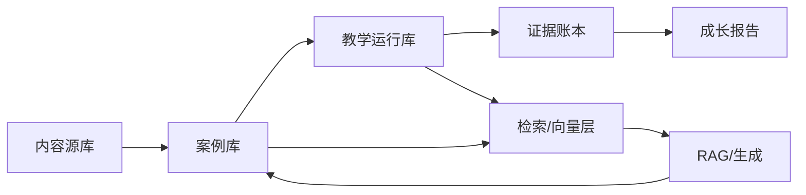

# 商科真实案例库
## 数据、项目与情景题生成方案 v0.1

> **定位：单点功能方案，不是当前 MVP 的必做项。**  
> 本文推荐 Postgres + pgvector + Meilisearch 等长远技术栈；当前 MVP 只用本地 SQLite，
> 先把新闻、知识点、题目和匹配跑通。案例卡/情景题流水线作为后续功能推进。  
> 当前实现以 [`../00-mvp/营小商-MVP-v2.0.md`](../00-mvp/营小商-MVP-v2.0.md) 为准。

| 项 | 内容 |
|---|---|
| 版本 | v0.1 |
| 日期 | 2026-10-17 |
| 状态 | 单点功能方案；MVP 不实现完整案例卡流水线 |
| 关联文档 | `../10-long-term/营小商-商科能力评价-需求拆解-v0.1.md`、`../30-research/参考项目清单-多智能体课堂与学习评价-v0.1.md` |
| 目标 | 把商科新闻/公告/报告变成可出题、可评价、可追溯的案例资产 |

---

## 0. 结论

1. **需要数据库，但至少分 5 层**：内容源库、案例库、教学运行库、证据账本、检索/向量层。不要把所有东西塞进一个库。
2. **新闻聚合只是原料层**。真正要入库的是**案例卡（case card）**：结构化的事实、利益相关者、决策问题、约束、数据、冲突、教学目标和 rubric。
3. **不要做“新闻阅读器”**。要做的是“**新闻 → 案例卡 → 情景题 → 学生作答 → 证据 → 成长报告**”的流水线。
4. **MVP 推荐组合**：RSSHub + FreshRSS/Miniflux 采集，trafilatura/news-please 抽取，Postgres + pgvector + Meilisearch 存储，RAGFlow/Dify 生成，LLM-Rubric 评分，教师复核。
5. **版权是硬约束**：优先存元数据、链接、摘要和自写案例卡；全文只在有授权/开放许可时入库。

---

## 1. 为什么不能只做一个“新闻库”

| 层 | 是什么 | 直接拿它出题的问题 |
|---|---|---|
| 新闻 | 一篇报道、一条公告、一份报告 | 事实未核验、视角单一、版权不清、时效性强 |
| 案例卡 | 从多篇材料中提炼的结构化案例 | 需要人工/LLM 加工，但这是可复用的教学资产 |
| 情景题 | 带角色、约束、任务、交付物的题目 | 需要设计“隐藏信息”和“评价点” |
| 证据 | 学生作答、追问、修订、反思 | 需要 rubric 和证据模型，否则只是聊天记录 |

**核心判断：新闻是原料，案例卡是中间件，情景题是产品，证据是评价数据。四层必须分开。**

---

## 2. 数据库分层



| 层 | 存什么 | 推荐技术 | 用途 |
|---|---|---|---|
| 内容源库 | 原始文章、公告、报告、RSS 元数据、抓取时间、来源 | Postgres + 对象存储（MinIO/S3） | 溯源、重跑、审计 |
| 案例库 | 案例卡、情景题、rubric、锚例、版本 | Postgres | 出题、复用、教师编辑 |
| 教学运行库 | 课程、班级、学生、任务、会话、提交物 | Postgres | 教学运行 |
| 证据账本 | 每条证据、来源片段、评分、置信度、复核 | Postgres + xAPI LRS | 评价、申诉、审计 |
| 检索/向量层 | 全文索引、向量、实体、主题 | Meilisearch/Elasticsearch + pgvector/Qdrant | 检索、RAG、相似案例 |
| 治理层 | 同意、权限、版本、删除、审计日志 | Postgres + 日志系统 | 合规与责任 |

**MVP 不需要图数据库。** 先用 Postgres 存实体关系；等实体关系复杂到“多跳查询”成为瓶颈，再考虑 Neo4j。

---

## 3. 数据流


### 3.1 采集

- RSS / Atom
- 新闻 API
- 网站抓取（遵守 robots.txt 与站点条款）
- 公司公告 / 监管披露
- 行业报告 / 政府统计
- 案例库（仅元数据与授权内容）

### 3.2 抽取

- 正文抽取：trafilatura、news-please、newspaper4k、Readability
- 元数据：标题、作者、发布时间、来源、语言、地区
- 附件：PDF、表格、图表（后续再做）

### 3.3 清洗与标准化

- 统一时间、语言、地区、行业、公司名
- 去除导航、广告、重复段落
- 保留原始链接与抓取快照

### 3.4 去重与聚类

- 文本相似度（MinHash/SimHash + 向量）
- 同一事件的多源报道聚成一个“事件簇”
- 事件簇是案例卡的原料，不是单篇文章

### 3.5 标注

- 实体：公司、人物、行业、地区、产品
- 主题：战略、营销、财务、运营、组织、伦理、宏观
- 事件类型：并购、融资、危机、监管、财报、产品发布、人事变动
- 冲突点：不同来源的矛盾说法
- 教学价值：是否有决策、取舍、利益相关者、数据、伦理张力

### 3.6 案例卡

从事件簇生成结构化案例卡，教师复核后入库。

### 3.7 情景题

从案例卡生成任务：决策备忘录、角色扮演、谈判、投资委员会、危机响应等。

### 3.8 评价

学生作答 → 证据抽取 → rubric 评分 → 教师复核 → 学生模型更新。

---

## 4. 案例卡 Schema

### 4.1 核心字段

| 字段 | 类型 | 说明 |
|---|---|---|
| case_id | string | 唯一标识 |
| title | string | 案例标题 |
| source_urls | array | 多源链接 |
| source_names | array | 来源名称 |
| published_at | date | 最早发布时间 |
| retrieved_at | datetime | 抓取时间 |
| language | string | 语言 |
| region | string | 地区 |
| industry | string | 行业 |
| companies | array | 涉及公司 |
| event_type | enum | 并购/融资/危机/监管/财报/产品/人事 |
| summary | text | 150–300 字事实摘要 |
| timeline | json | 关键时间线 |
| stakeholders | json | 利益相关者及诉求 |
| key_numbers | json | 关键数字与口径 |
| constraints | json | 资源、时间、监管、组织约束 |
| uncertainties | json | 未知/冲突/待验证信息 |
| dilemma | text | 核心取舍与伦理张力 |
| decision_question | text | 学生要回答的决策问题 |
| learning_objectives | array | 教学目标 |
| competencies | array | 对应能力维度 |
| difficulty | int | 1–4 |
| estimated_time | int | 分钟 |
| deliverable | string | 备忘录/路演/谈判/答辩 |
| hidden_info | json | 不直接给学生、用于追问的信息 |
| rubric_id | string | 评分标准 |
| rights | enum | 链接/摘要/授权全文/自写 |
| sensitivity | enum | 低/中/高 |
| freshness | enum | 新鲜/一般/过时 |
| reviewer | string | 复核人 |
| version | string | 版本号 |

### 4.2 案例卡示例（结构）

```yaml
case_id: case-2026-001
title: "某消费品牌在增长放缓后的渠道选择"
industry: "消费品"
event_type: "战略调整"
decision_question: "在预算有限的情况下，应该继续加投直播渠道，还是重建线下经销网络？"
stakeholders:
  - 创始人：要增长
  - 财务：要现金流
  - 经销商：要利润空间
  - 消费者：要性价比
constraints:
  - 现金流只能支撑 9 个月
  - 线下经销商合同还有 6 个月
  - 直播渠道退货率 35%
uncertainties:
  - 复购率数据缺失
  - 竞品降价幅度未知
dilemma: "短期增长 vs 渠道健康；规模 vs 利润"
competencies:
  - 问题建构
  - 证据与假设
  - 决策与取舍
```

---

## 5. 情景题生成模板

| 题型 | 给学生什么 | 隐藏什么 | 问什么 | 评什么 |
|---|---|---|---|---|
| 决策备忘录 | 案例事实、数据、约束 | 管理层真实选择、后续结果 | 给出有条件的主张、替代方案、风险 | 问题建构、证据、取舍 |
| 角色扮演/谈判 | 角色、目标、底线 | 对方底线、真实动机 | 谈成一个可执行方案 | 信息使用、让步、伦理 |
| 投资委员会 | 商业计划、财务数据 | 未披露风险、竞品动作 | 投/不投，条件是什么 | 假设、风险、敏感性 |
| 危机响应 | 事件时间线、舆情 | 内部责任、监管底线 | 24 小时内做什么、怎么说 | 优先级、利益相关者、沟通 |
| 市场进入 | 市场数据、竞争格局 | 渠道成本、政策风险 | 进/不进，怎么进 | 证据、取舍、实施 |
| 伦理困境 | 多方诉求、合规边界 | 法律意见、内部压力 | 怎么决策、怎么披露 | 伦理、利益相关者、论证 |
| 数据解读 | 仪表盘、口径说明 | 数据质量问题 | 你看到什么、不能得出什么 | 指标选择、因果谨慎 |
| 运营复盘 | 流程、指标、事故 | 根因、隐性成本 | 根因是什么、怎么改 | 系统思维、证据 |

**生成原则：**

1. **先有案例卡，再生成题目。** 不要让 LLM 直接“编一个商科案例”。
2. **事实与虚构分离。** 真实案例标注来源；虚构/补全部分明确标记。
3. **隐藏信息用于追问，不用于欺骗。** 学生可以要求补充信息，但要说明代价。
4. **每个题目必须有 rubric 和锚例。** 否则无法评分。
5. **教师复核后才能进课堂。** 尤其是涉及真实公司、人物、伦理的案例。

---

## 6. 项目清单

### 6.1 采集与聚合

| 项目 | 用途 | 适合 |
|---|---|---|
| [DIYgod/RSSHub](https://github.com/DIYgod/RSSHub) | 把没有 RSS 的网站变成 RSS | 中文媒体、公众号、行业网站 |
| [FreshRSS/FreshRSS](https://github.com/FreshRSS/FreshRSS) | 自托管 RSS 聚合器 | 多源订阅、标签、过滤 |
| [miniflux/v2](https://github.com/miniflux/v2) | 极简 RSS 阅读器 | 轻量、Postgres、API |
| [sansan0/TrendRadar](https://github.com/sansan0/TrendRadar) | 多平台热点 + RSS + AI 筛选 + 推送 | 热点发现、舆情监控 |
| [finaldie/auto-news](https://github.com/finaldie/auto-news) | 多源聚合 + LLM 摘要 | RSS/Twitter/YouTube/Reddit |
| [SuYxh/ai-news-aggregator](https://github.com/SuYxh/ai-news-aggregator) | 80+ AI/科技源聚合 | AI 新闻、双语标题 |
| [cclank/news-aggregator-skill](https://github.com/cclank/news-aggregator-skill) | 全网新闻聚合 skill，支持正文阅读 | Agent 工作流 |
| [janlukasschroeder/realtime-newsapi](https://github.com/janlukasschroeder/realtime-newsapi) | 财经新闻实时聚合 API | 金融/市场新闻 |
| [areed1192/finance-news-aggregator](https://github.com/areed1192/finance-news-aggregator) | 商业与市场新闻聚合 + 情感 | 财经新闻 |
| [linwoodc3/gdeltPyR](https://github.com/linwoodc3/gdeltPyR) | GDELT 全球事件数据 | 宏观、地缘、事件研究 |
| [alex9smith/gdelt-doc-api](https://github.com/alex9smith/gdelt-doc-api) | GDELT Doc API 客户端 | 新闻检索、事件追踪 |

### 6.2 正文抽取与清洗

| 项目 | 用途 | 注意 |
|---|---|---|
| [adbar/trafilatura](https://github.com/adbar/trafilatura) | 网页正文/元数据抽取，输出 JSON/CSV/MD | 首选，轻量、准确 |
| [fhamborg/news-please](https://github.com/fhamborg/news-please) | 新闻爬虫 + 抽取一体化 | 已归档，但仍是好参考 |
| [free-news-api/news-crawlers](https://github.com/free-news-api/news-crawlers) | 五种新闻爬虫对比 | 选型参考 |
| [NanmiCoder/MediaCrawler](https://github.com/NanmiCoder/MediaCrawler) | 小红书/抖音/B站/微博/知乎抓取 | 合规风险高，谨慎使用 |
| [mikwielgus/forum-dl](https://github.com/mikwielgus/forum-dl) | 论坛/新闻聚合/邮件归档 | 非主流来源 |

### 6.3 财经与企业数据

| 项目 | 用途 | 适合 |
|---|---|---|
| [akfamily/akshare](https://github.com/akfamily/akshare) | 开源财经数据接口 | A 股、宏观、行业 |
| [akfamily/aktools](https://github.com/akfamily/aktools) | AKShare 的 HTTP API | 服务化 |
| [dgunning/edgartools](https://github.com/dgunning/edgartools) | SEC EDGAR  filings、XBRL、10-K/8-K | 美股/公司研究 |
| [sec-edgar/sec-edgar](https://github.com/sec-edgar/sec-edgar) | 批量下载 EDGAR 报告 | 美股披露 |
| [Zdong104/FNSPID_Financial_News_Dataset](https://github.com/Zdong104/FNSPID_Financial_News_Dataset) | 金融新闻时间序列数据集 | 训练/评测 |
| [philipperemy/financial-news-dataset](https://github.com/philipperemy/financial-news-dataset) | Reuters/Bloomberg 新闻数据集 | 研究 |
| [T1mn/MarketPulse](https://github.com/T1mn/MarketPulse) | 财经新闻 AI 分析通知 | 参考架构 |

### 6.4 存储、检索与向量

| 项目 | 用途 | 建议 |
|---|---|---|
| [pgvector/pgvector](https://github.com/pgvector/pgvector) | Postgres 向量检索 | MVP 首选，少一个组件 |
| [qdrant/qdrant](https://github.com/qdrant/qdrant) | 高性能向量数据库 | 数据量大时再上 |
| [meilisearch/meilisearch](https://github.com/meilisearch/meilisearch) | 全文/混合检索 | 案例检索、教师搜索 |
| [infiniflow/ragflow](https://github.com/infiniflow/ragflow) | RAG 引擎 + Agent | 文档解析、知识库 |
| [langgenius/dify](https://github.com/langgenius/dify) | Agentic workflow + RAG | 快速搭生成流水线 |

### 6.5 评分与质量

| 项目 | 用途 | 注意 |
|---|---|---|
| [microsoft/LLM-Rubric](https://github.com/microsoft/LLM-Rubric) | 多维 rubric 评分 | 学术基线 |
| [delip/autorubric](https://github.com/delip/autorubric) | rubric-based judge | 工程实践 |
| [RANDCorporation/judge-reliability-harness](https://github.com/RANDCorporation/judge-reliability-harness) | 评分可靠性验证 | 上线前必做 |
| [LearningLocker/learninglocker](https://github.com/LearningLocker/learninglocker) | xAPI 证据账本 | 证据追溯 |
| [yetanalytics/lrsql](https://github.com/yetanalytics/lrsql) | 轻量 LRS | 易集成 |

### 6.6 调度与自动化

| 项目 | 用途 | 建议 |
|---|---|---|
| n8n | 可视化工作流 | MVP 快速串流程 |
| Airflow / Dagster / Prefect | 数据管道编排 | 数据量上来后再上 |
| GitHub Actions / Cron | 定时抓取 | 最简方案 |

---

## 7. 推荐技术组合

### 7.1 MVP（低成本、可自托管）

```text
RSSHub / FreshRSS / Miniflux
  → trafilatura / news-please
  → Postgres + pgvector
  → Meilisearch
  → RAGFlow 或 Dify
  → LLM-Rubric
  → 教师复核
```

**理由：**

- 全部可自托管，数据留在校内。
- Postgres 同时承担业务库和向量库，减少运维。
- Meilisearch 提供教师端搜索。
- RAGFlow/Dify 提供文档解析、检索、工作流。
- LLM-Rubric 提供评分基线。

### 7.2 进阶

- Qdrant 替换 pgvector（数据量大、并发高）。
- 对象存储 MinIO 存原始 HTML/PDF。
- xAPI LRS 存证据。
- Airflow/Dagster 做批处理与重跑。

---

## 8. MVP 计划

| 周 | 动作 | 产出 |
|---|---|---|
| W1 | 定 3 个来源、定案例卡 schema、手工做 20 张卡 | schema + 样例 |
| W2 | 搭采集/抽取/去重流水线，入库 200 篇文章 | 原始库 + 事件簇 |
| W3 | 生成 50 张案例卡、10 道情景题、rubric + 锚例 | 案例库 v0 |
| W4 | 1 个班试点、教师复核、学生作答、效度初测 | 试点报告 |

**来源建议：**

- 中文：36Kr、财新、第一财经、界面、华尔街见闻、虎嗅、晚点 LatePost。
- 官方：巨潮资讯、上交所/深交所/北交所、国家统计局、央行、商务部。
- 英文：Reuters、FT、WSJ、The Economist、HBR、McKinsey/BCG/Bain。
- 案例库：Harvard Business Publishing、Ivey、中国管理案例共享中心（仅元数据/授权内容）。

**成功指标：**

| 指标 | 目标 |
|---|---|
| 案例卡完整率 | ≥ 90% 字段完整 |
| 来源多样性 | 每张卡 ≥ 2 个独立来源 |
| 事实准确率 | 教师复核错误率 < 5% |
| 教师接受率 | ≥ 70% 可直接用于课堂 |
| 题目区分度 | 能区分 L2/L3/L4 |
| 生成成本 | 每张卡 < 10 分钟人工复核 |

---

## 9. 版权、合规与质量

| 风险 | 说明 | 应对 |
|---|---|---|
| 版权 | 新闻全文受版权保护 | 默认只存元数据、链接、摘要；全文需授权或开放许可 |
| 抓取条款 | 站点禁止爬取 | 遵守 robots.txt、服务条款；优先 RSS/API |
| 事实错误 | 单一来源、AI 幻觉 | 多源交叉、保留原文、教师复核 |
| 时效性 | 新闻很快过时 | 标注发布时间、过期标记、定期更新 |
| 来源偏差 | 单一媒体视角 | 多源对照、记录立场 |
| 敏感内容 | 真实公司/人物/伦理 | 脱敏、伦理审查、标注虚构部分 |
| 学生数据 | 与内容库混用 | 教学运行库与内容库物理/逻辑隔离 |
| AI 生成 | 虚构案例误导 | 标注“基于真实事件的改写”，保留来源 |
| 付费墙 | 无法合法获取全文 | 只用公开摘要/授权内容 |

**原则：能链接就不全文；能摘要就不复制；能授权就不抓取。**

---

## 10. 关键决策

| 决策 | 选项 | 推荐 |
|---|---|---|
| 内容范围 | 综合商业/金融/营销/运营/创业 | 先选 1–2 个方向 |
| 语言 | 中文/英文/双语 | 中文优先，英文补充 |
| 更新频率 | 日更/周更/按需 | 周更，避免噪音 |
| 版权策略 | 链接+摘要/授权全文/自写 | 链接+摘要+自写案例卡 |
| 生成方式 | 模板+LLM/纯 LLM | 模板+LLM，教师复核 |
| 评分方式 | 全自动/人机共评 | 人机共评 |
| 存储 | 单库/分层 | 分层 |

---

## 11. 附录 A：核心表结构（草案）

```sql
-- 来源
create table sources (
  id uuid primary key,
  name text not null,
  type text not null,            -- rss/api/web/announcement
  url text not null,
  language text,
  region text,
  license text,
  active boolean default true,
  created_at timestamptz default now()
);

-- 原始文档
create table raw_documents (
  id uuid primary key,
  source_id uuid references sources(id),
  url text not null,
  title text,
  published_at timestamptz,
  fetched_at timestamptz default now(),
  content_html text,
  content_text text,
  content_hash text,
  metadata jsonb
);

-- 事件簇
create table event_clusters (
  id uuid primary key,
  canonical_title text,
  event_type text,
  occurred_at date,
  companies text[],
  industry text,
  region text,
  summary text,
  source_count int,
  created_at timestamptz default now()
);

-- 案例卡
create table case_cards (
  id uuid primary key,
  cluster_id uuid references event_clusters(id),
  title text not null,
  summary text,
  timeline jsonb,
  stakeholders jsonb,
  key_numbers jsonb,
  constraints jsonb,
  uncertainties jsonb,
  dilemma text,
  decision_question text,
  learning_objectives text[],
  competencies text[],
  difficulty int,
  estimated_time int,
  deliverable text,
  hidden_info jsonb,
  rubric_id uuid,
  rights text,
  sensitivity text,
  freshness text,
  reviewer text,
  version text,
  status text default 'draft',
  created_at timestamptz default now()
);

-- 情景题
create table scenarios (
  id uuid primary key,
  case_id uuid references case_cards(id),
  type text not null,
  prompt text not null,
  role text,
  constraints jsonb,
  deliverable text,
  rubric_id uuid,
  version text,
  status text default 'draft'
);

-- 学生会话
create table sessions (
  id uuid primary key,
  student_id uuid not null,
  course_id uuid not null,
  scenario_id uuid references scenarios(id),
  started_at timestamptz default now(),
  ended_at timestamptz
);

-- 证据
create table evidence (
  id uuid primary key,
  session_id uuid references sessions(id),
  student_id uuid not null,
  competency text not null,
  source_type text not null,
  raw_ref text,
  rubric_level int,
  confidence numeric,
  scorer text,
  human_reviewed boolean default false,
  version text,
  notes text,
  created_at timestamptz default now()
);
```

---

## 12. 附录 B：商科信息源清单

### 12.1 中文媒体

- 36Kr
- 财新
- 第一财经
- 界面新闻
- 华尔街见闻
- 虎嗅
- 钛媒体
- 亿邦动力
- 晚点 LatePost
- 经济观察报
- 中国经营报
- 证券时报
- 上海证券报

### 12.2 官方/披露

- 巨潮资讯
- 上交所 / 深交所 / 北交所
- 国家统计局
- 中国人民银行
- 商务部
- 工信部
- 行业协会

### 12.3 英文

- Reuters
- Bloomberg
- Financial Times
- The Wall Street Journal
- The Economist
- Harvard Business Review
- McKinsey / BCG / Bain
- SEC EDGAR
- World Bank / IMF / OECD

### 12.4 案例库

- Harvard Business Publishing
- Ivey Publishing
- 中国管理案例共享中心
- 中欧案例库

> 案例库主要用于学习“案例卡怎么写”，不要直接批量抓取受版权保护的全文。

---

## 13. 下一步

1. **定 1 个课程方向**（战略/营销/财务/运营），不要一开始做全商科。
2. **手工做 20 张案例卡**，验证 schema 是否够用。
3. **选 3 个来源**，搭最小采集/抽取流水线。
4. **做 10 道情景题**，让 2–3 位教师盲评，看是否能区分水平。
5. **再决定技术栈**：如果 20 张卡都做不顺，先别上 RAGFlow/Dify；如果 schema 稳定，再自动化。
