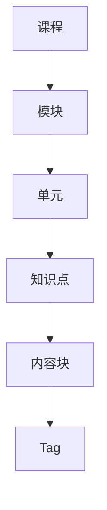
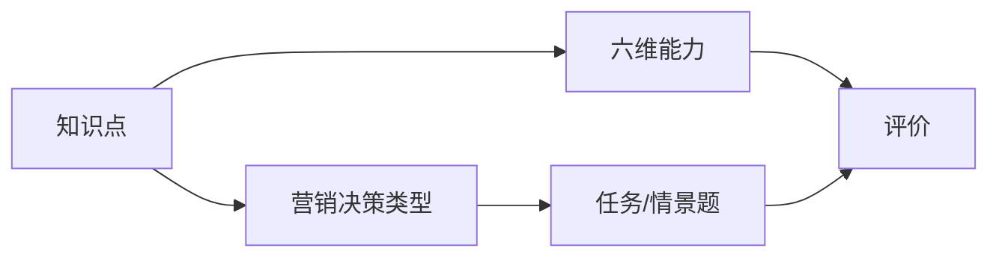
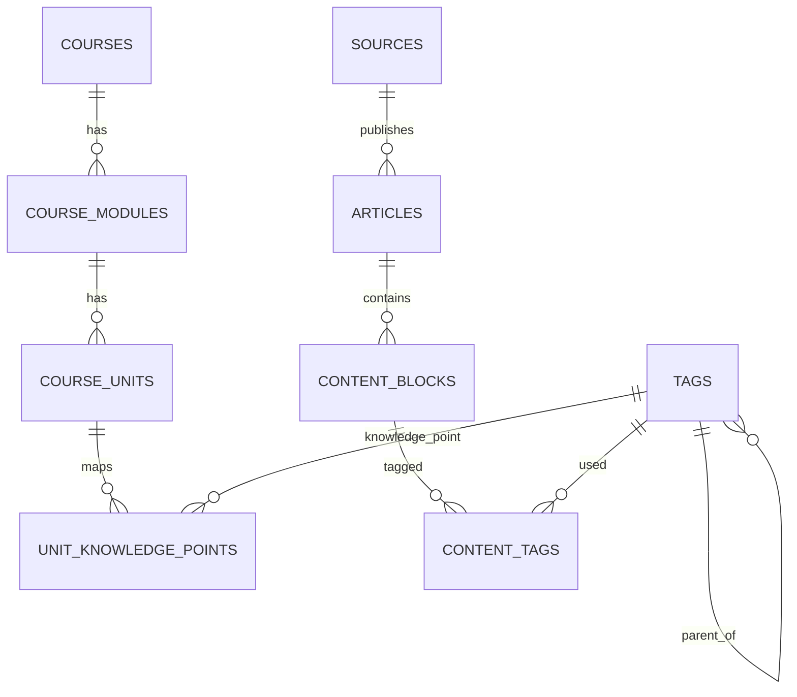

# 营销课程碎片化知识体系
## 设计、标注与匹配规范 v0.1

> **定位：单点数据规范，当前 MVP 的知识库底座仍适用。**  
> 本文定义知识点、内容块、受控 tag 与匹配流程；技术栈和标注工具以实际 pipeline 为准。  
> 当前实现以 [`../00-mvp/营小商-MVP-v2.0.md`](../00-mvp/营小商-MVP-v2.0.md) 与 `pipeline/` 为准。

| 项 | 内容 |
|---|---|
| 版本 | v0.1 |
| 日期 | 2026-10-17 |
| 状态 | 单点数据规范；MVP 已按此实现知识点/内容块/tag |
| 适用 | 营销/品牌/消费者行为/数字营销课程 |
| 关联文档 | `../10-long-term/营小商-系统拆解-v0.1.md`、`../20-features/商科真实案例库-数据与项目方案-v0.1.md` |
| 目标 | 把课程内容拆成可标注、可检索、可匹配、可评价的碎片化知识资产 |

---

## 0. 文档目的

这份文档只解决一件事：

> **如何把一门营销课程拆成“知识点 + 内容块 + 标签”，让教材、课件、新闻、案例都能被稳定地匹配到课程，而不是靠人读一遍再猜。**

它覆盖：

- 碎片化的层级与粒度。
- 知识点本体怎么定义。
- 内容块怎么切。
- Tag 怎么设计、怎么标、谁来审。
- 教材人工标注与爬取内容 AI 打标的双轨流程。
- 数据模型、匹配算法、质量指标。
- MVP 试点与反模式。

它不覆盖：

- 具体前端页面。
- 具体模型选型。
- 课程教学法本身。
- 法律意见。

---

## 1. 一句话定义

> **碎片化知识体系 = 课程本体（知识点）+ 内容实例（内容块）+ 受控标签（tag）+ 匹配规则。**

四个词对应四件事：

| 词 | 是什么 | 不是什么 |
|---|---|---|
| 知识点 | 课程里最小可教、可评的概念 | 不是章节标题，不是任务，不是关键词 |
| 内容块 | 教材/文章里最小可检索的段落、表格、图 | 不是整篇文章，也不是一句话 |
| Tag | 内容块与知识点/能力/决策/情境之间的受控连接 | 不是自由标签，不是老师随手写的关键词 |
| 匹配 | 按 tag + 语义 + 质量把内容块召回并排序 | 不是“让 LLM 读一遍猜” |

---

## 2. 为什么要碎片化

### 2.1 不碎片化的问题

| 问题 | 表现 |
|---|---|
| 检索粗 | 搜“购后失调”，只能找到整篇文章，教师还要自己读 |
| 匹配虚 | 文章提到一个词，就被判为“相关” |
| 出题难 | 找不到“刚好讲这个知识点”的案例 |
| 评价难 | 学生答的是哪一段、对应哪个能力，说不清 |
| 复用差 | 同一篇内容被不同课程反复人工处理 |
| 不可解释 | 系统说“相关”，但给不出证据 |

### 2.2 碎片化的收益

1. **可检索**：按知识点、能力、决策、情境直接找块。
2. **可匹配**：tag 精确召回，向量补语义。
3. **可解释**：每条结果带命中的 tag 和原文片段。
4. **可评价**：学生作答能对应到具体知识点/能力。
5. **可复用**：同一内容块可服务多个单元、多个任务。
6. **可治理**：知识点、标签、版本、审批都可审计。

### 2.3 碎片化的边界

不要切到句子级。建议：

- 内容块 = 1–3 个段落，或 1 张表，或 1 个图 + 说明。
- 每块保留 `article_id + position`，检索时带回前后文。
- 每块 1–3 个 tag，文章级聚合 3–8 个 tag。
- 知识点 = 最小可教/可评概念，不是每个名词。

**过度碎片化会把上下文切没，匹配反而更差。**

---

## 3. 五层结构



| 层级 | 定义 | 数量级 | 责任人 |
|---|---|---|---|
| 课程 | 一门营销课 | 1 | 课程负责人 |
| 模块 | 教学大块，如“消费者决策”“品牌资产” | 6–10 | 课程负责人 |
| 单元 | 周/主题级，如“消费者决策过程” | 8–15 | 课程负责人 |
| 知识点 | 最小可教/可评概念，如“购后失调” | 每单元 3–8 | 课程负责人 + 教研 |
| 内容块 | 教材/文章中的段落、表格、图 | 每篇 3–20 | 标注教师/AI |

### 3.1 知识点与能力、任务的关系



- 一个知识点可以映射到 1–2 个能力维度。
- 一个任务可以覆盖多个知识点和多个能力。
- 不要让“知识点 = 能力”，两者是不同粒度。

---

## 4. 知识点本体设计

### 4.1 知识点字段

| 字段 | 必填 | 说明 |
|---|---|---|
| `kp_id` | 是 | 稳定 ID，如 `kp_consumer_decision_post_purchase` |
| `name` | 是 | 中文名 |
| `name_en` | 否 | 英文名/别名 |
| `unit_id` | 是 | 所属单元 |
| `parent_id` | 否 | 子知识点 |
| `definition` | 是 | 1–3 句话，能判断“是不是” |
| `examples` | 是 | 2–3 个正例 |
| `non_examples` | 是 | 2–3 个反例，防止泛化 |
| `aliases` | 是 | 同义词、英文、行业说法 |
| `prerequisites` | 否 | 先修知识点 |
| `difficulty` | 是 | 1–4 |
| `competencies` | 是 | 对应六维能力 |
| `decisions` | 否 | 对应营销决策类型 |
| `status` | 是 | draft / reviewed / published / deprecated |
| `version` | 是 | 版本号 |

### 4.2 定义写法

好的定义要能回答三个问题：

1. **它是什么？**
2. **它不是什么？**
3. **怎么判断一段内容在讲它？**

示例：

> **购后失调（post-purchase dissonance）**
> 消费者购买后，因放弃其他选项、担心决策错误而产生的不安。
> 不是所有退货；不是“不满意”；不是“后悔没买更贵的”。
> 判断线索：购买后出现“我是不是买错了”“另一个是不是更好”的表述，且伴随信息搜寻/寻求认同。

### 4.3 正例、反例、别名

| 类型 | 作用 | 示例 |
|---|---|---|
| 正例 | 让标注者知道“长什么样” | 买完车后反复看测评、问朋友 |
| 反例 | 防止标签泛化 | 单纯因为尺码不合退货 |
| 别名 | 提高召回 | “购后后悔”“决策后失调”“post-purchase regret” |

**没有反例的知识点，不要发布。**

### 4.4 命名规范

- ID：`kp_<domain>_<concept>`，全小写、下划线。
- 中文名：名词短语，不用句子。
- 一个概念只保留一个主 ID；其他叫法进 `aliases`。
- 不在 ID 里写版本号；版本放在 `version` 字段。

### 4.5 知识点粒度判断

| 太粗 | 合适 | 太细 |
|---|---|---|
| 消费者行为 | 购后失调 | “购后失调中的情绪强度” |
| 品牌 | 品牌联想 | “品牌联想中的颜色联想” |
| 定价 | 价格弹性 | “某品类价格弹性系数” |

判断标准：**能不能独立教 10–20 分钟、独立评一次？** 能，才是知识点。

---

## 5. 内容块设计

### 5.1 块的类型

| 类型 | 说明 | 例子 |
|---|---|---|
| `paragraph` | 正文段落 | 教材一节 |
| `table` | 表格 | 价格/渠道/实验数据 |
| `figure` | 图 + 说明 | 漏斗图、品牌矩阵 |
| `case_fragment` | 案例片段 | 某品牌的具体做法 |
| `quote` | 引语 | 消费者原话、管理者说法 |
| `data_card` | 结构化数据卡 | CAC/CLV/ROI |
| `exercise` | 习题/思考题 | 教材课后题 |

### 5.2 切块规则

1. 按小节/段落切，不按句子切。
2. 表格、图单独成块，附说明。
3. 一个块只讲一个主要意思；如果讲两个，切开。
4. 保留标题层级与前后块 ID。
5. 每块保留原文位置（页码/段落号/字符偏移）。
6. 块文本过长（> 800 字）时，按语义切分。

### 5.3 上下文保留

检索返回时，至少带回：

- 当前块。
- 前一块/后一块（可选）。
- 文章标题、来源、发布时间。
- 章节标题。

否则教师看到一块断章取义的内容，无法判断。

### 5.4 文章级聚合

- 块级 tag 是主数据。
- 文章级 tag = 块级 tag 的聚合：
  - 取每个 tag 的最高 `tag_role`。
  - 取最高置信度。
  - 最多保留 8 个。
- 文章级 tag 只用于粗筛，不用于精确匹配。

### 5.5 版权与来源

- 教材：校内使用需符合教材授权/合理使用；全文入库要谨慎。
- 新闻：默认存元数据 + 链接 + 摘要；全文需授权或开放许可。
- 案例库：只存元数据/授权内容。
- 每块带 `source_id`、`rights`、`retrieved_at`。

---

## 6. Tag 体系

### 6.1 四个命名空间

| 命名空间 | 例子 | 作用 |
|---|---|---|
| `knowledge_point` | 购后失调、信息搜索 | 课程匹配 |
| `competency` | 洞察、策略、品牌、数据、沟通、伦理 | 能力评价 |
| `decision` | 新品、定价、媒介、渠道、危机 | 出题类型 |
| `context` | 美妆、直播电商、下沉市场 | 情境匹配 |

质量标记不是 tag，单独字段：

- `rights`：link / snippet / licensed / self-written
- `recency`：fresh / normal / stale
- `data_availability`：none / some / rich
- `sensitivity`：low / medium / high
- `source_quality`：high / medium / low

### 6.2 tag_role

| role | 含义 | 权重 |
|---|---|---|
| `core` | 直接讲解/定义这个知识点 | 1.0 |
| `example` | 用案例说明这个知识点 | 0.7 |
| `mention` | 只是顺带提到 | 0.3 |

没有 `tag_role`，匹配一定虚高。

### 6.3 证据等级

| 等级 | 来源 | 打标方式 | 用途 |
|---|---|---|---|
| `gold` | 教材/课件/讲义 | 人工审批 + 仲裁 | 本体基准、few-shot、评价锚点 |
| `verified` | 爬取内容 | AI 预标 + 人审抽样 | 教学、出题、匹配 |
| `auto` | 爬取内容 | AI/规则，无人工 | 只做召回候选，不做高利害 |

### 6.4 置信度与来源

每条 `content_tag` 记录：

- `confidence`：0–1。
- `method`：human / llm / rule / hybrid。
- `evidence_span`：支撑这个 tag 的原文片段。
- `review_status`：draft / reviewed / adjudicated / published / rejected。
- `reviewer_id`、`reviewed_at`。
- `version`。

### 6.5 标签数量约束

| 对象 | 上限 | 理由 |
|---|---|---|
| 内容块 | 1–3 个 tag | 防止“什么都沾一点” |
| 文章聚合 | 3–8 个 tag | 粗筛够用 |
| 知识点 | 1–2 个能力维度 | 避免能力映射泛化 |
| 任务 | 2–4 个知识点 | 聚焦 |

---

## 7. 数据模型

### 7.1 ER 图



### 7.2 表结构

```sql
-- 课程结构
create table courses (
  id uuid primary key,
  tenant_id uuid not null,
  name text not null,
  code text,
  version text,
  created_at timestamptz default now()
);

create table course_modules (
  id uuid primary key,
  course_id uuid references courses(id),
  title text not null,
  order_no int not null
);

create table course_units (
  id uuid primary key,
  module_id uuid references course_modules(id),
  title text not null,
  objectives text[],
  order_no int not null,
  estimated_minutes int
);

-- 统一 tag 表（知识点、能力、决策、情境都在这）
create table tags (
  id uuid primary key,
  tag_type text not null,        -- knowledge_point / competency / decision / context
  namespace text not null,
  name text not null,
  name_en text,
  parent_id uuid references tags(id),
  definition text,
  metadata jsonb default '{}',
  status text default 'draft',   -- draft / reviewed / published / deprecated
  version text default 'v1',
  created_at timestamptz default now()
);

-- 知识点扩展
create table knowledge_points (
  tag_id uuid primary key references tags(id),
  unit_id uuid references course_units(id),
  examples jsonb default '[]',
  non_examples jsonb default '[]',
  aliases jsonb default '[]',
  prerequisites uuid[] default '{}',
  difficulty int default 2,
  competencies uuid[] default '{}',
  decisions uuid[] default '{}'
);

create table unit_knowledge_points (
  unit_id uuid references course_units(id),
  kp_id uuid references knowledge_points(tag_id),
  weight numeric default 1.0,
  role text default 'core',      -- core / support / extension
  primary key (unit_id, kp_id)
);

-- 内容
create table sources (
  id uuid primary key,
  name text not null,
  type text not null,            -- textbook / news / report / announcement / case
  url text,
  language text,
  region text,
  rights text,
  quality text,
  active boolean default true
);

create table articles (
  id uuid primary key,
  source_id uuid references sources(id),
  title text not null,
  url text,
  published_at timestamptz,
  fetched_at timestamptz default now(),
  language text,
  region text,
  rights text,
  quality text,
  metadata jsonb default '{}'
);

create table content_blocks (
  id uuid primary key,
  article_id uuid references articles(id),
  block_type text not null,      -- paragraph / table / figure / case_fragment / quote / data_card
  text text not null,
  position int not null,
  page_no int,
  embedding vector(1536),
  metadata jsonb default '{}'
);

-- 内容-标签
create table content_tags (
  id uuid primary key,
  content_type text not null,    -- block / article
  content_id uuid not null,
  tag_id uuid references tags(id),
  tag_role text not null,        -- core / example / mention
  confidence numeric not null,
  method text not null,          -- human / llm / rule / hybrid
  evidence_span text,
  is_gold boolean default false,
  review_status text default 'draft',
  reviewer_id uuid,
  reviewed_at timestamptz,
  version text default 'v1',
  created_at timestamptz default now()
);

-- 查询索引
create index idx_content_tags_tag on content_tags(tag_id, content_type);
create index idx_content_tags_content on content_tags(content_type, content_id);
create index idx_blocks_article on content_blocks(article_id);
create index idx_kp_unit on knowledge_points(unit_id);
```

### 7.3 关键约束

- 一个内容块对同一个 tag 只能有一条主记录（可有版本历史）。
- `gold` 只能由人工审批产生。
- `auto` 不能直接用于高利害评价。
- `content_type = article` 的 tag 由块级聚合生成，不手工维护。
- 删除 tag 用 `deprecated`，不物理删除。

---

## 8. 教材人工标注流程

### 8.1 角色

| 角色 | 职责 |
|---|---|
| 课程负责人 | 定义单元/知识点、最终裁决、发布 |
| 标注教师 | 按指南打标 |
| 复核教师 | 抽样复核、提分歧 |
| 教研/评价专家 | 指南、效度、版本 |
| 产品/工程 | 工具、数据、质检 |

### 8.2 准备

1. 拆课程 → 模块 → 单元。
2. 写知识点卡片（定义、正例、反例、别名、先修、难度、能力）。
3. 写标注指南（含边界案例）。
4. 选 1 个章节做校准集。

### 8.3 双人独立标注

- 两位教师独立标同一章节。
- 不看对方结果。
- 标到内容块级，不标整章。
- 记录 `tag_role`、`confidence`、`evidence_span`。
- 允许“不确定”，不要强迫选。

### 8.4 分歧仲裁

- 计算一致率。
- 分歧逐条讨论：定义不清？边界不清？标签缺失？
- 修订知识点定义/反例/指南。
- 形成仲裁记录，进入培训材料。

### 8.5 抽样复核

- 全量教材标完后，第二人抽样 20–30%。
- 重点复核：核心知识点、边界案例、低置信度、真实品牌/伦理内容。
- 复核不通过 → 返工。

### 8.6 冻结与版本

- 每学期冻结一个 `gold` 版本。
- 教材改版 → 新版本，旧版本保留。
- 评分/证据绑定 `tag_version`，保证可追溯。

### 8.7 变更管理

- 任何人不能直接改已发布的 `gold` tag。
- 变更走申请：理由、影响范围、替代方案。
- 课程负责人审批。
- 变更记录进入审计日志。

---

## 9. 爬取内容 AI 打标流程

### 9.1 采集与清洗

```text
RSS/API/网页 → 正文抽取 → 去重 → 语言/地区/时间 → 入库
```

要求：

- 保留原始 URL、抓取时间、来源、版权状态。
- 正文抽取用 trafilatura/news-please。
- 付费墙/登录内容不抓。

### 9.2 切块

- 按段落/小节切。
- 表格、图单独成块。
- 每块保留 `article_id + position`。
- 块太长时按语义切。

### 9.3 候选生成

三种召回并行：

1. **别名/关键词匹配**：快，但召回有限。
2. **向量召回**：块 embedding vs 知识点 embedding。
3. **LLM 零样本**：让模型从受控词表里选。

候选合并、去重，进入打标。

### 9.4 LLM 结构化打标

Prompt 必须：

- 只允许从给定 `kp_id` 列表选择。
- 输出 JSON：

```json
[
  {
    "kp_id": "kp_consumer_decision_post_purchase",
    "tag_role": "example",
    "confidence": 0.86,
    "evidence_span": "退货率高达 35%……"
  }
]
```

- 不允许自由文本 tag。
- 不确定就输出空数组，不要硬猜。
- 最多 3 个 tag。

### 9.5 规则校验

- `kp_id` 必须在词表里。
- `tag_role` 必须合法。
- `confidence` 范围 0–1。
- 每块最多 3 个 tag。
- `evidence_span` 必须能在原文中找到。
- 低置信度（< 0.6）进人审。
- 高敏感/真实品牌内容进人审。

### 9.6 人审抽样

- 不需要全量。
- 优先：低置信度、高利害、边界案例、教师反馈差的来源。
- 人审结果写回 `review_status`、`reviewer_id`。

### 9.7 主动学习

教师改标 → 更新：

- 别名
- 正例/反例
- 知识点 embedding
- few-shot 示例

形成闭环，逐步减少人审量。

### 9.8 失败模式

| 失败 | 表现 | 修正 |
|---|---|---|
| 过度打标 | 一块 5 个 tag | 限制 1–3 个 |
| 泛化 | 所有退货都标购后失调 | 加反例 |
| 漏标 | 只标显性词 | 向量召回 + 别名 |
| 角色错 | mention 标成 core | 加 tag_role 规则 |
| 来源偏差 | 只标某一家媒体 | 多源、抽样 |
| 幻觉 | 编造 evidence_span | 原文校验 |

---

## 10. 匹配与检索

### 10.1 查询类型

| 查询 | 例子 | 主要用途 |
|---|---|---|
| 按单元 | “消费者决策过程” | 备课、找案例 |
| 按知识点 | “购后失调” | 出题、讲解 |
| 按能力 | “数据与效果” | 评价任务 |
| 按决策 | “定价” | 情景题 |
| 按情境 | “美妆 + 直播电商” | 案例匹配 |
| 自由文本 | “退货率高怎么办” | 探索 |

### 10.2 三段式匹配

```text
Query
  → 1. tag 倒排召回（精确、可解释）
  → 2. 向量召回（语义、跨表述）
  → 3. 排序 + 多样性 + 质量过滤
  → 4. LLM/教师复核 top N
```

### 10.3 排序公式

```text
score =
  0.45 * tag_match
+ 0.25 * semantic_similarity
+ 0.15 * tag_role_weight
+ 0.10 * quality
+ 0.05 * difficulty_fit
```

其中：

- `tag_match`：命中知识点的加权覆盖率。
- `semantic_similarity`：查询与块的向量相似度。
- `tag_role_weight`：core 1.0 / example 0.7 / mention 0.3。
- `quality`：来源、数据、时效、版权。
- `difficulty_fit`：难度与目标学生匹配。

### 10.4 多样性与覆盖

- 一个单元下尽量覆盖多个知识点。
- 同一事件不要全来自同一来源。
- 同一文章不要占据 top 5 全部位置。
- 结果里至少 1 条 `core`，否则提示“缺少讲解型内容”。

### 10.5 可解释性

每条结果必须返回：

- 命中的 tag（知识点/能力/决策/情境）。
- `tag_role`。
- `evidence_span`。
- 来源、时间、版权。
- 分数拆解（可选，教师端）。

### 10.6 使用边界

- `auto` tag 只用于召回，不直接进课堂。
- `verified` tag 可用于教学，但高利害任务要人审。
- `gold` tag 是本体基准，可用于评分锚点。
- 匹配结果不是“答案”，只是候选；教师/学生仍要判断。

---

## 11. 质量与治理

### 11.1 指标

| 指标 | 说明 | 目标 |
|---|---|---|
| 双人标注一致率 | 两个教师标同一块的重合度 | ≥ 0.75 |
| 仲裁率 | 需要第三人裁决的比例 | < 15% |
| 教材覆盖率 | 有 tag 的教材块比例 | ≥ 95% |
| 知识点覆盖 | 每个 KP 至少 3 个正例 | 100% |
| AI 建议采纳率 | 人工接受/修改/拒绝 | 持续提升 |
| 匹配 precision@5 | 前 5 条可用率 | ≥ 0.8 |
| 匹配召回率 | 人工找到的相关块被召回比例 | ≥ 0.7 |
| 返工率 | 复核不通过比例 | < 10% |

### 11.2 标注指南维护

- 每次仲裁都更新指南。
- 指南包含：定义、正例、反例、边界案例、常见错误。
- 新标注教师先做校准集，通过后再上岗。

### 11.3 本体治理

- 课程负责人拥有最终解释权。
- 知识点新增/合并/废弃走变更流程。
- 不允许“一个人一套词表”。
- 每学期 review 一次。

### 11.4 版本与审计

- 知识点版本、tag 版本、标注指南版本。
- 评分/证据绑定版本。
- 所有人工改标记录审计日志。

### 11.5 版权与合规

- 教材：按学校授权使用。
- 新闻：默认元数据 + 链接 + 摘要。
- 全文：仅授权/开放许可。
- 删除请求：内容下架，但保留必要审计记录。

---

## 12. MVP 试点

### 12.1 范围

- 1 门营销课。
- 1 个模块（如“消费者决策”）。
- 5–8 个知识点。
- 1 章教材，50–100 个内容块。
- 20 篇爬取文章，约 200 个块。
- 2 位标注教师 + 1 位仲裁。

### 12.2 步骤

| 步 | 动作 | 产出 |
|---|---|---|
| 1 | 拆模块/单元/知识点 | 知识点卡片 |
| 2 | 写定义、正例、反例、别名 | 本体 v0 |
| 3 | 两位教师独立标 1 章 | 双标数据 |
| 4 | 算一致率、开仲裁会 | 指南 v1 |
| 5 | 全量标该章 | gold 集 |
| 6 | AI 标 20 篇文章 | auto/verified 集 |
| 7 | 人审抽样 | verified 集 |
| 8 | 跑匹配、教师评 precision@5 | 试点报告 |

### 12.3 验收标准

- 双人一致率 ≥ 0.75。
- 每个知识点 ≥ 3 个正例。
- 教材块覆盖率 ≥ 95%。
- 匹配 precision@5 ≥ 0.8。
- 教师认为“可直接用于备课”的比例 ≥ 70%。

---

## 13. 风险与反模式

| 风险/反模式 | 表现 | 应对 |
|---|---|---|
| 自由标签 | 每人一套叫法 | 受控词表 + 别名 |
| 过度切分 | 一句话一个块 | 段落级，保留上下文 |
| 过度打标 | 一块 5–8 个 tag | 1–3 个上限 |
| 只标显性词 | 漏掉隐含案例 | 向量召回 + LLM |
| 把 mention 当 core | 匹配虚高 | `tag_role` |
| 用 auto 做高利害 | 评分不可信 | 证据等级 |
| 一人标全本 | 无信度 | 双人 + 仲裁 |
| 不写反例 | 标签泛化 | 反例必填 |
| 不版本化 | 无法追溯 | 版本 + 审计 |
| 版权不清 | 无法上线 | 版权字段 + 授权 |

---

## 14. 附录

### 14.1 知识点卡片模板

```yaml
kp_id: kp_consumer_decision_post_purchase
name: 购后失调
name_en: post-purchase dissonance
unit: 消费者决策过程
parent: null
definition: >
  消费者购买后，因放弃其他选项、担心决策错误而产生的不安。
not_this:
  - 所有退货
  - 单纯不满意
  - 后悔没买更贵的
examples:
  - 买完车后反复看测评、问朋友
  - 买完高价护肤品后搜索“是不是智商税”
non_examples:
  - 尺码不合退货
  - 收到破损商品退货
aliases:
  - 购后后悔
  - 决策后失调
  - post-purchase regret
prerequisites:
  - kp_consumer_decision_evaluation
difficulty: 3
competencies:
  - 市场与消费者洞察
decisions:
  - 售后/复购
status: reviewed
version: v1
```

### 14.2 标注表字段

| 字段 | 说明 |
|---|---|
| `block_id` | 内容块 ID |
| `article_id` | 文章 ID |
| `block_text` | 块文本 |
| `kp_id` | 知识点 ID |
| `kp_name` | 知识点名称 |
| `tag_role` | core / example / mention |
| `confidence` | 0–1 |
| `evidence_span` | 支撑片段 |
| `annotator` | 标注人 |
| `review_status` | draft / reviewed / adjudicated |
| `notes` | 分歧/备注 |

### 14.3 营销示例

课程：消费者行为
单元：消费者决策过程
知识点：问题识别、信息搜索、方案评估、购买、购后失调

文章：《直播电商退货率为什么高》

| 块 | 文本摘要 | Tag | Role |
|---|---|---|---|
| B1 | 某平台服饰退货率 35% | 购后失调 | example |
| B1 | 同上 | 直播电商 | context |
| B2 | 主播话术制造紧迫感 | 信息搜索 | example |
| B2 | 同上 | 创意与沟通 | competency |
| B3 | 七天无理由规则 | 购买情境 | mention |
| B3 | 同上 | 直播电商 | context |

文章聚合：购后失调、信息搜索、直播电商、渠道、创意与沟通。

### 14.4 API 草案

```text
GET  /api/v1/units/{unitId}/knowledge-points
GET  /api/v1/knowledge-points/{kpId}
GET  /api/v1/knowledge-points/{kpId}/contents?role=core&minConfidence=0.7
POST /api/v1/content-tags/suggest
POST /api/v1/content-tags
POST /api/v1/content-tags/{id}/review
GET  /api/v1/units/{unitId}/coverage
GET  /api/v1/search?unitId=&kpId=&competency=&decision=&context=
POST /api/v1/matching/run
```

### 14.5 术语表

| 术语 | 定义 |
|---|---|
| 知识点 | 课程里最小可教、可评的概念 |
| 内容块 | 教材/文章里最小可检索的段落、表格、图 |
| Tag | 内容块与受控实体之间的连接 |
| Gold tag | 教材人工审批的权威标签 |
| Verified tag | 爬取内容经人审的标签 |
| Auto tag | AI/规则生成、未人审的标签 |
| Tag role | core / example / mention |
| 本体 | 课程知识点的集合与关系 |

---

## 15. 一句话总结

> **先把课程拆成知识点，再把内容拆成块，再用受控 tag 把两者连起来；教材 tag 人工立法，爬取 tag AI 执法，匹配时 tag 精确召回、向量补语义、人做最终判断。**
