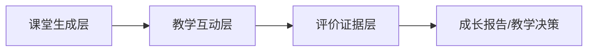

# 多智能体课堂与学习评价
## 参考项目清单 v0.1

> **定位：调研参考，不是实现依据。**  
> 本文用于选型、拆解与差异化定位；不随 MVP 代码更新。当前 MVP 设计以
> [`../00-mvp/营小商-MVP-v2.0.md`](../00-mvp/营小商-MVP-v2.0.md) 为准。

| 项 | 内容 |
|---|---|
| 版本 | v0.1 |
| 日期 | 2026-10-17 |
| 检索方式 | GitHub MCP `search_repositories` + 仓库 README 核对 |
| 用途 | 为“商科陪伴式能力成长评价智能体”做选型、拆解与差异化定位 |
| 关联文档 | `../10-long-term/营小商-商科能力评价-需求拆解-v0.1.md` |

---

## 0. 结论摘要

1. **OpenMAIC 代表的是“课堂生成 + 沉浸体验”方向，不是评价系统。** 它有 slides、quiz、模拟、PBL、白板、TTS，但没有证据账本、rubric 校准和纵向成长推断。
2. **最接近本项目需求的是 SpiralMAIC。** 它在 OpenMAIC 之上加了“记忆衰减 + Reverse Challenge（学生反教 AI 同学）+ 证据报告”，已经把“学生教 agent”做成评价活动。
3. **学习者模型看 GenMentor / DeepTutor / OATutor。** GenMentor 的 Adaptive Learner Profiler 会在每次会话后用 quiz 证据重建画像；DeepTutor 有 L1/L2/L3 可检查记忆和 Mastery Path；OATutor/pyBKT 提供可解释的掌握度更新。
4. **商科角色扮演与自动评分看 Mentingo。** 它的 AI mentor 做 voice/chat role-play 并自动评分，适合谈判、销售、合规、客户沟通。
5. **商科多 agent 教学看 AgentLab（Gies 商学院）。** VentureBots 用 5 个 agent 带学生走创业流程，已有 25+ 学生试点。
6. **评价证据底座看 xAPI LRS + LLM-Rubric + pyBKT。** 这三类拼起来，才能把“聊天”变成“可追溯、可校准、可申诉”的证据链。
7. **推荐路线：SpiralMAIC 的互动证据 + GenMentor 的 learner profiler + Learning Locker 的证据账本 + 商科任务库。** 不要直接从 OpenMAIC 改造成评价系统。

---

## 1. 检索方法与筛选标准

### 1.1 检索方式

- 使用 GitHub MCP 的 `search_repositories`，优先精确短语和 topic，避免 `learning` / `education` 这类泛词。
- 对核心候选仓库，读取 README 核对定位、功能、技术栈和 License。
- star 数只作参考，不作为质量判断；部分项目是 fork、课程作业或面试项目。

### 1.2 筛选标准

| 标准 | 说明 |
|---|---|
| 相关性 | 多智能体课堂、营小商、学习者建模、自动评分、学习记录 |
| 可运行性 | 有 README、安装说明、可执行代码 |
| 可复用性 | 有清晰模块边界，能拆出课堂生成、互动、评价中的至少一层 |
| 证据能力 | 是否产生可追溯的学习证据，而不只是聊天记录 |
| 商科适配 | 是否支持开放答案、角色扮演、案例判断、团队任务 |

### 1.3 评分说明

下表中的 1–5 分为主观评估，用于快速排序，不是严格 benchmark：

- **课堂体验**：生成课堂、互动场景、沉浸感。
- **多 agent**：角色分工、编排、对话真实感。
- **学习者记忆**：是否跨会话记住学生、是否可检查/可编辑。
- **评价能力**：是否有 rubric、证据、评分、成长推断。
- **商科适配**：是否适合劣构问题、角色扮演、开放答案。
- **成熟度**：代码完整度、文档、社区活跃度。

---

## 2. 三层框架



| 层 | 解决什么 | 代表项目 | 常见缺口 |
|---|---|---|---|
| 课堂生成层 | 把主题/文档变成 slides、quiz、模拟、PBL | OpenMAIC、SpiralMAIC、AIClass | 生成质量不稳定、成本高 |
| 教学互动层 | AI 老师/AI 同学/角色扮演/追问 | OpenMAIC、SpiralMAIC、Mentingo、DeepTutor | 热闹但缺少证据采集点 |
| 评价证据层 | 学习者模型、rubric、纵向测量、证据账本 | GenMentor、OATutor、LLM-Rubric、Learning Locker | 大多数课堂项目没有这一层 |

**本项目的差异化不在“生成课堂”，而在“把互动变成可校准的成长证据”。**

---

## 3. 直接同类：多智能体互动课堂

### 3.1 核心候选

| 项目 | 定位 | 技术栈 / License | 课堂 | 多 agent | 记忆 | 评价 | 商科 | 建议 |
|---|---|---|---|---|---|---|---|---|
| [THU-MAIC/OpenMAIC](https://github.com/THU-MAIC/OpenMAIC) | 多智能体互动课堂，一键生成 slides/quiz/模拟/PBL | TypeScript/Next.js，MIT，约 40.9k stars | 5 | 5 | 2 | 2 | 3 | **体验与工程架构基准** |
| [YizukiAme/SpiralMAIC](https://github.com/YizukiAme/SpiralMAIC) | 基于 OpenMAIC，加记忆衰减 + Reverse Challenge + 证据报告 | TypeScript，MIT | 4 | 5 | 4 | 3 | 3 | **最接近需求，优先拆** |
| [HKUDS/DeepTutor](https://github.com/HKUDS/DeepTutor) | 终身个性化 tutor 工作台，Mastery Path、三层 Memory、Quiz、Learning Journal | Python + Next.js，Apache 2.0，约 41.5k stars | 3 | 4 | 5 | 3 | 2 | **学习者记忆与掌握度参考** |
| [GeminiLight/gen-mentor](https://github.com/GeminiLight/gen-mentor) | WWW'25 多 agent 目标导向 ITS，9 个 agent，画像随 quiz 证据更新 | Next.js，License 见仓库 | 3 | 5 | 4 | 4 | 2 | **Learner Profiler 重点看** |
| [Selleo/mentingo](https://github.com/Selleo/mentingo) | AI-native LMS，AI mentor 角色扮演 + 自动评分 + 场景题 | NestJS + Remix，MIT | 3 | 3 | 3 | 4 | 5 | **商科 role-play + 评分参考** |
| [ahmedEid1/lumen](https://github.com/ahmedEid1/lumen) | 学习者拥有的 AI 教育平台，快速建课 + 课程内 tutor + evals | Python/Next.js，约 89 stars | 3 | 3 | 3 | 3 | 2 | 看课程生成 + eval 闭环 |
| [vishalsachdev/AgentLab](https://github.com/vishalsachdev/AgentLab) | Gies 商学院多 agent 创业 coaching（VentureBots） | 项目仓库，License 需确认 | 2 | 4 | 2 | 2 | 5 | **商科教学案例** |

### 3.2 扩展参考

| 项目 | 定位 | 可借鉴点 | 注意 |
|---|---|---|---|
| [Tyche-MKR/SmartOpenMAIC](https://github.com/Tyche-MKR/SmartOpenMAIC) | OpenMAIC 衍生/fork | 社区改法、部署经验 | 不是独立新架构 |
| [siqishi2021/AIClass](https://github.com/siqishi2021/AIClass) | “Generative Learning in Multi-Agent Interactive Classroom” 实验 | 小型结构，易读 | 成熟度低 |
| [GGGuYu/ai-reading-classroom](https://github.com/GGGuYu/ai-reading-classroom) | 多智能体英语阅读课堂 | 学科化课堂交互 | 场景窄 |
| [bcefghj/multi-agent-education](https://github.com/bcefghj/multi-agent-education) | 5-Agent Mesh + 事件驱动个性化学习，中文 | 多 agent 编排、中文场景 | 偏系统演示 |
| [A-R007/Multi-Agent-Study-Assistant](https://github.com/A-R007/Multi-Agent-Study-Assistant) | 6 个 agent：路线图、quiz、tutor、RAG、学习风格 | agent 分工 | 评价层弱 |
| [MultiAgent-AI-Teaching-Assistant](https://github.com/YoussefMohAttia/MultiAgent-AI-Teaching-Assistant) | 接 Google Classroom/Teams，生成摘要/quiz/tutor | LMS 集成、内容转换 | 评价层弱 |
| [shriguhanp/AdaptivePedagogyAI](https://github.com/shriguhanp/AdaptivePedagogyAI) | 多 agent 自适应学习，实时调内容/节奏/评估 | 自适应策略 | 成熟度低 |
| [Uzayr-Ch/Multi-Agent_Adaptive_E-Learning_System_With_Knowledge_Tracing](https://github.com/Uzayr-Ch/Multi-Agent_Adaptive_E-Learning_System_With_Knowledge_Tracing) | 多 agent + 知识追踪 + 自适应 quiz | KT 与 agent 结合 | 规模小 |
| [sixinzheng/AI-Classroom-Assistant](https://github.com/sixinzheng/AI-Classroom-Assistant) | 本地 AI 班级助理：学生画像、组卷、学情分析、批改 | 教师工作流、学生画像 | K12，非商科 |
| [3D-ai-school-threejs](https://github.com/theringsofsaturn/3D-ai-school-threejs) | Three.js 3D AI 课堂 | 沉浸式 UI | 教学/评价浅 |
| [37743/Classroom-VR](https://github.com/37743/Classroom-VR) | VR 课堂 + 分科 AI tutor | XR 交互 | 依赖硬件 |
| [haiderali780/AI-Classroom-XR](https://github.com/haiderali780/AI-Classroom-XR) | 3D 沉浸式 AI 教师课堂 | 空间交互 | 教学/评价浅 |

---

## 4. 评价 / 学习者模型 / 证据基础设施

### 4.1 学习者建模与知识追踪

| 项目 | 用途 | 为什么值得看 |
|---|---|---|
| [CAHLR/OATutor](https://github.com/CAHLR/OATutor) | 开源 ITS + Bayesian Knowledge Tracing | 最干净的“掌握度 + 提示 + 自适应”参考；React/Firebase |
| [CAHLR/pyBKT](https://github.com/CAHLR/pyBKT) | Bayesian Knowledge Tracing Python 实现 | 小样本、可解释，适合 MVP |
| [pykt-team/pykt-toolkit](https://github.com/pykt-team/pykt-toolkit) | 深度学习知识追踪 benchmark | 数据格式、评测协议 |
| [bigdata-ustc/EduKTM](https://github.com/bigdata-ustc/EduKTM) | 知识追踪模型 zoo | 快速对比 DKT/AKT/DKVN 等 |
| [ZhijieXiong/pyedmine](https://github.com/ZhijieXiong/pyedmine) | KT、认知诊断、推荐、学习路径 | 一体化教育数据挖掘库 |
| [riiid/ednet](https://github.com/riiid/ednet) | 大规模真实学生交互数据集 | 纵向行为建模、冷启动 |
| [THU-KEG/MOOC-Radar](https://github.com/THU-KEG/MOOC-Radar) | MOOC 细粒度多视角知识库 | 认知学生建模数据 |

### 4.2 评分、rubric 与校准

| 项目 | 用途 | 为什么值得看 |
|---|---|---|
| [microsoft/LLM-Rubric](https://github.com/microsoft/LLM-Rubric) | 多维、校准的 LLM 文本评分（ACL 2024） | rubric + LLM 评分的学术基线 |
| [paper-instruments/rubric](https://github.com/paper-instruments/rubric) | 加权 rubric 的 LLM 评估库 | 轻量、可直接试 |
| [delip/autorubric](https://github.com/delip/autorubric) | rubric-based LLM/VLM judge 最佳实践 | 评分流程与校准 |
| [RANDCorporation/judge-reliability-harness](https://github.com/RANDCorporation/judge-reliability-harness) | 为 LLM-as-judge / autograder 生成验证数据 | **评分信度/效度验证** |
| [deshwalmahesh/PHUDGE](https://github.com/deshwalmahesh/PHUDGE) | 可定制 rubric 的 LLM judge | 绝对/相对评分、参考答对比 |
| [AI9Stars/LLM-Rubrics-Survey](https://github.com/AI9Stars/LLM-Rubrics-Survey) | rubric 在 LLM 领域的综述 | 快速建立 rubric 方法论地图 |

### 4.3 证据账本与标准

| 项目 | 用途 | 为什么值得看 |
|---|---|---|
| [LearningLocker/learninglocker](https://github.com/LearningLocker/learninglocker) | 开源 xAPI Learning Record Store | 证据账本的现成底座 |
| [adlnet/ADL_LRS](https://github.com/adlnet/ADL_LRS) | 官方 xAPI LRS | 标准兼容参考 |
| [yetanalytics/lrsql](https://github.com/yetanalytics/lrsql) | SQL-based LRS | 更轻、易集成 |
| [Apereo-Learning-Analytics-Initiative/OpenLRW](https://github.com/Apereo-Learning-Analytics-Initiative/OpenLRW) | 学习记录仓库，支持 Caliper/xAPI/OneRoster | 学习分析数据模型 |
| [openfun/ralph](https://github.com/openfun/ralph) | LRS + 学习分析流处理 | 数据管道参考 |

### 4.4 LMS 与集成

| 项目 | 用途 | 注意 |
|---|---|---|
| [instructure/canvas-lms](https://github.com/instructure/canvas-lms) | 开源 LMS | 课程、作业、成绩、LTI |
| [openedx/openedx-platform](https://github.com/openedx/openedx-platform) | 开源 MOOC/LMS | 课程结构、xAPI 生态 |
| [moodle/moodle](https://github.com/moodle/moodle) | 开源 LMS | 插件生态、学校部署 |
| [frappe/lms](https://github.com/frappe/lms) | 轻量开源 LMS | 易二次开发 |
| [Selleo/mentingo](https://github.com/Selleo/mentingo) | AI-native LMS + AI mentor | 角色扮演、自动评分、SCORM |
| [vishalsachdev/canvas-mcp](https://github.com/vishalsachdev/canvas-mcp) | Canvas LMS MCP server | 用 agent 操作 LMS |
| [DMontgomery40/mcp-canvas-lms](https://github.com/DMontgomery40/mcp-canvas-lms) | Canvas LMS MCP server | 课程/作业/成绩管理 |

### 4.5 实验与效果验证

| 项目 | 用途 | 为什么值得看 |
|---|---|---|
| [terracotta-education/terracotta](https://github.com/terracotta-education/terracotta) | 在 LMS 里做随机对照试验 | 试点效果验证、隐私保护、知情同意 |
| [UM-Lifelong-Learning-Lab/AIED2022-MixFA-dataset](https://github.com/UM-Lifelong-Learning-Lab/AIED2022-MixFA-dataset) | 混合方法形成性评价数据集 | 形成性评价研究参考 |

---

## 5. 商科特别相关

| 项目 | 定位 | 可借鉴点 | 注意 |
|---|---|---|---|
| [vishalsachdev/AgentLab](https://github.com/vishalsachdev/AgentLab) | Gies 商学院多 agent 创业 coaching（VentureBots） | 5 个 agent 分工、25+ 学生试点、商科教学落地 | 仓库轻，评价层弱 |
| [Selleo/mentingo](https://github.com/Selleo/mentingo) | AI mentor 角色扮演 + 自动评分 | 销售/合规/客服场景、开放题评分、LMS 记录 | 企业 L&D 定位，不是学历教育 |
| [harrywang/obcb](https://github.com/harrywang/obcb) | Open Business Case Bench：LLM 商科案例分析 benchmark | 商科案例任务设计、评分对照 | 评的是 LLM，不是学生 |
| [rahulsharmars1988-netizen/unirank360](https://github.com/rahulsharmars1988-netizen/unirank360) | AACSB/EQUIS/AMBA 自评与报告 | AoL 映射、认证材料 | 不是教学系统 |
| [Saehon/Saeid-Homayoun](https://github.com/Saehon/Saeid-Homayoun) | 会计/审计/金融多 agent 原型，evidence-governed | 专业场景 agent 分工、证据治理 | 小众、成熟度低 |
| [bigcjat/CBE](https://github.com/bigcjat/CBE) | 能力本位教育（CBE）课程执行指南 | 能力本位课程结构 | 不是软件系统 |
| [HoaqAnh/eFlex](https://github.com/HoaqAnh/eFlex) | 个性化能力本位学习支持系统 | 能力/推荐/学习支持 | 成熟度低 |

---

## 6. 重点项目拆解

### 6.1 OpenMAIC

**它是什么**

- 输入主题或文档，生成完整课堂：slides、quiz、交互式 HTML 模拟、PBL。
- AI 老师 + AI 同学可以讲课、讨论、白板画图、TTS。
- 支持导出 PPTX、离线 HTML、课堂 ZIP。
- 有 OpenMAIC Skill，可接 OpenClaw、Codex、DeepSeek 等。

**值得拆的模块**

| 路径/能力 | 看什么 |
|---|---|
| 多 agent 编排 | 老师/同学/助教如何分工、如何轮流发言 |
| 场景生成 | slides、quiz、模拟、PBL 的 schema 与渲染 |
| 服务端生成 | 关掉标签页/重启后任务继续 |
| 导出 | PPTX/HTML/ZIP 的兼容性处理 |
| Skills | 如何把课堂生成能力封装成可复用 skill |
| eval | 生成质量如何评估 |

**它缺什么**

- 没有证据账本：课堂互动结束后，证据不可追溯。
- 没有 rubric 校准：quiz 有对错，但开放答案/判断质量没有评分标准。
- 没有纵向测量：没有“第 4 周 L2 → 第 10 周 L3”的成长推断。
- 没有教师复核/申诉流程。

**结论**：适合做“体验层”的参考，不适合直接做“评价层”。

---

### 6.2 SpiralMAIC

**它是什么**

- 基于 OpenMAIC，保留课堂生成、互动场景、白板、TTS、导出。
- 增加“记忆衰减”：每个概念有半衰期，课程结束后记忆会自然淡化。
- 增加 **Reverse Challenge**：学生反过来教 AI 同学，AI 同学提问、故意犯错、要新例子。
- 生成报告：clarity、doubt resolution、transfer、correction。
- 报告指向对话原文、翻过的页面、事实错误，强调“evidence, not vibes”。

**值得拆的模块**

| 路径 | 看什么 |
|---|---|
| `lib/revisit/` | memory、blueprints、evidence、judging、存储 |
| `eval/revisit-judge/` | 报告稳定性评估 |
| `app/classroom/[id]/revisit/` | Reverse Challenge 课堂流程 |
| `components/revisit/` | 报告、Study Studio、artifact viewer |
| `lib/overtime/` | 课后追问如何变成新课堂页 |

**它解决了什么**

- 把“学生教 agent”变成可观察的能力证据。
- 把“记忆”做成可操作的对象（半衰期、复习时机）。
- 报告不是分数，而是“哪里清楚、哪里还有疑问、能否迁移、能否纠错”。

**它还缺什么**

- 仍是**会话级**报告，不是课程级成长测量。
- 没有多任务锚定、难度校准、纵向等值。
- 没有教师复核、rubric 版本化、子群体公平性分析。
- 商科适配需要自己换任务与 rubric。

**结论**：**最值得先 clone 和拆的项目。**

---

### 6.3 GenMentor

**它是什么**

- WWW 2025 Industry Track 论文的官方实现。
- 9 个 agent：Goal Refiner、Skill Mapper、Skill Gap Identifier、Adaptive Learner Profiler、Path Scheduler、Knowledge Explorer、Knowledge Drafter、Document Integrator、Quiz Generator、Learner Feedback Simulator、AI Chatbot Tutor。
- 每次会话后，用 quiz 证据重建 learner profile。
- 无服务端数据库，学习者档案存在浏览器，可导出/导入 JSON。

**值得拆的模块**

| 路由/文件 | 看什么 |
|---|---|
| `app/api/refine-goal` | 模糊目标如何变成可执行目标 |
| `app/api/identify-skill-gap` | 目标技能 vs 当前水平的差距 |
| `app/api/profile` | 画像如何构建、如何用 quiz 证据更新 |
| `app/api/schedule-path` | 学习路径如何排期、如何重排 |
| `app/api/generate-quiz` | quiz 如何从材料生成 |
| `prompts-baseline` tag | 论文原始 prompt，可做对照 |

**它解决了什么**

- “逐渐了解学生”的工程化：profile 不是一次性问卷，而是每次会话后更新。
- 目标导向：先定义“要去哪”，再测“现在在哪”，再排路径。
- 轻量：无数据库，适合快速验证。

**它还缺什么**

- 偏知识/技能，不是劣构商科判断。
- quiz 主要是选择题/知识题，难以评价论证、取舍、伦理。
- 没有 rubric 校准与教师复核。

**结论**：**learner profiler 与 goal/skill gap 的最佳参考。**

---

### 6.4 DeepTutor

**它是什么**

- 终身个性化 tutoring 工作台：Chat、Ask Questions、Quiz、Research、Visualize、Solve、Course Study、Mastery Path、Immersive Reading、Audio Overview。
- 三层 Memory：L1 traces、L2 surface summaries、L3 synthesis，可检查、可编辑。
- Question Bank、Learning Journal、Task Board、知识库多引擎（LlamaIndex/PageIndex/GraphRAG/LightRAG 等）。

**值得拆的模块**

| 能力 | 看什么 |
|---|---|
| L1/L2/L3 Memory | 证据如何从原始对话抽象为可复用画像 |
| Mastery Path | 掌握度门槛如何 gate 下一步 |
| Learning Journal | 学习记录如何呈现给学生 |
| Question Bank | 题目如何沉淀、复用 |
| Quiz | 题目生成、判分、错题回流 |

**它解决了什么**

- 长期记忆的“可检查性”：学生/教师能看到“为什么系统这样理解我”。
- 掌握度路径：不是一次性推荐，而是按掌握情况推进。

**它还缺什么**

- 不是 rubric 评价，偏知识/技能掌握。
- 不是商科场景。
- 体量大，拆解成本高。

**结论**：**记忆架构与掌握度路径参考，不必整体复用。**

---

### 6.5 Mentingo

**它是什么**

- 开源 AI-native LMS，面向企业 L&D。
- AI mentor 做 voice/chat 角色扮演（销售、合规、客服），并自动评分。
- 场景题、开放题自动评分、可操作反馈。
- 学习记录、证书、复训、SCORM、多租户、Langfuse tracing。

**值得拆的模块**

| 能力 | 看什么 |
|---|---|
| AI mentor pipeline | 角色设定、对话推进、评分触发 |
| Role-play scoring | 评分维度、反馈生成、与 LMS 记录关联 |
| Scenario assessment | 场景题如何组织 |
| Open-ended grading | 开放答案如何自动评分 |
| Evidence/observability | Langfuse 如何追踪每次模型调用 |

**它解决了什么**

- 商科软技能（谈判、销售、沟通）的角色扮演 + 自动评分。
- 评分结果进入 LMS，形成可查询的记录。

**它还缺什么**

- 企业培训定位，不是学历教育的成长评价。
- rubric 深度、教师复核、纵向成长推断需要自己补。

**结论**：**商科 role-play 与自动评分的工程参考。**

---

### 6.6 OATutor / pyBKT

**它是什么**

- OATutor：开源 ITS，带 BKT、提示、自适应练习。
- pyBKT：Bayesian Knowledge Tracing 的 Python 实现，支持扩展。

**值得拆的模块**

- 知识组件（KC）如何定义。
- 每次作答如何更新掌握概率。
- 提示层级与下一步选择。
- 小样本下的参数估计与不确定性。

**它解决了什么**

- 一个简单、可解释、可审计的掌握度模型。
- 比直接上深度知识追踪更适合 MVP。

**它还缺什么**

- 只适合有明确 KC 的知识/技能。
- 商科的“判断质量”需要 rubric + 证据模型，不能只用 BKT。

**结论**：**MVP 的掌握度基线，不要拿它硬套商科能力。**

---

## 7. 对比矩阵

评分为 1–5 的主观评估，用于选型排序。

| 项目 | 课堂体验 | 多 agent | 学习者记忆 | 自动评分 | 证据可追溯 | 商科适配 | 成熟度 |
|---|---|---|---|---|---|---|---|
| OpenMAIC | 5 | 5 | 2 | 2 | 1 | 3 | 5 |
| SpiralMAIC | 4 | 5 | 4 | 3 | 4 | 3 | 3 |
| DeepTutor | 3 | 4 | 5 | 3 | 3 | 2 | 5 |
| GenMentor | 3 | 5 | 4 | 4 | 3 | 2 | 4 |
| Mentingo | 3 | 3 | 3 | 4 | 4 | 5 | 5 |
| Lumen | 3 | 3 | 3 | 3 | 3 | 2 | 3 |
| AgentLab | 2 | 4 | 2 | 2 | 2 | 5 | 2 |
| OATutor | 2 | 1 | 4 | 3 | 3 | 1 | 4 |
| pyBKT | 1 | 1 | 4 | 2 | 3 | 1 | 5 |
| LLM-Rubric | 1 | 1 | 1 | 5 | 3 | 4 | 4 |
| Learning Locker | 1 | 1 | 1 | 1 | 5 | 3 | 4 |

**读法**：

- 想要“课堂体验” → OpenMAIC / SpiralMAIC。
- 想要“学习者记忆” → DeepTutor / GenMentor / OATutor。
- 想要“自动评分” → Mentingo / LLM-Rubric / GenMentor。
- 想要“证据可追溯” → SpiralMAIC / Learning Locker / Mentingo。
- 想要“商科适配” → Mentingo / AgentLab / LLM-Rubric。

---

## 8. 组合路线

### 路线 A：体验优先

| 项 | 内容 |
|---|---|
| 骨架 | fork OpenMAIC 或 SpiralMAIC |
| 补什么 | 商科案例模板、课堂生成 prompt、角色设定 |
| 适合 | 先给老师/学生看“AI 课堂”长什么样 |
| 风险 | 评价层缺失，容易被当成“花哨的课件生成器” |

### 路线 B：学习者模型优先

| 项 | 内容 |
|---|---|
| 骨架 | GenMentor + DeepTutor + OATutor/pyBKT |
| 补什么 | 商科能力框架、rubric、证据账本 |
| 适合 | 真正做“逐渐了解学生 + 成长推断” |
| 风险 | 课堂体验弱，前端工作量大 |

### 路线 C：商科角色扮演优先

| 项 | 内容 |
|---|---|
| 骨架 | Mentingo + 商科任务库 + LLM-Rubric |
| 补什么 | 谈判/销售/合规/客户沟通脚本、教师复核 |
| 适合 | 想尽快进课堂、有成绩与证据链 |
| 风险 | 不是多智能体课堂，沉浸感弱 |

### 路线 D：评价优先（推荐）

| 项 | 内容 |
|---|---|
| 骨架 | SpiralMAIC 的 Reverse Challenge + GenMentor 的 Learner Profiler + Learning Locker 的证据账本 |
| 补什么 | 商科 4 维能力框架、4 级 rubric、锚定任务、教师复核 |
| 适合 | 陪伴式 + 能力成长评价，差异化最强 |
| 风险 | 工程量最大；需要先做小规模手工验证 |

---

## 9. 风险与注意事项

| 风险 | 说明 | 应对 |
|---|---|---|
| star 数 ≠ 质量 | 部分高 star 项目是课程作业、fork 或演示 | 看 commit、issue、release、测试 |
| License 不清 | 有些仓库未标 License 或使用 GPL/AGPL | 商用前逐一确认 |
| 生成质量不稳定 | 课堂内容依赖模型，可能事实错误 | 教师审核、引用溯源、生成后校验 |
| 成本高 | 多 agent + TTS + 渲染，token 与算力成本高 | 分层模型、缓存、异步生成 |
| “热闹但无证据” | 多 agent 对话很吸引人，但不产生可评价证据 | 在设计时就埋证据采集点 |
| 评价效度 | README 不会告诉你评分是否有效 | 自己做 rubric + 专家校准 + 子群体分析 |
| 学生隐私 | 对话、行为、情绪数据敏感 | 最小化采集、同意、可删除、脱敏 |
| 模型漂移 | 换模型后评分标准变化 | 版本化、锚例、定期重校准 |
| 供应商锁定 | 依赖单一模型/云 | 抽象 provider 层，支持本地模型 |

---

## 10. 下一步验证清单

按顺序做，避免一开始就陷入“选框架”：

1. **跑起来**：clone OpenMAIC 和 SpiralMAIC，各生成一堂课，对比“课堂生成”和“课后证据报告”。
2. **读 SpiralMAIC**：重点看 `lib/revisit/` 和 `eval/revisit-judge/`，理解它如何把对话变成证据。
3. **读 GenMentor**：看 `app/api/profile` 和 `app/api/identify-skill-gap`，理解画像如何随 quiz 证据更新。
4. **跑 Mentingo demo**：测试 AI mentor 的角色扮演与自动评分，记录评分维度和反馈质量。
5. **跑 OATutor + pyBKT**：用一个小数据集测试掌握度更新，观察小样本下的不确定性。
6. **搭证据账本**：用 Learning Locker 或 lrsql 发几条 xAPI statement，验证“证据可追溯”。
7. **做手工验证**：选 10 个商科案例，2–3 位教师独立评分，测试 LLM-Rubric 与人工的一致性。
8. **定路线**：根据验证结果选 A/B/C/D，不要同时铺开。

---

## 11. 附录：检索关键词

### 11.1 本轮使用的 GitHub 查询

```text
"AI tutor" in:name,description
"intelligent tutoring system" in:name,description
"learning companion" in:name,description
"knowledge tracing" in:name,description
"automated essay scoring" in:name,description
"open learner model" in:name,description
"learning record store" in:name,description
"multi-agent" classroom in:name,description
"AI classroom" in:name,description
"interactive classroom" in:name,description
"multi-agent" education in:name,description
"course generation" LLM in:name,description
"lesson generation" in:name,description
"AI teacher" in:name,description
"business simulation" in:name,description
"formative assessment" in:name,description
"competency-based" in:name,description
Socratic tutor in:name,description
```

### 11.2 建议继续检索的关键词

```text
"AI classmates"
"generative classroom"
"immersive learning" multi-agent
"role-play" assessment education
"scenario-based assessment" LLM
"rubric" "business education"
"case-based assessment" LLM
"team contribution" assessment LLM
"learning progression" LLM
"longitudinal" "competency" assessment
"student model" LLM
"teachable agent"
"learning by teaching" LLM
```

### 11.3 建议关注的会议/期刊

- AIED、EDM、LAK、AERA、NCME
- Computers & Education、BJET、IJAIED
- Academy of Management Learning & Education、Journal of Management Education
- Assessment & Evaluation in Higher Education
- 中国考试、电化教育研究、开放教育研究、中国远程教育

---

## 12. 附录：一句话速查

| 需求 | 先看 |
|---|---|
| 一键生成 AI 课堂 | OpenMAIC |
| 学生反教 + 证据报告 | SpiralMAIC |
| 学习者画像随证据更新 | GenMentor |
| 长期记忆 + 掌握度路径 | DeepTutor |
| 商科角色扮演 + 自动评分 | Mentingo |
| 商科多 agent 教学 | AgentLab |
| 可解释掌握度 | OATutor / pyBKT |
| rubric 评分与校准 | LLM-Rubric / autorubric / RAND harness |
| 证据账本 | Learning Locker / ADL_LRS / lrsql |
| LMS 集成 | Canvas / Open edX / Moodle |
| 试点效果验证 | Terracotta |
| 商科案例 benchmark | obcb |

---

## 13. 维护说明

- 本清单是 v0.1，后续应补充：每个项目的 License 核实、最近 release、issue 活跃度、真实部署案例。
- star 数、更新时间会变化，引用时注明“检索时”。
- 评分是主观排序，不应当作采购/选型唯一依据。
- 新增项目时，按“课堂生成 / 教学互动 / 评价证据”三层归类，避免清单变成链接堆。
