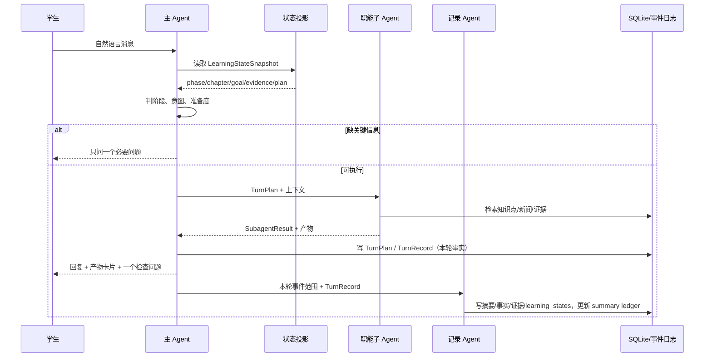
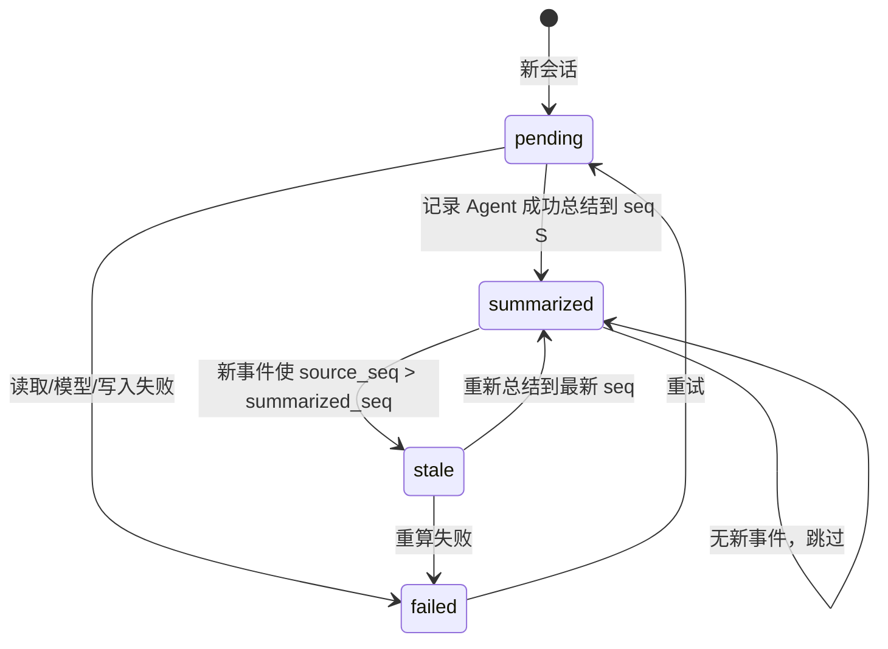

# 营小商 MVP 调研与设计报告 v0.1

> **阅读入口**：`营小商-MVP总文档-v1.0.md`；本文保留在 `00-mvp` 同一目录，作为调研与架构细节的追溯来源。

> 日期：2026-10-18  
> 范围：本科市场营销课程、本地优先、单学生本地演示库 MVP；未来可演进为服务端后端 + 客户端前端  
> 核心命题：把“用户选专家/选章节”的产品，改成“主 Agent 判断学习状态、调度职能子 Agent、记录 Agent 持续整理状态”的产品。

---

## 0. 结论摘要

当前原型已经能跑通出题、调研、BP、新闻分析和成长卡，但它仍然是一个“功能入口的集合”，不是“会判断学习状态的营小商”。用户看到的章节选择器、右侧“产物/关于我/成长”三个 Tab、以及“帮我出 3 道题”这类指令，都是把系统内部结构暴露给了用户。

本报告建议的 MVP 不是继续加功能，而是重做三条主线：

1. **入口从“关键词路由”升级为“状态判断”**  
   主 Agent 每次先读学生状态快照（学习前/学习中/学习后、当前章节、目标、计划、证据、最近产物、未解决问题），再决定是追问、解释、练习、调研、写 BP、复盘，还是只做记录。章节不靠顶部下拉框选择，而由对话内容和状态推断；不确定时只问一个必要问题。

2. **多 Agent 分工，但只让主 Agent 对用户说话**  
   主 Agent 负责判断与编排；职能子 Agent 负责出题、调研、BP、知识新闻、反馈；记录 Agent 负责把会话与产物整理成学生状态。用户不需要知道“专家”存在，最多看到“本次使用：出题”这类轻量标签。

3. **右栏从“固定功能 Tab”改成“多标签文档工作区”**  
   不再做“产物/关于我/成长”这种固定顶栏。右栏像编辑器/浏览器一样：顶部是已打开文档的标签页（产物、新闻原文、研究设计、导出文件……），右侧是 `+`、全屏、关闭；点 `+` 才出现“产物列表/任务概览/依据/过程/文件”这些入口。全局“学习档案/成长”移出右栏，放到左栏的独立入口；右栏只服务当前对话和当前任务。

产物展示也必须改：不再把 Markdown 字符串直接 `pre-wrap` 出来，而是 Skill 产出结构化 `content_json`，前端按产物类型用原生 renderer 渲染；Markdown 只作为导出与降级格式。否则“## 研究问题”“**研究目标**”这类原始标记会持续破坏体验。

更底层的一个判断：**当前系统没有把“轮次（turn）”当作一等对象**。一次用户输入应该产生一个 `TurnPlan`（判断 + 调度 + 追问），每个子 Agent 返回 `SubagentResult`，最后形成 `TurnRecord`（产物、证据、记录水位）。没有这个对象，主 Agent 的判断、子 Agent 的调用、记录 Agent 的整理就无法串起来，只能继续靠关键词和零散摘要。状态判断也不要让 LLM 自由发挥：先用确定性特征算出 `StateFeatures`，再让 LLM 在受限 JSON 里做选择；这样可回放、可调试、可解释。

数据库不需要升级成复杂系统：MVP 继续用现有 `learning.db`（SQLite），在 `chat_messages` 上加 `seq/turn_id`，再新增 `turns`、`learning_states`、`summary_ledger` 三张表即可。不引入 Redis、向量库、独立事件服务；等事件量真的变大再拆。

---

## 1. 调研范围与方法

本报告做了三类调研：

1. **WorkBuddy 官方文档**：左侧导航、任务对话、右侧边栏、结果查看、专家中心、任务管理。重点看它如何组织“任务—对话—结果—产物”，而不是看它的视觉皮肤。
2. **DSH 已安装包**：`dsh-tool-fs`、`dsh-fs-observation-policy`、`dsh-tool-todo`。重点看它如何记录“文件是否被读过、版本是否过期、任务清单如何持久化”，并把这套思路迁移到“哪些会话已总结、哪些没总结、哪些需要重算”。
3. **当前仓库**：`apps/desktop` 的三栏原型、`packages/skills` 的四个 Skill、`packages/profile` 的记忆/证据、`packages/db` 的 migration 2/3。重点找“功能已存在但产品结构不对”的地方。

限制：WorkBuddy 是闭源桌面产品，本报告依据其官方文档与公开说明，不假设未文档化的内部实现；DSH 只读取本地已安装包的 README 与类型，不修改上游代码。

---

## 2. 当前原型的问题

### 2.1 入口是“指令匹配”，不是“状态判断”

当前 `SkillService.route()` 用正则判断“出题/调研/BP/新闻/成长”，命中就直接执行。它有三个问题：

- 不知道学生现在处于学习前、学习中还是学习后，因此无法决定“先诊断”还是“直接产出”。
- 不知道学生已有的证据、计划、最近产物，因此无法判断“这个请求是否过早”“是否需要先补一个概念”。
- 命中失败就退回普通聊天，普通聊天又缺少课程上下文，体验断层。

### 2.2 章节选择器把教学结构暴露给用户

顶部“第4章 消费者市场与购买行为分析”下拉框，等于要求用户先做一次系统配置。用户想的是“我现在想搞懂直播间为什么让人冲动消费”，不是“请先选择章节”。章节应该由主 Agent 从对话、最近会话、学习计划中推断；只有推断置信度低时才问。

### 2.3 三个 Skill 平级，缺少“主 Agent”

出题、调研、BP 各自能生成产物，但它们不知道彼此的存在，也不知道“出题之后应该复盘”“调研之前应该先确认研究问题”。这不是多 Agent，而是三个工具按钮。主 Agent 需要拥有“教学策略”：先诊断、再示范、再练习、再迁移、最后复盘。

“单独出题很干”的根因也在这里：出题被做成了一个独立入口，用户说“出 3 道题”，系统就只返回 3 道题。真正的学习闭环应该是：

1. 主 Agent 判断学生当前在学什么、证据够不够；
2. 如果证据不足，先补一个概念或案例，而不是直接刷题；
3. 出题时绑定当前章节/知识点/新闻情境，而不是孤立知识点；
4. 学生答完后，反馈 Agent 判对错、给最小提示、抽取 evidence；
5. 记录 Agent 把答题表现写回状态，主 Agent 决定下一题或复盘。

所以出题不是“产品入口”，而是“学习中的练习环节”；题目集也不是终点，而是下一轮判断的输入。

### 2.4 产物是 Markdown 字符串，前端没有 renderer

当前 `artifacts.content` 存 Markdown，预览直接用 `whiteSpace: 'pre-wrap'` 显示。结果是：

- `##`、`**`、列表符号原样出现；
- 题目、答案、解析没有层级，长文本不可扫读；
- 研究设计的方法、抽样、风险挤成一段；
- 无法做“显示答案/隐藏答案”“证据引用跳转”“方法对比表”等交互。

### 2.5 右栏是“全局功能清单”，不是“任务工作区”

“产物/关于我/成长”三个 Tab 把三类完全不同层级的东西放在一起：

- 产物是当前任务的输出；
- 关于我是长期记忆；
- 成长是跨会话评估。

WorkBuddy 的右栏只服务当前任务：任务概览、产物、工作空间文件、变更、浏览器。全局资料在左侧“资料库/项目”。学习产品也应该这样：右栏是“本次学习任务的工作区”，全局档案去左栏。

### 2.6 当前实现与目标形态对照

| 维度 | 当前原型 | 目标形态 |
|---|---|---|
| 入口 | 关键词路由 + 章节下拉框 | 主 Agent 读状态快照，综合判断阶段/意图/准备度 |
| 专家 | 四个 Skill 平级，用户可能感知到“专家” | 专家隐藏；主 Agent 调度，最多显示“本次使用：出题” |
| 出题 | 独立入口，生成即结束 | 学习中的练习环节；答题后反馈、抽 evidence、决定下一步 |
| 右栏 | 固定“产物/关于我/成长”Tab | 多标签文档工作区 + 任务概览；全局档案去左栏 |
| 产物 | Markdown 字符串直出 | 结构化 `content_json` + 类型化 renderer + Markdown 降级 |
| 记录 | 每轮插一条摘要 | 事件日志 + summary ledger + 记录 Agent + 状态投影 |
| 历史 | 会话消息 + 零散摘要 | 可恢复的完整上下文 + 已整理/待整理/需重算状态 |

### 2.7 记录是“每轮写一条摘要”，没有状态账本

当前 `recordEpisode()` 每轮插入一条 `memory_episodes`，但没有回答：

- 这条摘要基于哪些消息？消息序号到哪？
- 后来又有新消息，这条摘要是否过期？
- 失败重试会不会重复写？
- 哪些会话已经总结、哪些没有、哪些需要重算？

这正是 DSH 文件观察系统要解决的问题，只是对象从“文件”换成“会话/产物”。

---

## 3. WorkBuddy 拆解

### 3.1 三栏结构

WorkBuddy 官方文档把主界面分成三块：左侧导航、中间任务对话、右侧结果区。左侧不是“功能按钮墙”，而是“新建任务 + 一级入口 + 任务/空间列表 + 底部账号”；中间是当前任务的对话与执行过程；右侧是当前任务的结果工作区。

| 区域 | WorkBuddy 的做法 | 对营小商的启示 |
|---|---|---|
| 左栏顶部 | 新建任务、助理、项目、专家·技能·连接器、定时任务、资料库、更多 | 营小商只需要“新对话、学习档案、资料/设置”；不要放三个专家入口 |
| 左栏中部 | 任务列表，按空间分组，显示状态标记（进行中/已完成未读/待确认） | 会话列表应显示“待确认/有新产物/已整理”状态，而不是只有标题 |
| 左栏底部 | 消息中心、多端协同、账号头像、设置 | 营小商保留设置与“学习档案”即可 |
| 中栏 | 任务标题、对话内搜索、分享、详情面板；消息、执行过程、队列、引用 | 中栏是唯一对话页；章节上下文做成轻量 chip，不做下拉框 |
| 右栏 | 任务概览浮层 + 多标签文档工作区（产物/工作空间文件/变更/浏览器/终端） | 右栏做多标签文档工作区 + 任务概览，不做固定“关于我/成长”Tab |

来源：[左侧导航栏](https://www.workbuddy.cn/docs/workbuddy/From-Beginner-to-Expert-Guide/Function-Description/Sidebar)、[任务管理](https://www.workbuddy.cn/docs/workbuddy/Task-Management)。

### 3.2 任务对话

WorkBuddy 的对话页有几个关键设计：

- **一个任务 = 一个独立对话**，任务之间上下文隔离；继续发消息会基于已有上下文推进。
- **执行过程在对话流里**：阶段说明（“正在分析数据”“正在生成报告”）、结果摘要、可展开的中间步骤。
- **执行中可以继续发消息**，新消息进入输入框上方的队列，当前轮结束后依次处理；队列支持编辑、删除、拖动排序。
- **引用模型输出**：选中文本、表格或组件，点“添加到对话”，输入框生成引用；可加批注。
- **顶部有任务标题、对话内搜索、分享、详情面板**；详情面板就是右栏入口。

来源：[任务对话](https://www.workbuddy.cn/docs/workbuddy/Conversation)。

对营小商的启示：

- 用户只负责聊天；系统把“主 Agent 判断 → 子 Agent 执行 → 产物生成 → 记录”的过程折叠成可展开的执行卡片。
- 不要用“帮我出 3 道题”这种模板教育用户；输入框应该允许“我总觉得直播间那段看不懂”这种自然表达。
- 产物卡片出现在对话流里，点击才在右栏打开；不要自动弹窗。

### 3.3 右侧结果区

WorkBuddy 右栏的正式结构是：

- **任务概览浮层**：对话区右上角，列出当前对话全部产物和任务进程；没有产物时显示“暂无产物文件”。
- **标签页**：打开的是具体文档/页面（产物、工作空间文件、浏览器、终端），不是固定分类；产物可多开，工作空间文件和变更各一个，浏览器/终端可多开。新标签页菜单才提供“打开浏览器/查看工作空间/查看变更/打开终端”。
- **产物详情**：标题栏、下载/分享/更多；已保存到本地后显示“打开所在文件夹”；Word/HTML 可编辑。
- **全屏**：右栏可铺满窗口。

来源：[右侧边栏](https://www.workbuddy.cn/docs/workbuddy/From-Beginner-to-Expert-Guide/Function-Description/Right-Sidebar)、[查看结果](https://www.workbuddy.cn/docs/workbuddy/Results)。

对营小商的启示：

- 右栏是“任务工作区”，不是“个人中心”。
- 右栏只显示已打开的文档标签；产物列表放在“任务概览”浮层或 `+` 菜单里，不占固定栏位。
- 需要一个“任务概览”入口，让用户随时看到本次任务生成了什么、进行到哪一步。
- 学习场景不需要终端/浏览器/变更，但需要“依据/证据”和“过程”。

### 3.4 专家、技能、连接器

WorkBuddy 把能力分成三层：

- **Skill**：工具能力，让 AI 能做某件事；
- **专家**：角色切换，用“人设 + 方法论 + 工具链”解决特定领域问题；
- **专家团**：协作执行，团长拆解、并行、整合。

专家中心支持按行业浏览、召唤、创建、修改、分享；专家团会并行调用多位专家，成本更高。WorkBuddy 把“专家”作为显式入口放在左栏，因为它的用户是职场人，愿意主动选角色。

来源：[专家](https://www.workbuddy.cn/docs/workbuddy/From-Beginner-to-Expert-Guide/Function-Description/Expert-Center)。

对营小商的判断：**不要照搬显式专家入口**。学习产品的用户是学生，专家选择会变成认知负担；营小商应该隐藏专家，只让主 Agent 调度。可以保留“本次使用：出题”这种轻量标签，满足可解释性即可。

### 3.5 可借鉴与不借鉴

| 借鉴 | 不借鉴 |
|---|---|
| 一个任务一个对话，上下文隔离 | 左栏放专家/技能/连接器一级入口 |
| 对话流内显示执行过程与队列 | 终端、浏览器、变更、工作空间文件树 |
| 右栏是任务工作区，打开文档标签 + 任务概览浮层 | 右栏放“关于我/成长”这类全局资料 |
| 任务概览浮层、产物卡片、点击打开 | 自动弹窗预览 |
| 引用文本/表格继续追问 | 让用户先选章节、选专家、选模式 |
| Plan/Ask/Agent 三种模式 | MVP 不做三种模式，默认 Agent，必要时主 Agent 自动追问 |

---

## 4. 学习场景的状态模型

### 4.1 阶段与状态

不要只做一个全局 `phase`。每个“学生 × 章节”有一条 `LearningState`，主题（topic）放在 `state_json` 里，MVP 不单独建主题状态。阶段建议为：

| 阶段 | 判定信号 | 主 Agent 的首要动作 |
|---|---|---|
| **学习前（pre）** | 没有当前章节的 evidence；没有 active 计划；首次会话；用户问“从哪开始/怎么学/先测一下” | 诊断：用 2–3 个问题确认目标、先备知识、约束；生成最小计划；不急着产出长文档 |
| **学习中（learning）** | 有 active 计划；最近有 evidence/产物；用户围绕某个概念、案例、题目、调研、BP 提问 | 支架：先让学生判断，再给最小提示；按需调用职能子 Agent；每轮最多一个检查问题 |
| **学习后（post）** | 计划完成；有 post 快照；用户说“我写完了/帮我看看/总结一下” | 复盘：用证据账本生成成长卡；指出证据不足；给出迁移任务；写入总结 |
| **复习（review）** | 用户说“下周考试/复习/再看一遍”；距上次学习有间隔；错误题仍存在 | 间隔复习：先回忆、再测、再补缺；不重复讲新课 |
| **评估（assessment）** | 用户要成长卡、教师复核、阶段验收 | 只依据证据账本给结论；证据不足明确标注；不把 AI 产出当学生证据 |

MVP 先实现 `pre / learning / post` 三态，`review / assessment` 作为 P1；但数据模型要允许它们存在，避免以后迁移。允许 `learning ↔ review` 回退，不强制线性。

状态判断采用“确定性特征 + LLM 受限决策”，而不是纯 LLM 路由：

```json
{
  "days_since_last_evidence": 3,
  "chapter_evidence_count": 9,
  "chapter_artifact_count": 2,
  "plan_phase": "learning",
  "plan_status": "active",
  "explicit_chapter": null,
  "recent_intents": ["why", "practice", "research"],
  "question_type_distribution": { "why": 3, "how": 1, "produce": 1 },
  "review_status_mix": { "reviewed": 6, "draft": 2, "rejected": 1 }
}
```

这些 `StateFeatures` 由代码计算，可回放、可测试；主 Agent 只在受限 JSON 里选择 `phase/intent/scope/decision`。纯 LLM 判断不可回放，纯规则又处理不了“我写完了，帮我看看”这类隐含阶段转换，所以两者必须结合。

MVP 的 phase 判定表（按优先级从上到下，命中即停）：

| 优先级 | 条件 | phase | confidence |
|---|---|---|---|
| 1 | 用户明确说“复习/考试/再看一遍” | review | high |
| 2 | 用户明确说“成长卡/评估/教师看” | assessment | high |
| 3 | 用户明确说“写完了/帮我看看/总结一下”，或计划 `status=completed` | post | high |
| 4 | `plan_status=active` 且 `chapter_evidence_count>=1` | learning | high |
| 5 | 最近 6 轮有 2 轮以上围绕同一章节，且 `chapter_evidence_count>=1` | learning | medium |
| 6 | 没有 active 计划、`chapter_evidence_count=0`、首次进入该章节 | pre | high |
| 7 | 有会话但上述都不满足 | pre | low |

`confidence` 不写 0.78 这种假精度，用 `high/medium/low`。规则覆盖度越高，confidence 越高；LLM 只能在这三档里选，不能自造数值。

写入权责：

- 主 Agent 写 `turns`（TurnPlan/TurnRecord）和 `learning_plan`（最小计划、计划状态）；
- 记录 Agent 写 `learning_states`（phase/scope 投影）、`summary_ledger`、`memory_*`、`evidence`；
- 主 Agent 每轮只读 `learning_states`，不直接改它。

post 快照触发条件：计划 `status=completed`、用户说“写完了/考试/总结”，或记录 Agent 检测到 post 阶段且尚无 post snapshot。快照写入现有 `growth_snapshots`，不新建表。

### 4.2 状态快照

主 Agent 每次不应重读全部数据库，而是读一个投影出来的 `LearningStateSnapshot`：

```json
{
  "student_id": "student_demo",
  "phase": "learning",
  "phase_confidence": "high",
  "phase_reasons": ["ch04 有 active 计划", "最近 3 轮围绕消费者行为", "已有 9 条 evidence"],
  "scope": {
    "chapter_id": "ch04",
    "chapter_title": "消费者市场与购买行为分析",
    "topic_ids": ["kp_consumer_definition"],
    "source": "inferred",
    "confidence": "high"
  },
  "goal": "能用消费者行为知识解释真实营销案例",
  "plan": { "active_item": "ch04 learning", "completed": 2, "total": 3 },
  "evidence": { "count": 9, "coverage": ["problem_framing", "evidence_hypothesis"], "recent": ["..."] },
  "artifacts": { "recent_types": ["question_set", "research_design"], "pending_review": 1 },
  "session": { "turns": 6, "open_questions": ["如何区分需求结构与渠道效率？"], "last_summary_seq": 42 },
  "signals": ["user_asked_why", "no_artifact_this_turn"]
}
```

快照不是事实表，而是投影：由 `student_profiles`、`learning_plan`、`evidence`、`growth_snapshots`、`artifacts`、`chat_sessions/messages`、`summary_ledger` 计算得出。它应该可缓存、可失效、可解释。

如果不想每轮重算，可以加一张很轻的表：

```sql
CREATE TABLE learning_states (
  student_id TEXT NOT NULL,
  chapter_id TEXT NOT NULL,
  phase TEXT NOT NULL,
  state_json TEXT NOT NULL,
  updated_at TEXT NOT NULL,
  PRIMARY KEY (student_id, chapter_id)
) STRICT;
```

它只存“学生×章节”的当前状态，不是事件日志；真正的历史仍在 `chat_messages`/`summary_ledger`。状态部分有这一张表就够，不需要每轮全量重算。

### 4.3 主 Agent 判定协议

主 Agent 的 system prompt 不应该写“你是出题老师/调研教练”，而应该写“你是营小商，先判断状态，再决定动作”。判定顺序建议固定：

1. **安全与边界**：不替学生写作业；不编造数据；没有证据就说证据不足。
2. **读状态**：如果 `phase` 置信度低，先问一个诊断问题；如果 `chapter` 置信度低，问“你现在在学哪一章/哪个概念？”。
3. **判意图**：解释、练习、产出、复盘、闲聊、求助。
4. **判准备度**：产出类请求是否缺关键参数（来源、题型、数量、研究问题、BP 想法、受众）。
5. **选子 Agent**：只选一个主职能子 Agent；需要多步时由主 Agent 拆成顺序步骤，不并行写同一产物。
6. **定教学策略**：先追问还是先给最小提示；本轮最多一个检查问题。
7. **定记录策略**：本轮是否触发记录 Agent；是否需要请求记录 Agent 标记 summary stale（主 Agent 不直接写账本）。

主 Agent 的输出不是直接的长文，而是一个 `TurnPlan`：

```json
{
  "turnId": "t_01",
  "sessionId": "s_01",
  "studentId": "student_demo",
  "phase": "learning",
  "phaseConfidence": "high",
  "intent": "practice_consumer_definition",
  "scope": {
    "chapterId": "ch04",
    "topicIds": ["kp_consumer_definition"],
    "source": "inferred",
    "confidence": "high"
  },
  "decision": "act",
  "asks": [],
  "steps": [
    {
      "id": "s1",
      "agent": "question",
      "skill": "question.generate_set",
      "dependsOn": [],
      "input": { "count": 3, "types": ["单选"], "difficulty": 2 },
      "outputSchema": "QuestionSet@1"
    }
  ],
  "assumptions": ["默认用于课后自测，不是考试"],
  "recordPolicy": { "summarize": true, "extractEvidence": true }
}
```

如果 `decision` 是 `ask`，`asks` 里只放最关键的问题，例如“你想练定义辨析，还是情境应用？”而不是一次抛出五个参数。用户不回答时，主 Agent 采用 `default` 继续，而不是卡住。

### 4.4 为什么去掉章节选择器

- 章节是课程结构，不是用户意图。用户说“直播间为什么让人冲动消费”，系统应该推断到第 4 章消费者行为，而不是让用户先选。
- 章节选择器会让“学习前/学习中/学习后”的判断失效：用户选第 4 章，系统就默认他在学第 4 章，但实际上他可能只是好奇。
- 章节信息仍然需要展示，但以“上下文 chip”出现：`第4章 · 消费者行为 · 学习中`，点开可以“调整/不是这一章”。这是一个纠错入口，不是必经配置。

章节推断顺序固定为：

1. 消息里显式章节（“第 4 章”“ch04”）；
2. 消息里的知识点/案例名，经 `searchKps` 映射；
3. 当前会话继承的 `scope`；
4. 最近活跃章节；
5. 课程计划当前周。

输出 `scope.source` 与 `scope.confidence`（high/medium/low）。`high` 直接执行；`medium` 且任务后果大（生成整套题、BP、研究设计）时只问一句：“这次按第 4 章消费者行为做，还是你指的是第 5 章？”；`low` 的开放式聊天不追问，按“课程通识”回答。用户改 scope 后写回 `TurnRecord`，下一轮继承。

---

## 5. 多 Agent 架构

### 5.1 角色

| Agent | 职责 | 不做什么 |
|---|---|---|
| **主 Agent（营小商/Orchestrator）** | 读状态快照、判阶段/意图/准备度、选子 Agent、定教学策略、组装最终回复、决定记录 | 不直接写长产物；不替学生做判断；不暴露内部专家列表 |
| **知识新闻 Agent** | 检索知识点/新闻、匹配证据、解释概念、引用原文 | 不编造新闻；不把匹配当标准答案 |
| **出题 Agent** | 生成/校验题目、绑定 kp_id、答案解析、难度控制 | 不凭空编知识点；不跳过校验 |
| **调研 Agent** | 解析 brief、研究问题、方法取舍、抽样、问卷/访谈、分析计划 | 不替学生定研究问题；不编造样本 |
| **BP Agent** | 目录、市场规模、竞争、画布、GTM、财务、评审 | 不编造市场数据；数字必须标 source/assumption |
| **反馈 Agent** | 评学生答案/产物、产 `evidenceCandidates`、给下一步 | 不直接写 `evidence`；不把 AI 产出当学生证据；证据必须来自学生原话/作品 |
| **记录 Agent** | 消费 TurnRecord、写摘要/事实/证据/状态、维护 summary ledger | 不改教学策略；不直接对用户说话；不重复总结；不重新生成 TurnRecord |

MVP 的反馈 Agent 可以先作为主 Agent 内部的一个步骤，不单独起进程；但它必须产出 `evidenceCandidates`，不能直接写 `evidence`。记录 Agent 必须是独立角色，否则“总结”会继续散落在每轮对话里。

P0 不做嵌套 Agent，也不做 Agent 间自由对话：主 Agent 最多并行 2 个只读 step（例如同时查知识点和新闻），写产物的 step 串行。这样延迟和调试成本可控。

### 5.2 交互契约

建议三个核心结构：

```ts
interface TurnPlan {
  turnId: string
  sessionId: string
  studentId: string
  phase: 'pre' | 'learning' | 'post' | 'review' | 'assessment'
  phaseConfidence: 'low' | 'medium' | 'high'
  intent: string
  scope: {
    chapterId?: string
    topicIds: string[]
    source: 'explicit' | 'inferred' | 'carried' | 'default'
    confidence: 'low' | 'medium' | 'high'
  }
  decision: 'act' | 'ask' | 'chat'
  asks: Array<{ question: string; options?: string[]; default?: string }>
  steps: Array<{
    id: string
    agent: 'knowledge' | 'question' | 'research' | 'bp' | 'feedback'
    skill: string
    dependsOn: string[]
    input: Record<string, unknown>
    outputSchema: string
  }>
  assumptions: string[]
  recordPolicy: { summarize: boolean; extractEvidence: boolean; force?: boolean }
}

interface SubagentResult {
  stepId: string
  agent: TurnPlan['steps'][number]['agent']
  status: 'ok' | 'partial' | 'needs_input' | 'failed'
  schema: string
  content: unknown
  citations: Array<{
    sourceType: 'kp' | 'news' | 'textbook' | 'resource'
    sourceId: string
    quote: string
    locator?: Record<string, unknown>
  }>
  evidenceCandidates: Array<{
    competencyId: string
    level: 'L1' | 'L2' | 'L3' | 'L4'
    strength: 'A' | 'B' | 'C' | 'D'
    excerpt: string
    rationale: string
    confidence: number
    attemptId?: string
    questionId?: string
  }>
  artifactDraft?: {
    type: ArtifactType
    title: string
    contentJson: unknown
    markdownFallback: string
    sourceRefs: string[]
  }
  warnings: string[]
  usage?: { ms: number; tokens: number }
}

interface TurnRecord {
  turnId: string
  sessionId: string
  status: 'completed' | 'failed' | 'partial'
  phaseBefore: TurnPlan['phase']
  phaseAfter: TurnPlan['phase']
  scope: TurnPlan['scope']
  subagents: Array<{ agent: string; status: SubagentResult['status']; schema: string }>
  artifactIds: string[]
  evidenceCandidateCount: number
  attemptIds: string[]
  episodeId?: string
  ledgerWatermark: number       // 只记水位，账本详情查 summary_ledger
  errors: string[]
  startedAt: string
  finishedAt: string
}
```

MVP 的 `phase` 只会产生 `pre/learning/post`；`review/assessment` 是类型预留，P1 再启用。

三个约束：

- `SubagentResult.status` 必须区分 `ok/partial/needs_input/failed`；`needs_input` 回到主 Agent，由主 Agent 决定是否追问，子 Agent 不能直接问用户。
- `citations` 与 `evidenceCandidates` 必须分开：前者是课程资料来源（kp/新闻/教材），后者是学生能力证据。当前 `artifacts.evidence_ids` 同时装 kp/news ID 和 evidence ID，是语义混用，必须拆成 `source_refs` 与 `evidence_ids`。
- 主 Agent 只把 `content`、`citations` 和产物卡片组装给用户；`usage/warnings` 不直接展示，最多折叠成“本次使用：出题”。

**何时追问**只保留四类情况：

1. 后果性歧义：章节、交付物类型、受众不明确，做错代价大；
2. 缺少只有用户知道的约束：截止时间、课程要求、预算；
3. 不可逆/高成本动作：整套 BP、长调研、批量出题；
4. 证据冲突且会影响结论。

一次最多 1–3 个问题，每个带默认选项；能从档案/历史查到的绝不问。其余情况直接执行，采用默认值并写入 `assumptions`。概念解释、知识点辨析、单题生成、新闻分析、基于已有产物的局部修改，默认直接执行；用户说“继续”时继承上一轮 `scope` 和未完成 step。

### 5.3 调用时序



### 5.4 教学策略

主 Agent 的“智能”不应该只体现在路由，而应该体现在教学顺序：

- **学习前**：先诊断，不急着产出。诊断问题不超过 3 个，且每次只问一个。
- **学习中**：先让学生给判断/假设，再给提示；学生卡住时才示范；每轮最多一个检查问题。
- **学习后**：先让学生自己总结，再用证据账本补充；证据不足的维度明确说“证据不足”。
- **产出类**：先确认目的和受众，再生成；生成后要求学生对产物做一次取舍或修改，而不是直接结束。
- **失败/空白**：不假装知道；明确说“这部分我还没有证据”，并给出下一步。

---

## 6. 记录 Agent 与 summary ledger

### 6.1 为什么需要账本

“每轮写一条摘要”会产生三个问题：重复、过期、无法重算。记录 Agent 需要知道：

- 这次总结基于哪些事件（从 seq A 到 seq B）；
- 总结完成后，又来了哪些事件；
- 哪些会话/产物已经总结、哪些没有、哪些失败；
- 重试时如何幂等，不重复插入。

### 6.2 事件日志

**MVP 不新建 `conversation_events` 表**。`chat_messages` 本身就是最小事件日志，只需要加列：

```sql
ALTER TABLE chat_messages ADD COLUMN seq INTEGER NOT NULL DEFAULT 0;
ALTER TABLE chat_messages ADD COLUMN turn_id TEXT NOT NULL DEFAULT '';
ALTER TABLE chat_messages ADD COLUMN kind TEXT NOT NULL DEFAULT 'message';
-- kind: user_message / assistant_message / tool_call / artifact_created / evidence_added / answer_submitted
ALTER TABLE chat_messages ADD COLUMN payload_json TEXT NOT NULL DEFAULT '{}';
CREATE UNIQUE INDEX chat_messages_seq ON chat_messages(session_id, seq);
```

迁移时按 `created_at, id` 给旧消息回填 `seq`，再建唯一索引；否则旧数据全是 0，索引建不起来。

`turns` 存一轮的 TurnPlan/TurnRecord 摘要，方便恢复和调试：

```sql
CREATE TABLE turns (
  id TEXT PRIMARY KEY,
  session_id TEXT NOT NULL,
  turn_id TEXT NOT NULL,
  status TEXT NOT NULL,              -- completed / partial / failed
  plan_json TEXT NOT NULL DEFAULT '{}',
  record_json TEXT NOT NULL DEFAULT '{}',
  seq_start INTEGER NOT NULL DEFAULT 0,
  seq_end INTEGER NOT NULL DEFAULT 0,
  started_at TEXT NOT NULL,
  finished_at TEXT NOT NULL DEFAULT '',
  UNIQUE(session_id, turn_id)
) STRICT;
```

`learning_states`（第 4.2 节）存当前“学生×章节”状态，主 Agent 每轮只读它，不读全量历史。`summary_ledger` 存摘要水位。三者职责不重叠：

| 表 | 作用 | 谁写 |
|---|---|---|
| `chat_messages` | 追加式事件（消息、工具、产物、答题） | 主 Agent / 子 Agent / 反馈 Agent |
| `turns` | 一轮的 Plan/Record 摘要 | 主 Agent |
| `learning_states` | 当前学习状态投影 | 记录 Agent |
| `summary_ledger` | 哪些总结过/没总结/需重算 | 记录 Agent |

P1 如果事件量变大，再把 `chat_messages` 拆成独立 `events` 表；MVP 不做这一步。P1 需要历史审计时再加 `state_snapshots`（按 `as_of_seq` 存旧状态），MVP 只保留 `learning_states` 的当前值。

### 6.3 账本状态机

```sql
CREATE TABLE summary_ledger (
  source_type TEXT NOT NULL,           -- MVP: session；P1: artifact / imported_file
  source_id TEXT NOT NULL,
  source_seq INTEGER NOT NULL,         -- 会话最新事件 seq（单调）
  summarized_seq INTEGER NOT NULL DEFAULT 0,
  source_hash TEXT NOT NULL DEFAULT '',-- P1 artifact 用内容 hash；session 留空
  status TEXT NOT NULL,                -- pending / summarized / stale / failed
  summary_id TEXT NOT NULL DEFAULT '',
  attempts INTEGER NOT NULL DEFAULT 0,
  last_error TEXT NOT NULL DEFAULT '',
  updated_at TEXT NOT NULL,
  PRIMARY KEY (source_type, source_id)
) STRICT;
```

MVP 只做 session 级账本：`source_seq` 是单调递增的事件序号，`summarized_seq == source_seq` 才算“已总结”，`summarized_seq < source_seq` 就是“需重算”。**不要用同一个字段同时表示 seq 和 hash**；artifact 账本放 P1，用 `source_hash` 比较，语义是“内容变了”，不是“版本号更大”。

MVP 是单进程、单学生，账本用 SQLite 事务保证单写者即可，不引入 lease/CAS。P1 如果出现后台任务并行，再加 `lease_owner`、`lease_expires_at`，并用 `expected_version` 做 CAS；状态机再从 4 态扩展为 `queued/summarizing/summarized/stale/failed`。

状态机：



关键规则（借鉴 DSH）：

- **read-before-summarize**：记录 Agent 必须先读 `summarized_seq + 1` 到 `source_seq` 的事件；没有读到就失败，不能凭印象总结。对应 DSH 的 read-before-edit。
- **version/stale**：`source_seq` 增长就标记 stale；不要用“上次总结时间”猜。对应 DSH 的 `FS_STALE_VERSION`。
- **single owner**：只有记录 Agent 能写 `summary_ledger`、`memory_episodes`、`evidence`、`learning_states`；主 Agent 只能请求 stale，不能直接写账本。对应 DSH todo 的 single owner。
- **log-backed / whole-record**：摘要以事件区间为输入，幂等 id 用 `source_id + summarized_seq`；重试不会重复写。对应 DSH todo 的 log-backed whole-list。
- **projection**：`learning_states` 从事件、摘要、证据投影出来；UI 读投影，不直接读日志。
- **失败可见**：`failed` + `last_error` + `attempts` 保留，不能静默吞掉。

### 6.4 总结算法

1. 记录 Agent 查询 `summary_ledger` 中 `status in ('pending','stale','failed')` 的 source。
2. 对每个 source，读取 `summarized_seq + 1 .. source_seq` 的事件。
3. **消费**主 Agent 已经写好的 `TurnRecord`，生成摘要、决策、待确认问题、状态补丁、事实候选；不要重新生成一份 TurnRecord。
4. 在一个事务里写 `memory_episodes`、`memory_facts`（需置信度与来源）、`evidence`（来自 `evidenceCandidates`）、`learning_states`；如果进入 post 阶段，同时写 `growth_snapshots`；更新 `summary_ledger`。
5. 如果失败，`attempts += 1`，保留 `last_error`，下次重试；连续重试 3 次后停止自动重试，保留 `failed` 状态，在“过程”面板可见。
6. 如果事件太少（例如只有一句“嗯”），标记 `summarized` 但不写 episode，避免垃圾摘要。

触发时机：

- 每轮对话后：主 Agent 写 `TurnRecord`；反馈 Agent 产 `evidenceCandidates`；记录 Agent 异步落库并更新账本；
- 每 10 轮或会话结束时：做会话级摘要；
- 用户说“总结一下/我学得怎么样”时：`recordPolicy: force`；
- 产物生成后：把产物 ID、证据 ID、标题写入事件，供后续总结。

`recordPolicy` 类型补上 `force`：

```ts
recordPolicy: { summarize: boolean; extractEvidence: boolean; force?: boolean }
```

### 6.5 文件/产物状态（P1）

MVP 不做独立的 `artifact_ledger`。产物状态先放在 `artifacts.status`（`draft/ready/stale/archived`）和 `version` 里；只有内容变更时才需要重算。

P1 再扩展：

- `artifact_ledger(artifact_id, content_hash, rendered_version, exported_version, review_status, updated_at)`；
- 内容变更 -> `content_hash` 变化 -> 旧摘要/旧渲染标记 stale；
- 导出成功 -> `exported_version` 更新，避免重复导出；
- 证据复核/驳回 -> `review_status` 变化，触发成长卡重算。

这样“哪些总结过、哪些没总结过、哪些需要重算”就不是 UI 里的模糊状态，而是数据库里可查询的账本。

### 6.6 UI 呈现

任务概览或“过程”文档标签可以显示：

- `已整理到 14:32`；
- `2 条新消息待整理`；
- `1 个产物需要重算`；
- `上次整理失败：模型超时，重试`。

这些是用户可理解的文案，不需要暴露 seq/hash。开发调试可以展开看技术细节。

---

## 7. 右栏信息架构

### 7.1 任务工作区

右栏不是固定“产物/依据/过程/文件”四个 Tab。WorkBuddy 和 DSH 的右栏都是**文档标签页**：打开一个产物就多一个标签，标签可关闭、可全屏、可并排查看；`+` 才出现“打开什么”的菜单。固定顶栏会把“查看器”做成“导航器”，用户每看一个东西都要先切分类，反而慢。

建议的桌面布局：

```text
┌────────────────┬──────────────────────────────────────┬────────────────────────────────────┐
│ 新对话          │ 第4章 · 消费者行为 · 学习中  [调整]   │ [题目集 ×] [研究设计 ×] [新闻原文 ×] +  ⛶  │
│                │                                      │ ┌────────────────────────────────┐ │
│ 最近对话        │  学生：直播间为什么让人冲动消费？      │ │ 题目集 · kp_consumer_definition  │ │
│ · 消费者行为    │                                      │ │ question_set · 3 题 · 难度 2     │ │
│ · 国潮调研      │  营小商：先别急着下结论。你觉得是       │ │                       打开文件夹 ⤓ ⋯ │ │
│ · 二手书 BP     │  主播的哪句话/哪个动作改变了判断？     │ ├────────────────────────────────┤ │
│                │  [本次使用：知识新闻]  [展开过程]      │ │ 1. 下列哪项最符合消费者的定义？  │ │
│ 学习档案        │                                      │ │   A. ...  B. ...  C. ...        │ │
│ 资料/设置       │  ┌──────────────────────────────┐    │ │   [显示答案]                    │ │
│                │  │ 说说你现在想解决什么…          │    │ │ 2. ...                          │ │
│                │  └──────────────────────────────┘    │ └────────────────────────────────┘ │
└────────────────┴──────────────────────────────────────┴────────────────────────────────────┘
```

右栏的交互规则：

| 区域 | 行为 |
|---|---|
| **文档标签栏** | 顶部一行标签，显示已打开的产物/文件；`×` 关闭，`+` 新建标签，`⛶` 全屏；可右键“关闭其他/关闭右侧” |
| **文档头** | 文件名、类型/版本、打开所在文件夹、下载、更多（导出 MD/DOCX、复制链接）；分享放 P1 |
| **文档内容** | 按产物类型渲染；可滚动、可缩放、可选中文本（P1 引用）；不显示原始 Markdown 标记 |
| **支持类型** | Markdown、DOCX、PDF、图片（PNG/JPG/WebP）、HTML、CSV；图片可缩放/旋转，文档可“打开所在文件夹”；不只是看产物，也能看课程资料、新闻原文、上传附件 |
| **`+` 新标签菜单** | “任务概览”“产物列表”“依据/引用”“过程/记录”“资料/文件”“打开本地文件”；这些是入口，不是常驻 Tab |
| **任务概览浮层** | 对话区右上角按钮打开；列出当前对话全部产物、任务步骤、记录状态；点击产物在右栏新标签打开 |
| **多标签** | 可以同时打开题目集、研究设计、新闻原文；切换会话时，旧会话的标签可自动关闭以省内存，回来再按需打开 |

这样右栏既不是“功能导航”，也不是“全局个人中心”，而是“当前任务的工作台”。全局“学习档案/成长”仍然去左栏；对话里生成的成长卡只是右栏的一个普通文档标签。

### 7.2 与 WorkBuddy 对照

| WorkBuddy | 营小商 MVP | 理由 |
|---|---|---|
| 任务概览浮层 | 任务概览浮层 | 让学生知道“这次做了什么” |
| 多标签产物 | 多标签产物/文件 | 直接对应；打开即标签，不做固定分类 |
| 工作空间文件 | 资料/文件标签 | 只保留导出/原始文件，不做文件树 |
| 变更 | 过程/版本标签 | 学习场景关心“判断/调用/记录”和产物版本，不是代码 diff |
| 浏览器 | 新闻原文/来源标签 | 学习场景关心“新闻/知识点/原文证据” |
| 终端 | 不做 | 与学习无关 |

### 7.3 全局档案去哪

“关于我/成长”不是当前任务工作区，应该移到左栏：

- 左栏一级入口：“学习档案”；
- 档案页包含：目标/偏好/约束、能力维度、证据账本、前测/后测、成长卡、待确认问题；
- 对话中用户问“我学得怎么样”时，主 Agent 调反馈/成长能力，在对话里给摘要，并生成成长卡产物；右栏打开一个成长卡文档标签，而不是常驻“成长”Tab。

这样右栏只回答“这次任务产出了什么、依据是什么、进行到哪”，全局问题去档案页。

### 7.4 左栏

左栏不再承担“专家导航”，只承担“会话与档案”：

| 区域 | 内容 | 说明 |
|---|---|---|
| 顶部 | 新对话 | 固定入口，不随滚动消失 |
| 最近对话 | 按时间/学习项目分组；显示“进行中/待确认/有新产物/已整理” | 点击恢复完整上下文 |
| 学习档案 | 目标、偏好、约束、能力、证据、前后测、成长卡 | 全局资料，不是当前任务 |
| 资料 | 课程资料、新闻库、导入文件 | 可选，P1 |
| 底部 | 设置、帮助 | 账号信息 MVP 可省略 |

不在左栏放：出题/调研/BP 三个专家入口、章节树、技能市场。这些是内部能力，由主 Agent 调度。

会话状态标记建议直接复用 WorkBuddy 的思路：`进行中`、`已完成未读`、`待确认`；学习场景再加一个 `已整理/待整理`，对应 summary ledger。

---

## 8. 产物渲染

### 8.1 从 Markdown 到结构化内容

建议 `artifacts` 增加：

```sql
ALTER TABLE artifacts ADD COLUMN content_json TEXT NOT NULL DEFAULT '{}';
ALTER TABLE artifacts ADD COLUMN schema_version TEXT NOT NULL DEFAULT 'Markdown@1';
ALTER TABLE artifacts ADD COLUMN version INTEGER NOT NULL DEFAULT 1;
ALTER TABLE artifacts ADD COLUMN status TEXT NOT NULL DEFAULT 'ready'; -- draft/ready/stale/archived
ALTER TABLE artifacts ADD COLUMN source_refs_json TEXT NOT NULL DEFAULT '[]';
-- evidence_ids_json 只保留学生能力证据，不再混装 kp/news ID
```

Skill 产出同时写 `content_json` 与 `markdown_fallback`：

```ts
interface ArtifactPayload {
  type: ArtifactType
  schemaVersion: string          // 例如 QuestionSet@1
  contentJson: unknown
  markdownFallback: string
  sourceRefs: string[]           // kp/news/教材来源
  // 注意：这里没有 evidenceIds。产物创建时只带来源；
  // 学生能力证据由反馈 Agent 产候选、记录 Agent 写入 artifacts.evidence_ids。
}
```

前端不再 `pre-wrap` 整个 Markdown，而是：

1. 按 `type` 找 renderer；
2. renderer 不认识 `schemaVersion` 时，降级到 Markdown renderer；
3. Markdown renderer 用 `react-markdown` + 自定义组件，至少把标题、列表、粗体、表格渲染成正常排版；
4. 导出仍用 Markdown/DOCX，保证可带走；
5. P0 右栏只读：预览、导出、打开文件夹、引用；**不提供编辑/批注**。P1 才允许编辑，编辑时 `version + 1`，旧版本保留，右栏“版本”可看差异；不要覆盖旧内容。
6. 领域表是 canonical：`questions`/`question_kps`、`research_artifacts`、`bp_sections` 仍是事实源；`artifacts.content_json` 只是渲染快照/引用，不复制一份独立真相。生成产物时先写领域表，再由它们组装 `content_json`。

### 8.2 各产物 schema 与视觉

以下 schema 都省略了公共字段 `schema_version`、`source_refs`、`version`，实际存储时必须带。

#### 题目集 QuestionSet

```json
{
  "intro": "来源：kp_consumer_definition；共 3 道；难度 2",
  "questions": [
    {
      "id": "q1",
      "type": "单选",
      "stem": "下列哪项最符合消费者的定义？",
      "options": ["...", "...", "..."],
      "answer": "...",
      "explanation": "...",
      "kpIds": ["kp_consumer_definition"],
      "difficulty": 2
    }
  ]
}
```

作答记录**不放进 QuestionSet 产物**，而是写现有 `question_attempts`（仓库已有 `insertAttempt`）：

```sql
-- 现有表，MVP 直接复用
question_attempts(id, question_id, student_id, answer, feedback_json, score, created_at)
```

产物只存题目与标准答案；反馈 Agent 消费 `{attemptId, questionId, answer}`，产出 `evidenceCandidates`；`TurnRecord.attemptIds` 记录本轮作答。这样“出题 → 作答 → 反馈 → 记录”才是可重建的闭环，而不是只生成一份题目集。

视觉：

- 顶部：来源、题量、难度、KP 标签；
- 每题一张卡：题型 badge、题干、选项列表；
- 答案与解析默认折叠，点“显示答案”展开；
- 解析下方显示 KP 链接与难度；
- 支持“只看错题/全部”后续扩展。

#### 研究设计 ResearchDesign

```json
{
  "researchQuestion": "...",
  "objectives": ["..."],
  "method": { "chosen": "mixed", "rationale": "...", "alternatives": [{ "method": "qualitative", "tradeoff": "..." }] },
  "sampling": { "frame": "...", "technique": "...", "targetSize": 72, "recruitment": "...", "risks": ["..."] },
  "nextSteps": ["..."]
}
```

视觉：

- 研究问题用 callout 突出；
- 研究目标用编号列表；
- 方法选择用“选中方法 + 替代方案对比表”；
- 抽样用信息卡（总体/技术/样本量/招募）；
- 风险用 warning 列表；
- 底部“下一步”清单。

#### BP 目录 BpOutline

```json
{
  "idea": "...",
  "sections": [
    { "id": "s1", "title": "执行摘要", "purpose": "...", "requiredEvidence": ["..."] }
  ]
}
```

视觉：

- 纵向 stepper 或 accordion；
- 每节显示“目的”和“所需证据”；
- 证据项可勾选（后续可做）；
- 顶部提示“数字必须标 source/assumption”。

#### 新闻分析 NewsAnalysis

```json
{
  "article": { "title": "...", "source": "...", "publishedAt": "...", "url": "..." },
  "matches": [
    { "kpId": "...", "name": "...", "role": "core", "confidence": 0.8, "evidence": "...", "definition": "..." }
  ],
  "ideology": [{ "name": "...", "evidence": "...", "rationale": "..." }]
}
```

视觉：

- 顶部新闻卡（标题、来源、时间、链接）；
- 知识点卡：角色 badge、置信度用“强/中/弱”而非数字、原文引用 blockquote、定义；
- 思政点单独区域，不硬贴；
- 底部“使用提示：这是线索，不是标准答案”。

#### 成长卡 GrowthCard

```json
{
  "dimensions": [
    {
      "id": "problem_framing",
      "name": "问题建构",
      "level": "L3",
      "levelWord": "能情境化",
      "status": "进步",
      "evidenceCount": 3,
      "preLevel": "L2",
      "postLevel": "L3",
      "evidence": [{ "quote": "...", "strength": "B" }],
      "nextStep": "..."
    }
  ]
}
```

视觉：

- 四张维度卡；
- 等级用文字“起步/能套用/能情境化/能批判/证据不足”，不用数字；
- 证据用引用块，标注“强/中/弱”；
- 证据不足时明确写“证据不足”，不画满格进度条；
- 底部“下一步”。

### 8.3 渲染器注册

```ts
const renderers: Record<ArtifactType, ArtifactRenderer> = {
  question_set: QuestionSetRenderer,       // P0
  research_design: ResearchDesignRenderer, // P0
  bp_outline: BpOutlineRenderer,           // P0
  case_analysis: NewsAnalysisRenderer,     // P0
  growth_card: GrowthCardRenderer,         // P1
  // ...
}
```

`ArtifactRenderer` 统一接收 `{ artifact, evidence, onExport, onOpenSource }`，保证导出/引用/来源跳转行为一致。

---

## 9. 对话体验

### 9.1 中栏应该展示什么

中栏从“气泡列表”改成“轮次时间线”。一个轮次建议长这样：

```text
你：直播间为什么让人冲动消费？

┌ 营小商 · 学习中 · 第4章（推断）────────────────────┐
│ 计划：判断状态 → 检索知识/新闻 → 解释 → 记录       │
│ ▸ 知识新闻 · 匹配 3 个知识点 · 1.8s               │
│ ▸ 校验 · 证据均来自原文                           │
│ 先别急着下结论。主播的哪句话让你觉得“被说动了”？   │
│ 依据：[1] 消费者行为定义  [2] 新闻原文             │
│ 本轮记录 2 条证据 · 查看                            │
└────────────────────────────────────────────────────┘
```

四层结构：

1. **结论/回应**：一到三句话，直接回应用户。
2. **执行过程**：可折叠的步骤条，例如“判断状态 → 知识新闻 → 校验 → 记录”；默认折叠，只显示“本次使用：知识新闻”。
3. **产物/引用**：产物卡片显示标题、类型、题量/节数、版本；正文用 `[1]` 脚注引用来源，hover 显示原文，点击定位到右栏对应文档。
4. **一个检查问题**：推动学生继续思考，而不是“还需要什么”。

轮次里还可以有：

- **计划卡**：多步任务先显示“我准备这样做”，用户可“开始/调整”；低风险任务直接执行，不打断。
- **子 Agent 行**：用用户语言命名（“出题”“调研”），显示状态和耗时，不显示内部 ID。
- **追问卡**：内联问题，带默认选项；用户不答也能继续。
- **队列**：执行中继续发消息，显示“排队 1 · 取消”；当前轮结束后依次处理。

不要展示：

- 内部 router 置信度、候选专家排名、思维链；
- 原始 JSON、Markdown 标记；
- 大段“我作为 AI”的解释；
- 自动弹出的全屏产物。

### 9.2 输入框

- 占位符：“说说你现在想解决什么…”
- 上下文 chips：当前章节（可调整）、当前产物（P1 可引用）、当前目标；默认收起，不抢注意力。
- 支持粘贴长文本、拖拽文件；引用选中文本/表格放 P1。
- 执行中允许继续输入，进入队列；队列可编辑/删除/排序。
- 不做“帮我出题/帮我调研”的固定模板；可以根据状态给 2–3 个建议，但建议要具体到当前学习内容。

### 9.3 历史记录与上下文组装

- 左栏会话列表按“最近/学习项目”分组；
- 每个会话显示状态：进行中、待确认、有新产物、已整理；
- 打开会话恢复完整消息、产物、证据、状态快照；
- 会话摘要由记录 Agent 生成，不在 UI 里让用户手动写。

主 Agent 每轮不要把所有历史都塞进 prompt。建议上下文包：

```text
LearningStateSnapshot（状态、阶段、scope、计划、证据摘要）
+ 最近 6–10 轮原始消息（用户/助手，去掉工具噪声）
+ 相关会话摘要（summary ledger 里 summarized 的 episode；MVP 按 chapter_id + 最近时间 + 关键词重叠取 2–3 条，不做向量检索）
+ 当前会话未解决问题（open_questions）
+ 当前引用的产物/新闻/知识点片段（按需，不整篇塞）
```

完整历史留在 SQLite，需要时由工具按 `session_id + seq` 读取；主 Agent 只拿“当前决策需要的最小上下文”。这样既保留历史连续性，又不会让 token 随会话线性膨胀。

---

## 10. MVP 切分与验收

### 10.1 P0（必须）

| 模块 | 内容 |
|---|---|
| 数据库 | 继续用现有 `learning.db`；`chat_messages` 加 seq/turn_id/kind/payload_json，新增 `turns`、`learning_states`、`summary_ledger`；不引入独立事件服务 |
| 轮次对象 | `TurnPlan / SubagentResult / TurnRecord` 类型 + `turns` 表 |
| 状态投影 | `LearningStateSnapshot` + `StateFeatures` + 三阶段（pre/learning/post）+ 章节推断；review/assessment 放 P1 |
| 主 Agent | TurnPlan、追问策略、子 Agent 调度、最终回复 |
| 记录 Agent | 消费 TurnRecord、维护 summary ledger/learning_states、失败重试 |
| 职能子 Agent | 出题、调研、BP 三个核心；知识新闻作为只读检索；反馈 Agent 消费 `question_attempts` |
| 答题闭环 | 复用 `question_attempts`；`answer_submitted` 事件；`TurnRecord.attemptIds` |
| 产物渲染 | 题目集、研究设计、BP 目录、新闻分析的原生 renderer + Markdown 降级 |
| 右栏 | 多标签文档工作区；任务概览浮层；产物/依据/过程/文件从 `+` 菜单打开；Markdown/DOCX/图片/PDF 只读预览；导出 |
| 对话 | 去掉章节选择器；上下文 chip；执行过程折叠；产物卡片；执行中队列 |
| 档案 | 左栏“学习档案”页；关于我/成长移出右栏 |

首次启动仍需 `pnpm db:seed && pnpm db:seed:student` 装入章节/知识点/新闻/题目和假想学生；桌面端 home 用 `LEARNING_AGENT_HOME` 指向 `~/.learning-agent`。

### 10.2 P1（应该）

- 成长卡 renderer；
- 证据认可/驳回与置信度更新；
- 引用选中文本/表格继续追问；
- 对话内搜索；
- 产物 `content_hash` 与 stale 重算；
- 批量导出与版本历史。

### 10.3 Out of scope

- 多用户/登录/云端同步（MVP 单学生本地库；架构预留 `student_id` 分区，见 §10.5）；
- WorkBuddy 式终端、浏览器、变更、工作空间文件树；
- 专家市场/专家团；
- 全自动评分与高利害评价；
- 复杂的自适应学习算法。

### 10.4 验收场景

1. **首次进入**：用户说“我想学消费者行为”。主 Agent 判定学习前，问 1–2 个诊断问题，生成最小计划；不出现章节下拉框。
2. **学习中解释**：用户说“直播间为什么让人冲动消费”。主 Agent 推断 ch04，调知识新闻 Agent，引用 KP/新闻证据解释，最后问一个检查问题；右栏打开“依据/引用”文档标签。
3. **练习**：用户说“给我出 3 道题”。主 Agent 判断准备度，调出题 Agent；产物以题目卡渲染，答案默认折叠；右栏打开题目集标签。学生作答后写 `question_attempts`，反馈 Agent 给对错/提示，记录 Agent 抽 evidence。
4. **调研**：用户说“帮我设计国潮联名调研”。主 Agent 只问一个缺失关键问题（如“你想验证购买意愿还是品牌态度？”），再调调研 Agent；产物用研究设计 renderer。
5. **BP**：用户说“校园二手书 BP”。主 Agent 调 BP Agent；目录用 accordion 渲染，每节显示所需证据。
6. **复盘（P1）**：用户说“我学得怎么样”。主 Agent 调反馈/成长能力，用证据账本生成成长卡；证据不足的维度明确标注；右栏打开成长卡标签。
7. **记录**：连续 10 轮后，summary ledger 显示已总结/待总结/需重算；记录 Agent 不重复写同一区间摘要；失败可重试。
8. **渲染**：P0 产物预览不出现 `##`、`**` 等原始 Markdown 标记；导出仍可用。

### 10.5 单学生本地库与未来服务端

MVP 的数据库是**专一学生的本地演示库**：一个 `learning.db`、一个 `student_demo`、没有登录、没有多租户、没有云端同步。桌面端的 Electron main process 暂时充当后端，renderer 是客户端；这不是最终形态，但足够演示。

未来如果变成“服务端后端 + 客户端前端”，按用户信息匹配学生数据，需要提前守住三条边界：

| 层 | MVP（现在） | 未来（服务端） |
|---|---|---|
| 身份 | 固定 `student_demo` | 登录后 `user_id → student_id` 映射；token/session |
| 数据 | 本地一个 SQLite 文件 | 共享库按 `tenant_id/student_id` 隔离，或每学生一个 DB/schema |
| 文件 | 本地 `artifacts/<student_id>/...` | 对象存储 + DB 存元数据/路径 |
| 后端 | Electron main process 直接调服务 | 独立 API 服务；客户端只调 API，不直连 DB |
| 模型 Key | 本机设置 | 服务端保管，客户端不落 Key |
| 删除/导出 | 手动删本地文件 | 按学生导出/删除；审计与备份 |

**架构约束（MVP 就要遵守）**：

1. **所有服务方法都显式接收 `studentId`**，不要从全局常量或 UI 默认值里拿。当前 `STUDENT_ID` 在 `App.tsx`、`main/index.ts`、`api` 里多处硬编码，未来必须收敛成“会话里的当前学生”。
2. **所有 per-student 查询都带 `student_id`**。课程/章节/知识点/新闻是全局课程数据，可以共享；档案、计划、证据、记忆、会话、产物、答题必须按学生隔离。
3. **不要做全局单例缓存**。缓存 key 必须包含 `student_id`，否则服务端多用户会串数据。
4. **把“本地 SQLite 访问”收在一个 `StudentStore` / repository 后面**。MVP 可以继续用 SQLite，但业务服务不要直接拼 SQL；未来换服务端数据库或每学生 DB 时只换实现。
5. **产物路径不要假设单用户**。`artifacts/<student_id>/<month>/...` 现在可以，未来要能换成对象存储 key。
6. **客户端不保存模型 Key**。MVP 为了本地演示可以存本机设置，但服务端形态必须把 Key 移到服务端。

**演进建议**：

- **阶段 0（MVP）**：单学生本地 SQLite；保留 `student_id` 字段；加 `StudentStore` 抽象；桌面端 main process 作为“本地后端”。
- **阶段 1（服务端化）**：抽出 HTTP/RPC API；客户端只发 `studentId + sessionToken`；登录后由服务端解析学生，不接受客户端直接传任意 `studentId`。
- **阶段 2（多租户）**：小规模优先“共享库 + `tenant_id/student_id` 行级隔离”；需要强隔离/易导出时改“每学生一个 DB 或 schema”。两者都可以，MVP 不要提前锁死。
- **阶段 3（教学场景扩展）**：教师/班级/课程维度再加 `tenant_id`、`course_id`、`class_id`，但学生个人证据仍然按 `student_id` 隔离。

一句话：**MVP 可以是单学生本地库，但不能把“单学生”写死进业务逻辑；`student_id` 从第一天就作为分区键，未来才能平滑换服务端。**

---

## 11. 风险与开放问题

| 风险 | 影响 | 缓解 |
|---|---|---|
| 主 Agent 误判阶段/章节 | 给错教学策略 | 显示“本次判断”与“调整”；置信度低时只问一个问题；保留规则兜底 |
| 记录 Agent 编造摘要 | 学生档案被污染 | 摘要必须引用事件 seq/原文；事实带 confidence/source；无证据不写 |
| 账本状态复杂 | 实现成本高 | MVP 只做 session 级账本；artifact 账本 P1；状态机只有 4 态 |
| 产物 schema 演进 | 旧产物渲染失败 | schemaVersion + Markdown 降级；renderer 注册表 |
| 右栏信息过载 | 用户不看 | 默认只显示产物；依据/过程折叠；任务概览浮层 |
| 继续堆功能 | 又回到工具集合 | 所有新能力先问“主 Agent 在什么状态下会调用它”；没有状态归属就不做 |
| 单学生假设泄漏到业务代码 | 未来服务端多用户串数据 | 所有服务显式传 `studentId`；查询带 `student_id`；缓存 key 带学生；不把 `student_demo` 写进组件/服务 |

开放问题：

1. 主 Agent 的“教学策略”用纯 prompt 还是规则+prompt？建议 MVP 用“规则决定硬边界（不替写、必须引用证据）+ prompt 决定语气与追问”。
2. 记录 Agent 用同一条模型还是小模型？建议 MVP 用同一模型、低温度、结构化输出；后续可换小模型。
3. 章节推断是否要单独的 classifier？建议先用“最近会话 + 关键词 + 学习计划”规则，LLM 只在不确定时裁决。
4. 右栏“依据”文档是否要展示全部证据？建议只展示本轮/本产物引用，完整证据在“学习档案”。

---

## 12. 参考资料

### WorkBuddy

- [左侧导航栏](https://www.workbuddy.cn/docs/workbuddy/From-Beginner-to-Expert-Guide/Function-Description/Sidebar)
- [任务对话](https://www.workbuddy.cn/docs/workbuddy/Conversation)
- [右侧边栏](https://www.workbuddy.cn/docs/workbuddy/From-Beginner-to-Expert-Guide/Function-Description/Right-Sidebar)
- [查看结果](https://www.workbuddy.cn/docs/workbuddy/Results)
- [专家](https://www.workbuddy.cn/docs/workbuddy/From-Beginner-to-Expert-Guide/Function-Description/Expert-Center)
- [任务管理](https://www.workbuddy.cn/docs/workbuddy/Task-Management)
- [新建任务栏](https://www.workbuddy.cn/docs/workbuddy/From-Beginner-to-Expert-Guide/Function-Description/Task-Bar)

### DSH 本地包

- `@deepseek-ai/dsh-tool-fs`：read/write/edit 工具，读取后记录 observed version，写入/编辑前检查。
- `@deepseek-ai/dsh-fs-observation-policy`：read-before-edit、`FS_NOT_OBSERVED`、`FS_STALE_VERSION`、会话级 observed state。
- `@deepseek-ai/dsh-tool-todo`：log-backed whole-list todo、single owner、projection、持久化任务清单。

### 当前仓库

- `apps/desktop/src/renderer/src/App.tsx`：三栏原型、章节选择器、右栏三 Tab、Markdown 直出。
- `apps/desktop/src/main/index.ts`：关键词路由、Skill 执行、会话摘要写入。
- `packages/skills/src/index.ts`：出题/调研/BP/成长/新闻 Skill。
- `packages/profile/src/index.ts`：记忆、证据、成长卡、`recordEpisode`。
- `packages/db/src/index.ts`：migration 2/3，`chat_messages`、`memory_episodes`、`artifacts`。

---

## 附：一句话版本

**不要再让用户选章节、选专家、看功能 Tab。让主 Agent 先判断“这个学生现在在哪、需要什么”，再调度一个职能子 Agent，最后让记录 Agent 把这一轮整理成可追溯的状态；右栏只做这次任务的工作区，产物用结构化 renderer 渲染。**
