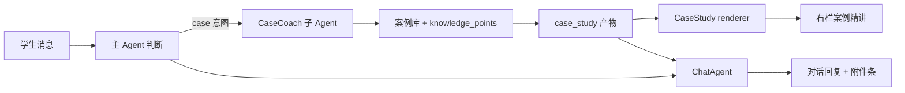

# 营小商：案例联动与 Web 部署 v0.3

> 日期：2026-10-19  
> 产品：**营小商**（山东大学威海商学院市场营销专业）  
> 状态：本文件是 v0.2 的增补实现基线，不替代 v0.2 的对话/多 Agent 约束。  
> 对应需求：案例展示与知识点分析联动；知识点先定义、再在下方对话框结合案例说明；消费者/学习两个指定示例；可部署供学生连续使用数天；产出真实界面截图。

---

## 0. 一句话结论

这一版把“知识点解释”从聊天里的一段文字，改成**可追溯的案例精讲文档**：

```text
知识点 → 定义（先）→ 这个案例里对应什么 → 案例对话（再）→ 结论/边界 → 想一想
```

聊天仍然先说话，但右侧会打开同一份案例精讲；聊天回复、引用、案例证据和对话解释指向同一组知识点，不再出现“案例讲案例、知识点讲知识点”的两张皮。

---

## 1. 需求与实现映射

| 需求 | 实现 |
|---|---|
| 案例展示与知识点分析联动 | 新增 `case_study` 产物；每个知识点是一个独立卡片，定义、案例对应、证据、对话、结论、边界在同一张卡里 |
| 每个知识点先定义，再在其下对话框说明 | `CaseStudyContentSchema.knowledgePoints[]` 固定字段顺序：`definition → caseMapping → evidence → dialogue → takeaway → boundary → checkQuestion`；renderer 按同一顺序渲染 |
| 示例一：消费者 | `消费者` 卡片：定义“为生活消费而购买和使用产品或服务的个人和家庭”；案例对应永辉/胖东来/步步高；对话解释“买来给谁用”而不是“在哪买、买多少” |
| 示例二：学习 | `学习` 卡片：定义“由经验引起的行为或行为潜能的变化”；案例对应胖东来体验 → “胖东来＝放心、贴心、不坑人”心智 → 跨城打卡/长距离到店；对话区分“重复购买”与“行为规则改变” |
| 学生连续使用数天 | 新增 `apps/web` 长驻 Web 服务；SQLite、产物、导出、设置都在 `LEARNING_AGENT_HOME` 持久化；Docker 卷 + 首次启动自动 seed |
| 真实界面截图 | `docs/screenshots/` 下 4 张，来自实际部署的 Web 服务（Playwright + 本机 Chrome） |

---

## 2. 案例精讲的数据契约

共享类型在 `packages/shared/src/index.ts`：

```ts
CaseStudyContent {
  case: { id, title, subtitle, summary, companies[], sourceNote }
  knowledgePoints: [{
    id, name, definition, definitionSource,
    caseMapping,
    evidence: [{ quote, sourceId, sourceTitle }],
    dialogue: [{ role: 'student' | 'mentor', text }],
    takeaway, boundary, checkQuestion
  }]
  transfer[], boundaries[], usageNote
}
```

约束：

- `definition` 必须是课程定义，优先从 `knowledge_points` 读取；案例库只做兜底。
- `caseMapping` 必须显式写出“这个案例的哪一部分对应这个定义”，不能只贴新闻原文。
- `dialogue` 必须是学生/营小商交替，且第一轮由学生提问；它是“用案例解释定义”的对话，不是聊天记录回放。
- `boundary` 必须写清定义不成立的条件，防止学生把案例结论过度外推。
- `sourceRefs` 只放知识点与新闻来源；学生能力证据仍走 `evidence_ids`，不混装。

---

## 3. 运行时链路



- 路由：`packages/agent/src/index.ts` 新增 `CASE_PATTERN`，命中“案例 / 胖东来 / 永辉 / 步步高 / 超市 / 消费者市场 / 什么是消费者 / 学习是什么”等表达时进入 `case` 意图；练习请求优先，不会被案例路由截走。
- 子 Agent：`packages/agent/src/case-coach.ts` 只做案例组装、定义补全、引用生成；不直接对学生说话。
- 案例库：`packages/agent/src/case-library.ts` 保存确定性内容，保证无模型 Key 时两个指定示例仍然完整。
- 产物：`CaseStudy@1`，写入 `artifacts.content_json`，Markdown 只作为导出/降级。
- 新闻分析同步升级：`NewsAnalysis@1.matches[]` 增加 `caseMapping` 与 `dialogue`，新闻卡也按“定义 → 案例对应 → 原文证据 → 对话”渲染，旧产物缺字段时自动降级。
- 说话层：`ChatAgent` 收到 `case_study` 的压缩内容后，按“结论 → 每个知识点定义 → 案例对应 → 对话关键一步 → 边界”组织回复；模型失败时使用本地兜底。
- 右栏：`case_study` 是唯一与题目集一样自动打开的产物；因为案例精讲本身就是本轮学习主表面，不是旁路附件。

---

## 4. 界面

### 4.1 案例精讲卡片

每个知识点卡片固定五段：

1. **定义**：蓝色强调框，显示定义与来源；
2. **案例对应**：左侧强调线的说明框，写清永辉/胖东来/步步高的具体对应；
3. **证据**：公开报道引用，标注来源；
4. **案例对话**：独立对话框，学生右侧、营小商左侧，逐轮把定义用回案例；
5. **结论 / 边界 / 想一想**：可迁移结论、失效条件、检查问题。

截图：

- `docs/screenshots/02-case-lesson.png`：聊天 + 右栏案例精讲总览；
- `docs/screenshots/03-case-dialogue.png`：`消费者` 知识点，定义 → 案例对应 → 对话；
- `docs/screenshots/04-learning-dialogue.png`：`学习` 知识点，胖东来心智与跨城行为的对话解释；
- `docs/screenshots/01-empty-state.png`：按学习状态生成的空态建议。

### 4.2 空态建议

`AgentService.suggestions()` 按 `LearningStateSnapshot` 生成标题、说明和 2–3 个入口：

- `pre`：先摸底 / 案例入口 / 基础自测；
- `learning`：案例精讲 / 消费者市场 / 最新新闻分析或情境题；
- `post`：成长复盘 / 案例检验 / 情境题；
- 有未完成研究设计：继续改研究设计 / 案例检验 / 方法题。

固定三条只作为接口失败时的兜底，不再作为主路径。

---

## 5. Web 部署

### 5.1 本地构建与启动

```bash
pnpm install
pnpm web:build
LEARNING_AGENT_HOME="$PWD/.learning-agent" pnpm web:start
# http://127.0.0.1:3081
```

- `apps/web` 复用 `apps/desktop/src/renderer` 的同一份 React 界面，避免桌面/网页两套 UI 分叉。
- `apps/web/server.ts` 初始化与 Electron main 相同的服务：同一个 SQLite、同一组 Agent、同一个 DeepSeek 配置。
- `apps/web/src/bridge.ts` 把 `window.learning` 映射为同源 HTTP；浏览器端不需要 Electron。
- 数据目录 `LEARNING_AGENT_HOME` 持久化数据库、产物、导出和设置；应用重启不丢学习记录。

### 5.2 Docker

```bash
docker compose up -d --build
```

- 镜像基于 `node:22-slim`，暴露 `3081`；
- `/data` 是持久卷；首次启动检测不到 `data/learning.db` 时自动执行 `pnpm db:seed` 与 `pnpm db:seed:student`；
- `LEARNING_AGENT_ACCESS_TOKEN` 可选，设置后 `/api/*` 要求 Bearer；公网必须放在 HTTPS 反向代理后；
- 健康检查：`GET /api/health`。

### 5.3 连续使用边界

- 单学生共享令牌，不是多租户登录；学生数据按 `student_id` 分区，但当前 Web 入口固定 `student_demo`。
- 新闻自动刷新在服务进程内定时执行；进程停止后不抓取。
- 浏览器不支持本地文件选择/预览，相关方法返回 501；桌面端仍支持。

---

## 6. 验证记录

已实际运行：

```bash
pnpm typecheck
pnpm --dir apps/desktop exec tsc --noEmit
pnpm --dir apps/web exec tsc --noEmit
pnpm web:build
pnpm test:case
pnpm test:agent
pnpm test:ui-flow
node scripts/test-ui-case.mjs
node scripts/capture-screenshots.mjs
```

验证覆盖：

- `test:case`：`用胖东来案例讲消费者` → `case` 意图、`CaseStudy@1`、3 个知识点、定义/案例对应/对话/结论/边界齐全；`消费者市场是什么` 与 `学习是什么` 都进入案例；`给我出 3 道消费者题` 不被案例路由截走；空态建议包含案例入口。
- `test:ui-flow`：诊断 → 最小计划 → ch04 解释 → 出题/交卷 → 调研 → BP → 成长卡 → 新闻分析 → 记录水位，全部通过。
- `test-ui-case`：真实 Electron UI 打开案例精讲，定义在对话之前，三家超市与“胖东来＝放心”“跨城”均出现，无原始 Markdown。
- `capture-screenshots`：对 `http://127.0.0.1:3083` 的实际 Web 服务走“空态 → 案例精讲 → 对话”流程并截图。

---

## 7. 已知限制

- 当前案例库只有一组区域商超案例；新增案例需要补 `case-library.ts` 的结构化内容，不能只加一段新闻。
- 案例对话是确定性教学内容，不是实时生成的自由对话；学生追问仍走 ChatAgent/知识 Agent。
- 案例精讲暂不支持逐轮展开/折叠或学生作答；检查问题目前只显示，不进入证据账本。
- 多学生登录、教师端、案例版本管理仍属于后续阶段。
