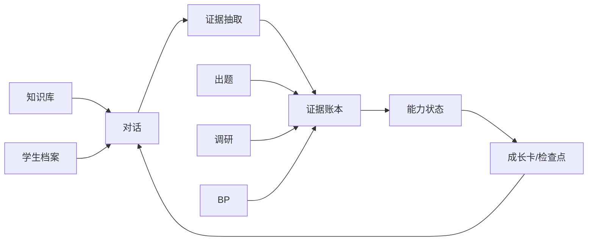
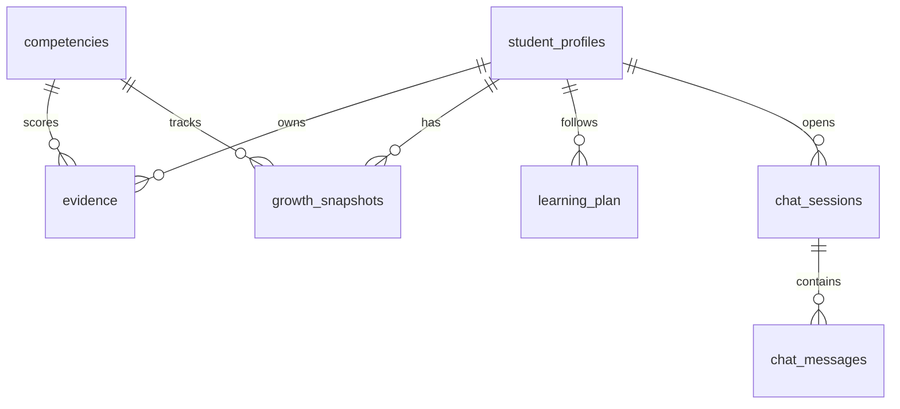
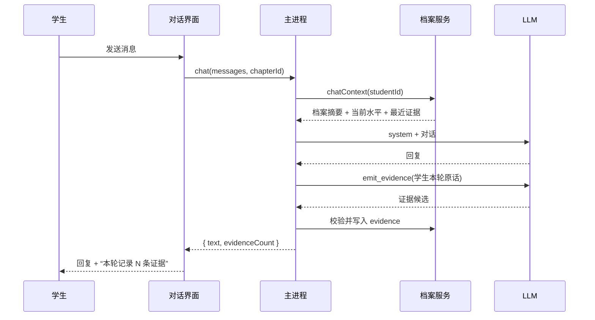

# 营小商追踪系统设计 v0.1

> **历史归档，已被取代。**  
> 产品现已更名「营小商」；归档文件名保留历史命名。  
> 本文是最早的“对话 + 证据追踪”设计，保留用于追溯。当前实现与产品设计以
> [`../90-archive/00-mvp-v2/00-mvp/营小商-MVP-v2.0.md`](../90-archive/00-mvp-v2/00-mvp/营小商-MVP-v2.0.md) 为准。

| 项 | 内容 |
|---|---|
| 状态 | 历史归档；已被 MVP 报告取代 |
| 目标 | 以对话为主，持续采集证据，追踪一位假想学生在课程中的能力成长 |
| 参照 | `E:\Documents\GitHub\resume` 的 YAML 数据驱动 + `reference` 记忆区；`../90-archive/00-mvp-v2/10-long-term/营小商-商科能力评价-需求拆解-v0.1.md`；`../90-archive/00-mvp-v2/10-long-term/营小商-系统拆解-v0.1.md` |
| 范围 | 单学生、单课程、4 个能力维度、章节前/后检查点、对话证据、成长卡 |
| 不做 | 多租户、教师看板、自动高利害评分、申诉、LTI/SSO |

---

## 0. 一句话

> 学生和营小商聊天、做任务、交作业；系统把学生自己的判断、假设、取舍和表达抽成**可追溯证据**，按章节前/后形成**能力成长卡**，而不是只给一个分数。

## 1. 产品形态

- **默认页面是对话**。学生打开软件先看到营小商，而不是仪表盘。
- 对话右侧是**当前学生模型**：当前章节、4 维水平、最近证据、待验证点。
- 左侧导航是工具，不是主界面：对话、成长档案、知识库、出题、调研、商业计划书、设置。
- 对话是主入口；知识库/出题/调研/BP 是对话可以调用的固定工作流（skill），也保留独立页面供直接操作。
- 学生模型贯穿所有工具：出题难度、调研反馈、BP 评审都会读取同一份档案。



## 2. 学生模型

### 2.1 四个 MVP 维度

采用需求文档的 4 维，避免 MVP 铺满 6 维：

| id | 名称 | 看什么 | 不把什么当主证据 |
|---|---|---|---|
| `problem_framing` | 问题建构 | 症状/根因、边界、约束、利益相关者 | 背框架名称 |
| `evidence_hypothesis` | 证据与假设 | 事实/假设/推断、证据选择、反证 | 资料数量 |
| `decision_tradeoff` | 决策与取舍 | 条件性主张、替代方案、风险、伦理 | 结论听起来对不对 |
| `communication` | 沟通与影响 | 受众适配、回应质疑、行动建议 | 口才、PPT 美观 |

可选第五维 `metacognition`（元认知）先只记录，不进入主卡。

### 2.2 四级表现

每个维度存 L1–L4 描述，外加 `unknown`。MVP 的 rubric 由教师定稿前先作为草稿，UI 明确标注“草稿 rubric”。

| 维度 | L1 | L2 | L3 | L4 |
|---|---|---|---|---|
| 问题建构 | 把现象当问题 | 套框架拆解 | 情境化界定边界与利益相关者 | 质疑题目预设，提出替代框架 |
| 证据与假设 | 观点堆砌 | 有证据意识但标准不清 | 证据链完整，区分事实/假设/推断 | 主动找反证，做敏感性/情景分析 |
| 决策与取舍 | 单一建议 | 列选项比优缺点 | 明确标准，给条件性建议与风险 | 触发条件/退出机制，处理伦理冲突 |
| 沟通与影响 | 信息倾倒 | 结构清晰 | 受众适配，回应质疑 | 处理反对意见，建立可信度与下一步 |

### 2.3 进步判定

- 只比较**可比任务**上的独立表现。
- 输出三种结论：`进步`、`停滞`、`证据不足`。
- 每个结论必须带：当前水平、置信度、证据数、支持证据、反例/待验证点、下一步建议。
- 不合成单一总分；分数只能作为辅助字段。

## 3. 数据模型

### 3.1 新增表（SQLite migration 2）



| 表 | 关键字段 | 说明 |
|---|---|---|
| `student_profiles` | `id`, `name`, `cohort`, `profile_json`, `updated_at` | 扩展已有表；`profile_json` 存背景、目标、偏好、约束、自评 |
| `competencies` | `id`, `name`, `definition`, `levels_json`, `observable_json`, `version` | 4 维 + 可选元认知；rubric 草稿 |
| `evidence` | `id`, `student_id`, `competency_id`, `level`, `strength`, `source_type`, `source_id`, `chapter_id`, `session_id`, `excerpt`, `rationale`, `confidence`, `method`, `review_status`, `occurred_at`, `metadata_json` | 不可变证据账本；`excerpt` 必须是学生原话/原文片段 |
| `growth_snapshots` | `id`, `student_id`, `chapter_id`, `checkpoint`(`pre`/`post`), `competency_id`, `level`, `confidence`, `evidence_count`, `summary`, `created_at` | 章节前/后检查点 |
| `learning_plan` | `id`, `student_id`, `chapter_id`, `phase`(`pre`/`learning`/`post`), `title`, `tasks_json`, `status`, `due_at` | 章节时间线 |
| `chat_sessions` | `id`, `student_id`, `chapter_id`, `title`, `created_at`, `updated_at` | 对话主界面 |
| `chat_messages` | `id`, `session_id`, `role`, `content`, `evidence_count`, `created_at` | 对话记录；`evidence_count` 便于 UI 提示 |

### 3.2 证据强度

| 级别 | 含义 | 使用规则 |
|---|---|---|
| A | 独立、跨情境、有追问/答辩 | 可支撑结论 |
| B | 有过程记录的复杂任务 | 可支撑结论，需注明 |
| C | 单次对话/课堂发言 | 只能作线索，不能单独定论 |
| D | 出勤、自评、聊天时长 | 不作能力证据 |

### 3.3 证据类型

`explanation`（解释机制）、`decision`（有条件主张）、`hypothesis`（假设）、`evidence_use`（证据选择/反证）、`tradeoff`（取舍）、`communication`（受众/回应质疑）、`reflection`（元认知）、`artifact`（交付物）。

## 4. 档案数据（YAML，参照 resume）

目录：

```text
data/students/student_demo/
├── profile.yaml          # 学生背景、目标、偏好、约束、自评
├── competencies.yaml     # 4 维 rubric（草稿）
├── plan.yaml             # 13 章时间线，每章 pre/learning/post
├── evidence_seed.yaml    # 假想学生的历史证据
└── reference.md          # 可选：AI 记忆区（口径、红线、用户原话）
```

约束：

- 一个 YAML 一个板块；`reference:` 字段只给 AI 读，不进入 UI/导出。
- 学生档案可编辑；证据不可被档案覆盖，只能追加/复核。
- 章节 id 与教材入库一致（`ch01`…`ch13`），知识点 id 复用知识库。

## 5. 证据抽取

### 5.1 触发点

- 每轮对话结束后（异步或同步，MVP 同步等待）。
- 出题作答、调研设计提交、BP 章节提交时（后续阶段）。
- 学生手动“记录检查点”时生成快照。

### 5.2 抽取契约

LLM 只通过合成工具 `emit_evidence` 返回：

```json
{
  "evidence": [{
    "competency_id": "problem_framing",
    "level": "L2",
    "strength": "C",
    "evidence_type": "explanation",
    "excerpt": "学生原话连续片段",
    "rationale": "为什么这条证据支持该水平",
    "confidence": 0.6
  }]
}
```

校验：

- `competency_id` 在 4 维集合内。
- `excerpt` 必须是**学生消息**的连续片段；不是则重试一次，仍失败丢弃。
- `level` 在 L1–L4；`strength` 在 A–D；`confidence` 0–1。
- 没有证据时返回空数组，不硬凑。
- 证据默认 `method='llm'`, `review_status='draft'`；教师复核后可 `reviewed`/`rejected`。

## 6. 成长推断

MVP 不引入复杂模型，先规则 + 加权：

1. 每条证据映射 L1=1…L4=4；强度权重 A=4,B=3,C=2,D=1。
2. 当前水平 = 加权中位数（或加权均值四舍五入），只看 A/B/C；只有 D → `unknown`。
3. 置信度 = `min(1, 0.15 * Σ(强度权重 * confidence))`；证据少于 2 条 → 低置信。
4. 前/后快照：章节 `pre` 与 `post` 各算一次；`post.level - pre.level` 为位移。
5. 结论：
   - 有前后快照且位移 > 0 → `进步`
   - 位移 = 0 且证据 ≥ 2 → `停滞`
   - 证据 < 2 或只有 D → `证据不足`
6. 输出“反例/待验证”：取最近一条低于当前水平的证据，或 LLM 生成的待验证点。

## 7. 对话循环



系统提示必须包含：

- 营小商角色：先追问、再提示、不代写。
- 当前章节与检查点。
- 学生档案摘要（目标、偏好、约束）。
- 4 维 rubric 摘要。
- 最近 3–5 条证据（只读）。
- 证据抽取规则：只记录学生原话，不把 AI 的话当证据。

## 8. UI

### 8.1 对话（默认）

- 主区：消息流、角色标签、输入框。
- 右侧：当前章节、4 维水平条、最近证据、待验证点、`记录检查点` 按钮。
- 每条助手消息下方显示“本轮记录 N 条证据”，可点开查看。

### 8.2 成长档案

- 学生卡：姓名、年级、课程、目标、偏好。
- 4 维能力卡：当前水平、前/后位移、置信度、证据数、支持证据、反例。
- 章节时间线：13 章，pre/learning/post 状态；ch04 展开。
- 证据账本：按维度/章节/强度筛选；每条显示原文片段、水平、理由、时间、复核状态。
- `生成成长卡`：LLM 汇总，输出 Markdown，可导出。

### 8.3 工具页

知识库/出题/调研/BP 保留，但都带“当前学生/当前章节”上下文；产出的题目、调研、BP 可一键写入证据。

## 9. 与现有系统的接入

| 现有模块 | 接入方式 |
|---|---|
| `packages/db` | migration 2；新增 profile/evidence/growth/chat 表 |
| `packages/shared` | 新增 zod schema：`StudentProfile`, `Competency`, `Evidence`, `GrowthSnapshot`, `LearningPlan`, `ChatMessage` |
| `packages/profile`（新） | `ProfileService`：档案、证据、快照、成长卡、chatContext |
| 桌面主进程 | 初始化 `ProfileService`；chat 前后调用；IPC 暴露 |
| 桌面 renderer | 对话页 + 成长档案页；复用现有知识库/出题/调研/BP 页面 |
| 出题/调研/BP | 后续阶段：提交/评审时调用 `profile.addEvidence` |
| 知识库/新闻 | 对话引用知识点/新闻时，证据绑定 `chapter_id`/`source_id` |

## 10. MVP 验收

1. 启动桌面端，默认进入对话；假想学生 `student_demo` 的档案可见。
2. 对话 3–5 轮后，至少产生 2 条证据，证据片段能在学生原话中找到。
3. 成长档案显示 4 维水平、证据数、置信度；证据不足的维度显示“证据不足”。
4. ch04 有 pre/post 两个快照；post 与 pre 的位移能显示“进步/停滞/证据不足”。
5. 点击“记录检查点”生成快照，刷新后仍在。
6. 成长卡生成成功（有 API key 时）；无 key 时明确提示。
7. 现有知识库/出题/调研/BP 页面仍可打开。

## 11. 实施阶段

| 阶段 | 内容 | 验收 |
|---|---|---|
| P1 | schema + migration 2 + `ProfileService` + YAML seed | `db:seed:student` 后档案/证据/计划可查 |
| P2 | 证据抽取 + 成长推断 + mock LLM 测试 | 3 轮对话产生证据；快照计算正确 |
| P3 | 桌面端对话页 + 右侧学生模型 + 成长档案页 | 默认对话；档案页可读 |
| P4 | 检查点/成长卡/导出 | pre/post 快照与 Markdown 导出 |
| P5 | 出题/调研/BP 写入证据 | 三类工具各至少 1 条证据 |
| P6 | 演示脚本与假想学生数据打磨 | 一条完整 12 周演示线 |
