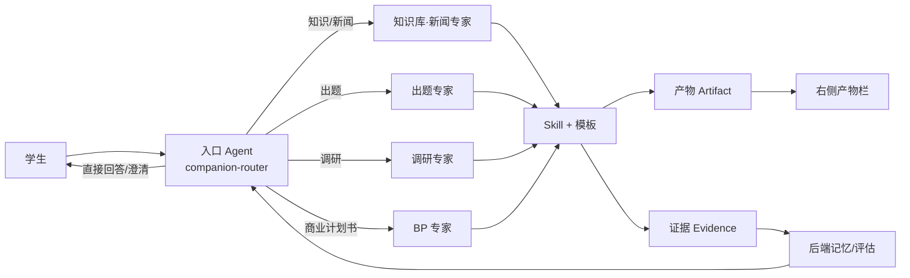
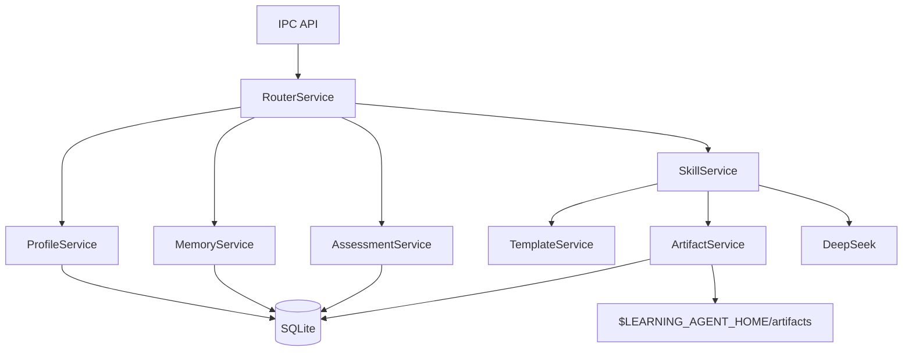
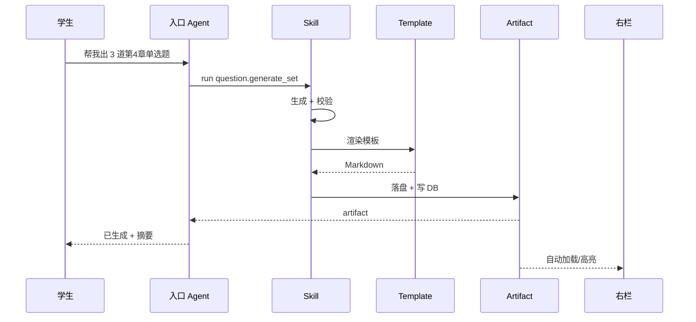
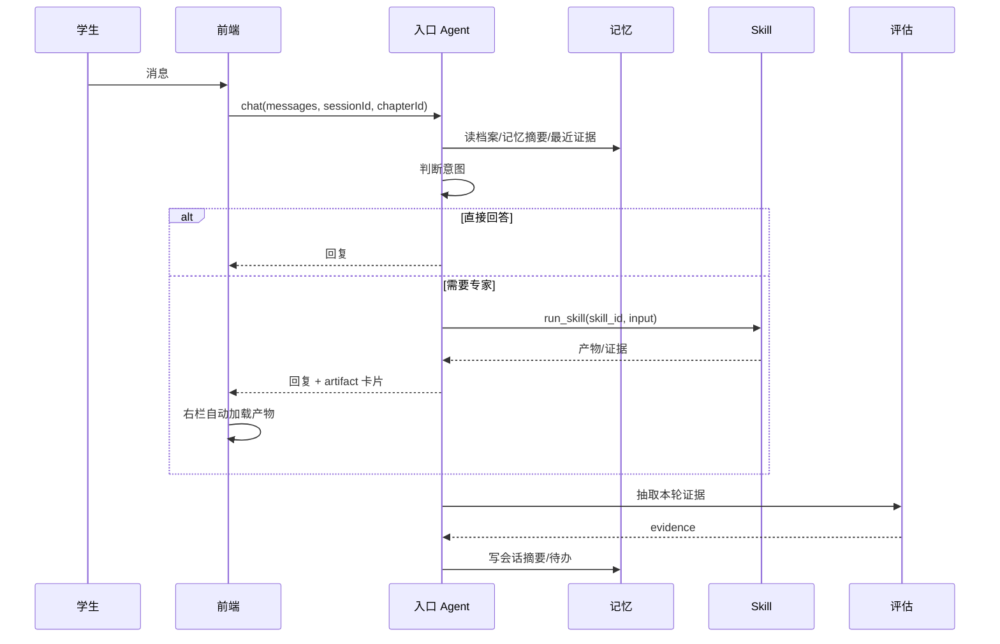

# 营小商追踪系统设计 v0.2

> **历史基线，已被取代。**  
> 产品现已更名「营小商」；归档文件名保留历史命名。  
> 本文保留 v0.2 的产品细节，但以下部分已过时：右栏固定“产物/记忆/评估”三 Tab、
> 入口 Agent 的关键词/专家路由、章节选择器、Markdown 直出产物。当前实现与产品设计以
> [`../90-archive/00-mvp-v2/00-mvp/营小商-MVP-v2.0.md`](../90-archive/00-mvp-v2/00-mvp/营小商-MVP-v2.0.md) 为准。

| 项 | 内容 |
|---|---|
| 状态 | 历史基线；已被 MVP 报告取代 |
| 部署形态 | 当前为单学生本地演示库（`student_demo`，SQLite，无登录/多租户）；未来演进为服务端后端 + 客户端前端，按登录用户匹配学生数据 |
| 核心 | 对话为主 + 后端记忆/评估 + 入口 Agent 调度三个专家 + 产物自动出现 |
| 参照 | `E:\Documents\GitHub\resume` 的 YAML 数据驱动 + `reference` 记忆区；`../90-archive/00-mvp-v2/10-long-term/营小商-商科能力评价-需求拆解-v0.1.md`；`../90-archive/00-mvp-v2/10-long-term/营小商-系统拆解-v0.1.md` |
| 修订 | v0.2 把学生档案/记忆/评估全部移到后端；取消三个专家的独立页面；新增入口 Agent、Skill、Template、Artifact |

---

## 0. 一句话

> 学生只和**一个营小商**聊天。营小商判断需求，调度「知识库·新闻 / 出题 / 调研 / 商业计划书」四个专家；专家用固定 Skill + 模板产出文件，文件自动出现在右侧栏；后端同时把对话变成记忆和证据，持续更新学生档案与成长评估。

## 1. 三条硬边界

### 1.1 前端 / 后端

| 层 | 负责 | 不负责 |
|---|---|---|
| 前端（Electron renderer） | 对话流、右侧产物预览、记忆/评估只读展示、设置 | 不计算 rubric、不拼 prompt、不直接读写数据库、不决定路由 |
| 后端（Electron main + services） | 学生档案、记忆、证据、评估、Skill、模板、产物、路由、LLM 调用 | 不直接画 UI |
| 存储 | SQLite + `$LEARNING_AGENT_HOME/artifacts/` | 前端不直接访问 |

前端只通过 IPC 调用后端；所有“学生记得什么”“当前什么水平”“该找哪个专家”都在后端。

### 1.2 入口 Agent 与专家



- **入口 Agent** 是唯一对话面。它先判断：直接回答、先澄清、还是交给某个专家。
- **四个专家不是页面**，是后端可调用的 persona + skill 集合。
- 专家不直接和用户多轮对话；入口 Agent 负责对话，专家负责执行固定工作流并返回产物/证据。
- 后续新增功能 = 新增 expert + skill + template，不改主界面。

### 1.3 记忆与评估

- **记忆系统**：稳定事实（目标、偏好、约束、背景）+ 会话摘要（学生说过什么、做过什么、待办）+ 产物/证据引用。
- **评估系统**：证据账本 + 章节前/后快照 + 四维能力状态 + 成长卡。
- 记忆可以被学生纠正；评估证据不可被记忆覆盖。
- 前端只读展示；编辑走“记忆修正”对话或设置页。

## 2. 布局

### 2.1 三栏

```text
┌──────────────┬──────────────────────────────────────┬──────────────────────┐
│ 左栏 220px    │ 中栏：对话                            │ 右栏 360px            │
│              │                                      │                      │
│ + 新对话      │ 营小商消息 / 学生消息 / 产物卡片          │ [产物] [记忆] [评估]   │
│ 会话列表      │                                      │ 自动加载本轮产物        │
│ 产物库        │                                      │ 记忆摘要/证据/水平      │
│ 设置          │ 输入框                                │ 预览 / 导出            │
└──────────────┴──────────────────────────────────────┴──────────────────────┘
```

- **左栏**不固定四个专家入口；保留会话、产物库、设置。未来功能（课程、班级、教师端）可以在这里增加一级入口。
- **中栏**永远是对话；不因为切专家而换页面。
- **右栏**是上下文面板，默认“产物”；本轮生成了文件就自动切到产物并高亮；没有产物时显示记忆/评估摘要。
- 专家工作流以**消息内卡片**出现：例如“已生成 3 道单选题（DOCX）”，点开在右栏预览。

### 2.2 右侧栏三个 Tab

| Tab | 内容 | 数据来源 |
|---|---|---|
| 产物 | 本轮/最近文件、类型、模板、导出 | `artifacts` |
| 记忆 | 学生画像、目标、偏好、约束、最近会话摘要、待确认事项 | `memory_facts` / `memory_episodes` |
| 评估 | 4 维水平、前/后位移、置信度、证据数、最近证据 | `evidence` / `growth_snapshots` |

## 3. 后端服务



| 服务 | 职责 |
|---|---|
| `RouterService` | 入口 Agent 的工具循环：判断意图、调用专家 Skill、汇总回复 |
| `ProfileService` | 学生档案视图：稳定事实 + 当前评估摘要 + 计划 |
| `MemoryService` | 记忆事实、会话摘要、待确认事项、记忆修正 |
| `AssessmentService` | 证据抽取、证据账本、前/后快照、成长推断、成长卡 |
| `SkillService` | Skill 注册表、输入校验、执行、产物生成 |
| `TemplateService` | Markdown/DOCX 模板渲染，槽位替换 |
| `ArtifactService` | 产物元数据、文件落盘、列表、导出 |

## 4. 数据模型

### 4.1 新增/调整表

| 表 | 关键字段 | 说明 |
|---|---|---|
| `student_profiles` | `id`, `name`, `cohort`, `profile_json`, `updated_at` | 档案视图 |
| `memory_facts` | `id`, `student_id`, `kind`(`goal`/`preference`/`constraint`/`background`/`self_assessment`), `key`, `value_json`, `confidence`, `source`, `updated_at` | 稳定记忆 |
| `memory_episodes` | `id`, `student_id`, `session_id`, `summary`, `decisions_json`, `open_questions_json`, `created_at` | 会话记忆 |
| `competencies` | `id`, `name`, `definition`, `levels_json`, `observable_json`, `version` | 4 维 rubric |
| `evidence` | `id`, `student_id`, `competency_id`, `level`, `strength`, `evidence_type`, `source_type`, `source_id`, `chapter_id`, `session_id`, `excerpt`, `rationale`, `confidence`, `method`, `review_status`, `occurred_at` | 评估证据 |
| `growth_snapshots` | `id`, `student_id`, `chapter_id`, `checkpoint`, `competency_id`, `level`, `confidence`, `evidence_count` | 前/后测 |
| `learning_plan` | `id`, `student_id`, `chapter_id`, `phase`, `title`, `tasks_json`, `status`, `due_at` | 章节时间线 |
| `chat_sessions` / `chat_messages` | 现有字段 + `artifact_ids_json` | 对话与产物引用 |
| `artifacts` | `id`, `student_id`, `session_id`, `skill_id`, `template_id`, `type`, `title`, `format`, `path`, `content`, `evidence_ids_json`, `created_at` | 产物 |
| `skills` | `id`, `expert_id`, `name`, `description`, `input_schema_json`, `template_id`, `enabled` | Skill 注册表（可代码内置，DB 存启用状态） |

### 4.2 记忆与评估的关系

- 记忆事实用于个性化（称呼、目标、偏好、约束）。
- 评估证据只从学生原话/交付物抽取；记忆不能改写证据。
- 学生会话摘要可以引用证据，但不能替代证据。
- 学生可以修正记忆；证据只能追加/复核/驳回。

## 5. 专家 / Skill / 模板

### 5.1 专家

| expert_id | 名称 | 负责 | 典型 Skill |
|---|---|---|---|
| `knowledge-news` | 知识库·新闻 | 知识点检索、新闻匹配、案例分析 | `knowledge.search`, `news.match`, `case.analyze` |
| `question-gen` | 出题 | 生成/校验/导出题目 | `question.generate_set`, `question.validate`, `question.export` |
| `research` | 调研 | 研究问题、方法、抽样、问卷/访谈、分析 | `research.design`, `research.questionnaire`, `research.review` |
| `bp` | 商业计划书 | 目录、市场、竞争、画布、GTM、财务、评审 | `bp.outline`, `bp.market_sizing`, `bp.section`, `bp.review` |

入口 Agent 本身也可以直接回答概念/学习策略问题，不强制路由。

### 5.2 Skill 契约

```ts
interface SkillDefinition<I, O> {
  id: string
  expertId: string
  name: string
  description: string
  inputSchema: ZodType<I>
  templateId?: string
  run(input: I, ctx: SkillContext): Promise<{ output: O; artifacts?: ArtifactDraft[]; evidence?: EvidenceDraft[] }>
}
```

- Skill 是固定工作流：参数确认 → 调 LLM/服务 → 校验 → 模板渲染 → 落盘 → 返回产物。
- Skill 不负责多轮对话；缺参数时返回 `needs_input`，由入口 Agent 追问。
- 每个 Skill 必须有：输入 schema、输出 schema、模板、证据绑定规则。

### 5.3 模板

目录：

```text
templates/
├── question_set.md
├── research_design.md
├── research_questionnaire.md
├── bp_outline.md
├── bp_section.md
└── growth_card.md
```

模板是 Markdown + 槽位（`{{title}}`、`{{items}}`、`{{evidence}}`），DOCX 由统一导出器从 Markdown 结构生成。模板不写业务逻辑。

## 6. 产物

### 6.1 Artifact 类型

`question_set`、`research_design`、`questionnaire`、`bp_outline`、`bp_section`、`growth_card`、`evidence_pack`、`case_analysis`。

### 6.2 生命周期



- 产物默认保存到 `$LEARNING_AGENT_HOME/artifacts/<student>/<yyyy-mm>/`。
- 右栏自动加载最近产物；本轮产物高亮。
- 导出：Markdown / DOCX；题目可 CSV/JSON。

## 7. 对话循环



入口 Agent 使用工具：

- `route_expert(expert_id, reason)`：选择专家。
- `run_skill(skill_id, input)`：执行固定工作流。
- `get_profile()` / `get_recent_evidence()`：读记忆/评估。
- `ask_user(question)`：参数不足时追问。

MVP 可以先做确定性路由 + 少量 LLM 路由，不追求全自动。

## 8. 前端页面

### 8.1 唯一主页面：对话

- 消息流：文本、产物卡片、证据提示。
- 输入框：发送、附件、技能快捷入口（可选）。
- 右栏：产物/记忆/评估三个 Tab。
- 左栏：新对话、会话列表、产物库、设置。

### 8.2 设置

- API Key、模型、学生档案（只读 + 修正入口）、数据目录、导出目录。
- 不展示 rubric 编辑（教师端后续）。

### 8.3 不再有

- 三个专家的独立页面。
- 独立“成长档案”一级页面（改为右栏评估 Tab + 产物库中的成长卡）。
- 左侧四个专家入口。

## 9. MVP 验收

1. 打开软件默认是对话；左栏只有会话/产物/设置，没有三个专家页面。
2. 说“帮我出 3 道第 4 章单选题”，入口 Agent 路由到出题专家，生成题目产物，右栏自动出现，可导出 DOCX。
3. 说“帮我设计 Z 世代国潮联名调研”，路由到调研专家，生成研究设计产物。
4. 说“帮我写校园二手书 BP 的市场规模”，路由到 BP 专家，生成 BP 章节产物。
5. 每轮对话后，后端抽取证据；右栏“评估”更新；证据片段来自学生原话。
6. 右栏“记忆”显示学生目标/偏好/约束/最近会话摘要；可修正。
7. ch04 前/后快照可记录；成长卡可生成并作为产物出现。
8. 前端不计算 rubric、不直接读 DB；所有数据经 IPC/后端服务。

## 9.1 竞品调研结论（2026-10-18）

### 记忆

- ChatGPT 用“记忆摘要 + 已保存记忆列表 + 回答下方 Sources”，用户可编辑/删除/关闭；摘要不等于全部记忆。([OpenAI Memory](https://help.openai.com/en/articles/8590148-memory-in-chatgpt))
- Claude 用 Topics 列表，支持 Pause/Reset、单聊关闭、敏感主题默认不存；记忆与项目隔离。([Claude memory](https://support.claude.com/en/articles/11817273-use-claude-s-chat-search-and-memory-to-build-on-previous-context))
- Copilot 保存前询问、显示 “Memory updated”，关闭 Saved memories 不等于删除已有记忆；问 “What do you know about me” 可得摘要。([Copilot memory](https://support.microsoft.com/en-us/microsoft-365-copilot/manage-copilot-memory-in-microsoft-365-copilot))
- Devin 把 Knowledge 做成带 Trigger 的条目，并在聊天里给 Knowledge Suggestions；Cursor 后台记忆需要用户批准。([Devin Knowledge](https://docs.devin.ai/product-guides/knowledge)) ([Cursor 1.0](https://cursor.com/changelog/1-0))
- 结论：**摘要 + 条目列表 + 来源 + 可修正/可忘记 + 与评估分开**；不展示向量、检索分、内部置信度。

### 评估

- Khan Academy 把 mastery 分为 Attempted/Familiar/Proficient/Mastered，允许“Not Started/Attempted”这种证据不足状态；等级可升可降。([Khan mastery](https://support.khanacademy.org/hc/en-us/articles/5548760867853--How-do-Khan-Academy-s-Mastery-levels-work))
- Coursera 用 rubric 分项 + 评语，未凑够评阅不出分；Formative 学生端分数默认隐藏；PebblePad 默认私有、逐项分享。([Coursera peer grading](https://www.coursera.support/s/article/learner-000001434)) ([Formative](https://help.formative.com/en/articles/6949843-student-home-page)) ([PebblePad](https://helphub.pebblepad.com/support/solutions/articles/101000539592-share-an-asset-with-people))
- 研究提醒：可视化不确定性并不自动提升理解，skill-meter 对低教育程度用户尤其不友好。([Uncertainty in open learner models](https://link.springer.com/chapter/10.1007/978-3-032-29770-9_14))
- 结论：学生端展示“我现在能做什么 / 支持证据 / 下一步”，用“证据不足/证据有限/证据较充分”替代数字置信度；原始分数与教师看板分离。

### 入口 Agent 与产物

- WorkBuddy：单一任务入口 + Expert Center/Skills 库 + 右侧 Results Panel；模板是预填 prompt + skill + expert 的配方。([WorkBuddy](https://www.workbuddy.ai/))
- Claude Skills 自动触发或 `/` 调用，Artifact 在对话旁打开；Manus/Genspark 用 Skills 库 + 聊天内调用 + 产物抽屉。([Claude Skills](https://support.claude.com/en/articles/12138966-what-are-skills)) ([Manus](https://manus.im/docs/features/projects)) ([Genspark](https://www.genspark.ai/))
- Cursor Plan Mode 先澄清再计划；Devin 推荐 Ask 规划 → Agent 执行；产物用进度/PR/截图证明。([Cursor Plan](https://cursor.com/docs/agent/plan)) ([Devin](https://docs.devin.ai/))
- 结论：**单一入口、专家不可见、技能可发现、产物在右栏、只在首次/用户点击时打开预览**；路由只显示“本次使用：出题”这类用户语言。

### 据此对实现的修订

1. 右栏从“记忆/评估”改为“产物 / 关于我 / 成长”，避免把用户当评审对象。
2. 记忆面板显示摘要 + 分组条目 + 来源 + 修正/忘记；不显示原始 JSON。
3. 成长面板用“起步/能套用/能情境化/能批判/证据不足”替代 L1-L4 + 置信度数字；证据用“证据强/中/弱”。
4. 产物生成后只高亮右栏，不自动弹窗；点击卡片再预览/导出。
5. 左栏回到会话列表 + 产物 + 关于我 + 设置；不再有专家页面。
6. 聊天里显示“本次使用：出题”标签；不显示 router 置信度/候选排名。
7. 评估与记忆分开存储；忘记记忆不删除证据，证据只能复核/驳回。

## 10. 实施阶段（优化后的 todo）

| 阶段 | 内容 | 验收 |
|---|---|---|
| P1 后端基础 | 迁移 3：memory_facts/memory_episodes/artifacts/skills；Profile/Memory/Assessment/Artifact 服务；YAML 档案 seed | 后端 API 可返回档案、记忆、证据、产物 |
| P2 专家与 Skill | Skill 注册表、模板目录、4 个专家、题目/调研/BP 三个核心 Skill | 直接调用 Skill 能生成 Markdown/DOCX 产物 |
| P3 入口 Agent | 路由工具 + 工具循环 + 参数追问；会话摘要/证据回写 | 自然语言请求能路由并生成产物 |
| P4 对话式前端 | 三栏布局；右栏产物/记忆/评估；产物卡片；导出 | 无专家独立页面；产物自动出现 |
| P5 评估闭环 | 前/后快照、成长卡、证据复核；产物绑定证据 | 对话后评估更新；成长卡可生成 |
| P6 演示 | 假想学生完整演示线；typecheck/build/UI 验证 | 一条 5 分钟演示脚本 |

## 11. 实现状态（2026-10-18）

- 桌面端：Electron 三栏对话页；营小商按关键词路由到出题 / 调研 / BP /
  新闻分析 / 成长卡；右栏产物、关于我、成长三个 Tab。
- 产物：Markdown + DOCX 落盘，预览、导出、`evidence_ids` 引用展示。
- 记忆：每轮写入会话摘要（请求、路由、产物、证据数、待确认问题）；
  支持修正/忘记；摘要与评估证据分开。
- 评估：ch04 前/后快照、成长卡、证据认可/驳回；成长卡与新闻分析产物绑定证据 ID。
- 离线：无 API Key 时，出题、调研、BP、新闻规则匹配、成长卡走确定性模板；
  有 Key 时优先模型。桌面端首次启动需先执行 `db:seed` 与 `db:seed:student`。
- 验证：`pnpm typecheck`、`pnpm build`、`test:smoke`、`test:plugins`、
  `test:llm`、`test:ui`、`scripts/test-skills.ts`、`scripts/test-profile.ts` 通过；
  桌面端真实 UI 完成出题/调研/BP/新闻四条链路并生成产物。

> 后续架构（主 Agent + 记录 Agent、summary ledger、右栏多标签文档工作区、
> 结构化产物 renderer）以 `../90-archive/00-mvp-v2/00-mvp/营小商-MVP-v2.0.md` 为准；
> 本文保留为 v0.2 产品设计基线。
