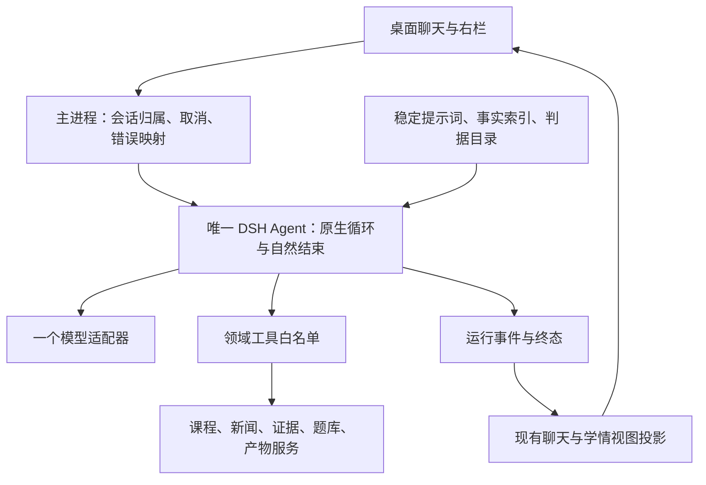

# Agent 运行链调查与 DSH 直接复用指导

> 范围：桌面聊天主链、提示词装配、上下文、工具、产物、做题、记忆与界面事件；对照 `example/deepseek-harness-master` 和 `example/oh-my-pi-main`。
>
> 本文是**代码调查与实现指导**，不另立产品需求。权威顺序仍是 [设计原则](principles/single-agent.md) → [MVP v3](mvp/mvp-v3.md) → [R01–R20](requirements/README.md)。保留单说话人、按需取材、真实证据与本地数据等产品语义；工具名称、context 消息位置、历史处理等旧实现约定若与原生机制冲突，实施时同步对应需求，不为维持旧实现再造一套运行时。
>
> 阅读顺序：先看一、二；负责改代码的人重点看四；实测结果、验证限制见六。文中「代码事实」可从引用核对；未运行的影响推导标为 `[INFERENCE]`；「建议」均不是已经实现的能力。

## 一、摘要

**能直接复用的运行时机制就直接复用，不再自己实现一套相似但不完整的东西；营小商只保留真正属于自身业务的部分。** 目标是直接组合 DSH 的单 Agent、模型服务、session、prompt、工具、skill 和上下文管理组件，而不是把它们读懂后重写进 `tool-loop.ts`。身份与教学判断放提示词，真实数据与副作用作为领域工具，任务判据与方法论作为 skill 及其手册；桌面只适配输入、展示、设置和会话归属。默认不设置固定轮次、请求次数或工具调用总数上限，不增加“次数到了再强制收口”的模型请求，采用原生工具驱动的自然结束、错误和取消机制。

现有身份与简单概念路径可以运行，但输出撤回、工具虚报成功、题目不落题库、页面分片覆盖、聊天记录不被记忆整理器消费等问题已被定位。应把这些调查结果作为**业务工具和接入层的修复清单**，在原生运行时上接通它们，而不是先给自研循环补一套预算、守卫、状态注入和压缩系统。本文是这一直接复用方案的实施指导，重建尚未实施，既有调查证据保留在第六节。

## 二、为什么做

### 2.1 用户感知的问题与对应机制

| 感知 | 已确认的代码机制 | 后果 |
|---|---|---|
| 一直转圈、不回答 | 工具阶段禁止正文；无用户取消；工具能力/反馈不完整；还有按次数强制收口的分支 | 学生无法区分有效工作、无效重复和传输停滞；限轮不能证明任务完成 |
| 字出来了又消失 | `App.tsx` 在工具开始时清空当前文本 | 明明发生了流式输出，看起来却像重新开始 |
| 输出很慢 | 重复请求、全量历史、工具参数生成、轮末文件生成与刷新都在同一等待链 | 首段答复和整个回合完成被混为一谈 |
| 说有附件，但附件不完整或没生成 | 先给成功话术，轮末才校验/持久化；分片正文覆盖 | 模型和学生都拿到不准确的成功信号 |
| 出题看起来成功，交卷失败 | 产物里有题，题库表里没有对应题 | UI 做题壳存在，但核心学习闭环不成立 |
| 越聊越慢、记不住之前做了什么 | 历史无总预算，摘要水位卡住，产物不可按需读取 | 同时存在上下文越来越长和关键信息缺失 |

其中，网络等待、上下文增长对具体耗时的贡献尚未做分项性能剖析，不能把所有慢响应都归因于模型服务。后文区分确定性错误与性能风险。

### 2.2 目标

- 一轮只有一个对学生说话的 Agent；简单问题不经过规划器、专家路由或另一条生成管线。
- 有效工具工作可以自然继续；正常答复、澄清、证据不足、错误、取消与 token 截断均按真实原因结束，不按固定次数强制交卷。
- 文本真实流式显示，不因随后调用工具而被偷偷删除；等待期间显示真实阶段，而非工具日志或假进度。
- 资料只在模型需要时读；目录不能冒充原文；超长内容可缩小范围重读。
- 两类产物能完整保存；新出的题可以交卷，判分使用的题与屏幕显示的题是同一份。
- 学情、摘要、水位和最近产物能影响下一轮，但不把教材、新闻、题库、产物全文预塞进 system。
- 后续增加能力只动领域工具或 skill，不再修改通用循环里的业务分支。
- 桌面直接消费同一套原生运行时的消息、事件、工具、skill 和 context；不再在业务仓库平行维护这些通用机制。

### 2.3 非目标

- 不趁这次调查改成多 Agent、自动专家协作或意图分类工作流。
- 不以“控制长循环”为由默认增加固定轮次、请求数、工具总数、整任务倒计时、自动催促消息或无进展强停器。
- 不引入任意 shell、任意路径访问、任意 URL 抓取、浏览器自动化或完整 MCP 工具面。
- 不重写已有 SQLite 数据层、题目判分、教材入库和新闻采集。
- 不把 UI 动画、全仓代码卫生、教学评分算法重新设计混进循环重建。
- 不宣称现有全部功能已经运行验收；本次只调查、写文档，不修改业务实现。

## 三、方案

### 3.1 学生应当看到什么

学生仍然只聊天：

- 问身份、致谢、必要澄清：直接回答，不机械地查教材、读手册或生成附件。
- 问概念：按需读取对应定义与原文，简明解释，并给一个适合当前问题的检查问题。
- 要案例/新闻分析：选择材料、核对来源、按需读判据；能得出结论就回答，材料不足就明确缺口，不以无限检索代替回答。
- 要可带走的成果：生成一份完整 HTML 页面；要练习：生成可以实际交卷的题目集。
- 问学习进展：依据真实学生证据回答，证据不足时说不足，而不是把之前 AI 写的页面当作学生能力。
- 等待太久或不想继续：可以停止；已显示的文字和已提交的产物不会消失，也不会被误记为学生作答。
- 切换会话：旧请求留在原会话，不把文字灌进新会话，完成时也不强行把人拉回去。

### 3.2 产品结构不变，运行时归一

这里的运行时控制、资料读取、产物持久化都不是第二个说话人。记录器可以异步做事实整理，但不得再接管对话或阻止当前回复完成。

### 3.3 业务只落位，不另造流程

| 归属 | 放什么 | 不放什么 |
|---|---|---|
| 提示词 | 营小商身份、教学边界、何时追问/解释/产附件、何时查事实和读判据 | 教材正文、模型配置、循环次数倒计时、关键词意图路由 |
| 领域工具 | 课程/新闻/成长证据读取、题目校验与入库、页面保存、真实作答处理 | 另起模型生成器、决定“第几轮必须回答”、重复实现通用工具调度 |
| skill 与手册 | 案例、出题、调研、BP、成长评价的判据、方法与边界 | 另一个角色、独立主循环、模板化业务状态机 |
| 业务 context | 当前章节线索、学习目标/约束、真实学情概况、最近产物索引 | 预选的材料全文、“已读”假回执、全部数据库记录 |
| DSH 原生运行时 | 循环、消息、工具执行管线、prompt 组装、skill 发现、context 压缩、取消与恢复 | 为营小商专门决定案例怎么分析、学生应该处在哪个教学阶段 |
| 桌面与领域存储 | 设置/权限、会话归属、事件展示、题目与证据持久化 | 第二条对话调用路径、另一套事件事实源 |

新增一个教学能力时，先判断需要一条提示规则、一份 skill，还是一个真实领域工具；不默认新增 Agent、调度器、执行阶段或模型调用。

## 四、技术细节

### 4.1 当前真正可达的链路：先认清，别按文件名删代码

当前桌面链路为：

`App.send` → preload `chat` → `learning:chat` → `AgentService.handleConversation` → `runTeamTurn` → `runAgentLoop` → `DeepSeekLlm.stream`。

依据：

- [主进程初始化与模型注入](../apps/desktop/src/main/index.ts#L77-L91)，[聊天 IPC](../apps/desktop/src/main/index.ts#L398-L432)。
- [聊天服务及落库](../packages/agent/src/index.ts#L400-L522)。
- [本轮装配与循环入口](../packages/agent/src/team.ts#L169-L256)。
- [界面发送与回合收尾](../apps/desktop/src/renderer/src/App.tsx#L894-L958)。

**重要纠偏：**

- `team.ts` 现在承载的是桌面**单 Agent**装配，不等于还在跑多专家。其 `members` 是空数组，主路径没有角色路由。按旧文档的文件名清单直接删除它，会删掉当前聊天入口。
- `index.ts` 中一批意图/品牌正则仍在，但不能据此认定聊天每轮都经过旧路由；当前 `handleConversation` 直接进入上述单循环。另一方面，[`StateProjector`](../packages/agent/src/state.ts#L43-L108) 的章节推断、[阶段正则](../packages/agent/src/state.ts#L174-L227)确实可达，应区分“事实投影”和“业务动作决策”。
- `mentor.md` frontmatter 的 `maxTurns: 200` **不是**桌面循环上限：[加载器会剥离 frontmatter](../packages/agent/src/prompts.ts#L19-L25)，实际参数在 [`team.ts`](../packages/agent/src/team.ts#L204-L220)。改这个元数据不能解决当前长循环。
- 旧 Web/profile/bundle 是另一套入口，不是桌面的实际运行链；不要把旧入口能启动当成桌面已经修好。

### 4.2 问题证据与优先级

P0 表示可能挂住、错误交付或阻断核心闭环；P1 表示明显退化或需求未接通；P2 表示收敛与维护问题。优先级是本报告的实现建议，不改原需求范围。

#### A. 循环、协议与输出

| 编号 | 优先级 | 代码事实与证据 | 应怎样处理 |
|---|---|---|---|
| F01 | P0 | [循环请求](../packages/agent/src/tool-loop.ts#L232-L245)不传 `signal`；[适配器](../apps/desktop/src/main/llm.ts#L114-L122)虽接受 signal，主链未使用；读取流可长期等待 | 直接接 DSH 取消链与 provider 的传输错误/空闲处理；网络停滞不是任务轮次超限，不另造回合倒计时 |
| F02 | P0 | [SSE 处理](../apps/desktop/src/main/llm.ts#L134-L201)只用 `finish_reason` 判断停读，最后一律发 `finish: stop` | 保留 `stop/tool-calls/max-tokens/aborted/error`；无合法终态的 EOF 不能伪装成功 |
| F03 | P0 | [`maxRounds=10`](../packages/agent/src/team.ts#L204-L220)；[工具循环耗尽后](../packages/agent/src/tool-loop.ts#L377-L420)还有第 11 次请求。收口仅减少 schema，[执行仍查全量工具](../packages/agent/src/tool-loop.ts#L291-L299) | 随原生 loop 切换删除 maxRounds、强制收口和 writers-only 分支；工具解析/可见性由 DSH 原生执行管线负责 |
| F04 | P1 | [`team.ts`](../packages/agent/src/team.ts#L190-L201)要求“正文只在不再调用工具的那一轮写”；[界面工具事件](../apps/desktop/src/renderer/src/App.tsx#L716-L735)还会清空已流出的文字 | 允许必要的短进展说明；区分已显示文字、当前阶段和最终消息，不靠撤回文字制造整洁 |
| F05 | P1 | [循环事件](../packages/agent/src/tool-loop.ts#L90-L102)没有请求结束、终态、tool-call id；[转发层](../packages/agent/src/team.ts#L133-L160)有 `tool-end`，界面却不处理它 | 使用运行时原生流/终态事件并做单点 IPC 映射；工具完成后更新真实阶段 |
| F06 | P1 | [缓存](../packages/agent/src/tool-loop.ts#L291-L318)命中仍把原结果交给模型；每次调用计数继续增加；改参数字符串可绕开缓存 | 缓存不等于任务有进展；先修材料可读性、反馈与 prompt/skill 冲突，不据此另写无进展强停器 |
| F07 | P1 | [执行器](../packages/agent/src/tool-loop.ts#L310-L328)只 JSON.parse，没有统一参数 schema 校验；一批 JSON 错误一律解释成“参数太长被截断” | 使用 DSH 工具注册、输入验证与错误结果；领域工具只补真实业务校验，不维护第二份通用执行器 |

F03 的条件必须说完整：**只有最后一个允许轮次仍返回工具调用、循环自然耗尽时才进入收口轮**。正常无工具文本会提前返回，不是每次请求都会额外收口。

F04 的影响也有边界：真实模型在多轮工具期间是否输出短说明，取决于生成结果；“出现后被清空”由代码确定，“每次无输出都因此发生”则不成立。

#### B. 产物、题目与记忆

| 编号 | 优先级 | 代码事实与证据 | 应怎样处理 |
|---|---|---|---|
| F08 | P0 | [`collect`](../packages/agent/src/artifacts.ts#L74-L89)只暂存，却返回“已收齐/已关闭”；循环[立即把 write 工具记作 written](../packages/agent/src/tool-loop.ts#L315-L318)，[状态提示](../packages/agent/src/team.ts#L213-L219)进而说“产物已写入” | 区分 staged、validated、committed；暂存不是成功落库，也不代表内容齐全 |
| F09 | P0 | [页面 merge](../packages/agent/src/tools/write-tools.ts#L26-L40)合并 `content.html`，但 [`collect.body`](../packages/agent/src/artifacts.ts#L74-L84)被新分片覆盖；[最终创建](../packages/agent/src/artifacts.ts#L109-L125)使用 body | 从完整合并后的内容派生唯一落盘正文，不能让 `content_json` 与文件各有一份不一致的事实 |
| F10 | P0 | [`emit_question_set`](../packages/agent/src/tools/write-tools.ts#L121-L159)最终只创建 artifact；[交卷检查](../packages/agent/src/index.ts#L674-L686)却要求 `questions` 已有题目 | 产物提交时完成题目校验、稳定 ID、题库与知识点关联写入，随后才向 UI 宣布 ready |
| F11 | P0 | [聊天 turn](../packages/agent/src/index.ts#L495-L507)写 `record_json: {}`；[记录器](../packages/agent/src/recorder.ts#L25-L30)要求 `turnId/status`，[消费循环](../packages/agent/src/recorder.ts#L125-L150)遇缺记录就停止 | 聊天也写完整 TurnRecord；先修生产者契约，不能让记录器跳过空记录、直接推进水位掩盖问题 |
| F12 | P1 | [产物校验](../packages/agent/src/artifacts.ts#L96-L107)发生在模型循环结束之后；[题目 schema](../packages/shared/src/index.ts#L763-L777)还允许空题目列表、任意 type、空知识点 | 参数与领域约束在工具返回前校验；轮末校验仅兜底，不是第一次发现错误的地方 |

F10 的准确范围：**当前模型新出的题，如果题库没有同 ID 行，会无法交卷**。题库中原本存在的题不因此失效。若模型 ID 恰好撞上另一道已有题，则存在显示题与判分题错配的风险 `[INFERENCE]`，不能把“查得到这个 ID”当作一致性证明。

#### C. 上下文、能力暴露与 UI 隔离

| 编号 | 优先级 | 代码事实与证据 | 应怎样处理 |
|---|---|---|---|
| F13 | P1 | [历史读取](../packages/agent/src/index.ts#L438-L441)无条数/总体积预算；[当前环境](../packages/agent/src/team.ts#L84-L111)不带记忆摘要、最近产物；工具结果裁剪不处理历史正文 | 分开管理 system、历史、当前工具结果；摘要完成后才替代历史，不假装已有摘要 |
| F14 | P1 | [九工具注册](../packages/agent/src/tools/index.ts#L13-L16)及读写清单没有 `read_skill/read_growth`；[skills 说明](../packages/agent/skills/README.md#L43-L53)明确未接加载器 | skill 使用原生注册表、filesystem provider 与 `skill` 工具，不补自研 read_skill 加载器；成长证据接独立领域读工具 |
| F15 | P1 | [`read_news`](../packages/agent/src/tools/read-tools.ts#L372-L395)硬切前 4,000 字；[`read_material`](../packages/agent/src/tools/read-tools.ts#L280-L288)切前 12,000 字，却没有范围/续读信息；[总裁剪](../packages/agent/src/tool-result-pruner.ts#L74-L96)不是严格总预算 | 返回范围、总量、截断标记和可行的窄读方式；已经省略的内容不能算模型已读 |
| F16 | P1 | [`read_kp`](../packages/agent/src/tools/read-tools.ts#L50-L59)和 [`read_material`](../packages/agent/src/tools/read-tools.ts#L220-L225)共用 kp 已读键；后者可能因此跳过尚未交付的教材部分 | 已读状态按资源和已交付范围记录，不把“读过定义”当成“读过定义加所有原文” |
| F17 | P1 | [发送与返回](../apps/desktop/src/renderer/src/App.tsx#L894-L950)只有一个 stream；[切换/新建](../apps/desktop/src/renderer/src/App.tsx#L1062-L1087)不约束活跃请求 | 请求与会话绑定；晚到事件只更新所属会话，不能覆盖当前视图 |
| F18 | P1 | [用户消息先入库](../packages/agent/src/index.ts#L400-L420)，失败前没有 started 回执给 UI；[失败刷新](../apps/desktop/src/renderer/src/App.tsx#L945-L950)仍用旧 sessionId | 在模型调用前确认 sessionId/turnId；失败也有可恢复的回合记录 |
| F19 | P2 | [路由常量](../packages/llm-json/src/index.ts#L9-L12)写 `deepseek-flash`，[桌面设置](../apps/desktop/src/main/settings.ts#L24-L29)实际决定模型；适配器用 settings 而非传入路由 | 一个模型配置来源；日志与实际请求一致，避免排查时看错模型 |

F15 还有两点容易漏：

- 总工具结果超过阈值后，只裁每条大于单条阈值的结果；很多小结果之和仍可能超预算。这里是“触发一次裁剪”，不是严格保证总量小于上限。
- 当前工具先记账、后截断，可能把模型没有真正看到的尾部也列进 reads/citations。应把资源可获取、工具执行过、片段已交付、回复实际引用分开，而不是混成一个“读过”。

### 4.3 参考如何选：DSH 作主内核，但不是简单换一个 import

| 维度 | DSH | OMP | 本项目取舍 |
|---|---|---|---|
| 运行环境 | Node 风格 ESM 发布物；Cordis 服务体系 | Bun 包、TS 源码入口、原生组件 | 当前 Electron/Node 优先 DSH |
| 已有关系 | agent 包已直接用 Cordis 与 `dsh-llm`；旧 profile 也在 DSH 生态 | 未作为当前桌面底座 | 有重合，但桌面尚未接官方 loop |
| 主循环 | 工具驱动、session 事件、取消、生命周期钩子 | 工具驱动、stream/steering、deadline 等 | 选一个，不做互相翻译的双内核 |
| 自然结束与保护 | 无内置轮次预算；支持错误与取消 | 无通用固定步数上限；支持取消及可选 deadline | 默认采用自然结束，不据此新增固定轮次或任务总时长上限；传输、权限、容量限制分别处理 |
| 工具调度 | 显式安全才并行，默认独占 | shared/exclusive 屏障 | 采用 DSH 原生调度，不重新造一套 |
| 产品工具面 | 可以只注册领域工具，但完整 bundle 很大 | 默认编码工具、CLI/TUI 生态很大 | 两边完整应用壳都不搬 |
| 许可证 | MIT | MIT，部分子资产另有声明 | 实质复制保留版权、许可证及所复制资产的额外声明 |

可核对的参考入口：

- [DSH loop 包依赖](../example/deepseek-harness-master/packages/core/agent-loop/package.json#L29-L45)。其 peers 包括 agent、session、session-persistence、session-projection、system-prompt、tools 等，不是一份独立循环函数。
- [DSH 步骤与终止](../example/deepseek-harness-master/packages/core/agent-loop/src/agent.ts#L298-L390)、[工具调用后的继续判断](../example/deepseek-harness-master/packages/core/agent-loop/src/agent.ts#L547-L555)。
- [DSH 明示没有轮次预算](../example/deepseek-harness-master/packages/core/agent-loop/README.zh.md#L208-L220)。
- [DSH 工具并发分类](../example/deepseek-harness-master/packages/core/tools/src/index.ts#L1304-L1319)、[有界调度与顺序提交](../example/deepseek-harness-master/packages/core/agent-loop/src/tool-calls.ts#L113-L246)。
- [DSH 每步 prompt 装配](../example/deepseek-harness-master/packages/core/agent-loop/src/agent.ts#L267-L287)、[每次尝试准备请求](../example/deepseek-harness-master/packages/core/agent-loop/src/agent.ts#L403-L453)。
- [OMP agent 包](../example/oh-my-pi-main/packages/agent/package.json#L27-L53)、[模块级 Bun/native 依赖](../example/oh-my-pi-main/packages/agent/src/tokenizer.ts#L12-L25)。因此不能声称原包可直接在当前 Node 主进程 import。
- [DSH MIT](../example/deepseek-harness-master/LICENSE)、[OMP MIT](../example/oh-my-pi-main/LICENSE)。

**直接复用，而非仅作参考**：使用匹配版本的 DSH 原生组件及公开扩展接口。能用发布包就显式依赖并组合；确有发布/构建障碍时，先核实原因，再以保留许可证和上游版本来源的方式引入必要上游实现，不翻译重写一份简化 loop。营小商自己的模型选择/凭据来源、领域服务、UI 与业务表保留，但不因此保留自研协议和执行机制。

**明确不搬**：旧四专家 preset、`dsh-base` 全量配置、goal 自动续行、无限 retry、Stop hook 强制续行、shell/文件系统万能工具、subagent。参考里的 `sdk-minimal` 也带终端和宽权限配置，不能因为名字叫 minimal 就整份复制。

**不是“接线即可”**：还要处理 session 身份、prepare/create/resume/close、持久化后端、投影注册、Agent 工厂、上下文归属与卸载顺序。依据见 [工厂与投影注册](../example/deepseek-harness-master/packages/core/agent-loop/src/index.ts#L342-L390)、[create](../example/deepseek-harness-master/packages/core/agent-loop/src/index.ts#L678-L701)、[resume 必须配置 persistence](../example/deepseek-harness-master/packages/core/agent-loop/src/index.ts#L837-L848)。

#### 4.3.1 直接复用清单与替换边界

| 通用机制 | 原生组件/接口 | 营小商只负责什么 |
|---|---|---|
| 主循环、输入队列、取消、空闲与生命周期 | `dsh-agent`、`dsh-agent-loop` | 创建/恢复一个业务会话的 Agent，提交用户输入，连接停止按钮 |
| 模型路由、规范 stream、终态与 provider | `dsh-llm` 及匹配实际协议的 provider | 绑定现有设置里的 Key、模型和端点，中文化错误；不手写第二份 SSE/finish 解析 |
| 执行日志、派生消息、恢复与持久化 | `dsh-session`、`dsh-session-projection`、`dsh-session-persistence` 及原生后端 | session 身份映射、存储根放在现有 app home、投影到现有业务表 |
| prompt 装配与动态事实 | `dsh-system-prompt` 的 section/context 注册 | 提供身份文本、教学规则和业务快照，不手工重拼完整 messages |
| 工具注册、schema、可见性、执行/并发/错误 | `dsh-tools` | 声明领域参数、结果、并发安全性和执行函数 |
| skill 发现、目录发布、正文加载 | `dsh-skill`、`dsh-skill-filesystem`、`dsh-tool-skill` | 编写教学 skill，配置产品专用资源根，打包并核验必需内容 |
| 模型上下文压力与历史压缩 | `dsh-token-meter`、`dsh-compaction-basic`，需要时配原生 tool-result-pruner | 提供准确模型容量；领域读工具返回合理范围，不重写压缩算法 |
| 流式消息和工具状态 | `agent/assistant-stream`、session 原生事件 | 做一层 IPC 展示映射，不重建事件总线或推测完成状态 |

新增核对依据：[prompt 注册与原生 context](../example/deepseek-harness-master/packages/core/system-prompt/README.zh.md#L54-L86)、[原生 skill 组合及目录/加载行为](../example/deepseek-harness-master/packages/skill/tool-skill/README.zh.md#L25-L61)、[filesystem 根目录隔离](../example/deepseek-harness-master/packages/skill/skill-filesystem/README.zh.md#L44-L75)、[原生上下文压缩](../example/deepseek-harness-master/packages/compaction/compaction-basic/README.zh.md#L25-L82)、[工具结果修剪](../example/deepseek-harness-master/packages/compaction/compaction-tool-result-pruner/README.zh.md#L25-L60)、[持久化后端](../example/deepseek-harness-master/packages/session/session-persistence-jsonl/README.zh.md#L25-L81)。

**provider 必须先核实协议，不能盲换。** 当前桌面适配器发 `/chat/completions`；本地 example 的 `dsh-llm-deepseek` 使用 Messages 协议，默认基址与路径不同，见 [端点与协议格式](../example/deepseek-harness-master/packages/llm/llm-deepseek/README.zh.md#L80-L91)。阶段 A/B 应验证当前端点、Key 和所选模型是否支持目标 provider。兼容则直接用原生 provider；不兼容先查同版本现有 provider/配置支持，不能把旧 chat/completions 基址直接塞给 Messages，也不能借兼容之名默认重写传输层。只有确认现有组件确实无法覆盖的协议差异，才允许范围明确的 provider 适配，并记录缺口。

#### 4.3.2 切换后不再保留的自研机制

- `tool-loop.ts` 中的工具循环、maxRounds、额外收口、通用工具派发、结果缓存和状态催促逻辑，不作为 fallback 留下。
- 当前宿主手写的消息拼装、SSE 解析、DSML 文本执行入口，迁移到原生 provider/session 契约，不另开旁路。
- 自研 skill 扫描/目录/加载器不再补建；当前工具名 `read_skill` 只作为旧需求术语，目标使用原生 `skill`，同步 R04 与提示词，不保留两个同义工具。
- 不平行保留旧的通用工具结果裁剪和历史摘要调度；与领域内容无关的部分交还原生 compaction。教材范围读取与原文 locator 则属于业务工具，仍由项目负责。
- 教学证据抽取、学生事实更正、题目与产物提交属于领域服务，可以保留；它们不能再次驱动对话循环。

`team.ts` 中的有用业务装配可迁移为原生组件注册；文件是否保留由最终职责决定，不按名字删除，也不为保留文件而留下第二套通用运行时。

### 4.4 自然结束、取消与运行保护

#### 4.4.1 记录执行事实，不拿计数当任务完成判据

- **turn**：一次用户输入触发的工作及其明确终态。
- **step**：主 Agent 一次生成、执行所需工具并决定是否继续的步骤。
- **attempt**：一次实际模型请求；修复和重试也应可观测，不能藏在计数里。

这些身份和计数优先使用原生事件，用于定位多余读取、传输失败与恢复，不用于实现“第 N 次强制回答”。工具多并不等于空转，工具少也不保证完成。

#### 4.4.2 默认采用 DSH 的完成语义

| 情况 | 默认行为 | 营小商不应追加什么 |
|---|---|---|
| 模型请求合法工具 | 原生执行器执行，结果进入 session，主 Agent 继续 | 按次数突然撤工具、强迫写附件或总结 |
| 模型不再调用工具，且无原生待处理的后续输入 | 按原生 turn 规则结束 | 再请求一次“最终结论”、必须调用 finish 工具或必须产附件 |
| 模型需要澄清、材料不足 | 用正常答复说明问题或缺口，自然结束 | 为凑齐材料自动反复检索、自动转交专家 |
| 出现 token 截断、协议错误或取消 | 保留原生真实终态与可确认的部分结果 | 伪装成 stop/completed，再整轮重跑 |

依据：[step 的完成/继续判断](../example/deepseek-harness-master/packages/core/agent-loop/src/agent.ts#L547-L555)、[turn 与输入队列的收尾](../example/deepseek-harness-master/packages/core/agent-loop/src/agent.ts#L340-L365)。不能将写工具的 `concludesTurn` 当成默认捷径：产物是附件而不替代聊天答复，第一次分片更不代表任务已完成。

#### 4.4.3 保留真正的工程边界，不重新引入轮次预算

| 边界 | 是否保留 | 负责方 |
|---|---|---|
| 用户主动停止、窗口关闭与 Agent 释放 | 保留，按原生取消与生命周期处理 | DSH + 很薄的桌面接入 |
| 网络断开、无合法终态的 EOF、传输空闲 | 保留准确错误与 provider 支持的等待策略 | 原生 provider；网络停滞不是“任务做得太久” |
| 参数、工具可见性、会话归属与副作用幂等 | 保留，失败不得假成功 | 原生 tools + 领域校验/存储 |
| 单次模型输出和模型 context 容量 | 保留，与真实模型能力匹配 | 原生模型配置/token-meter/compaction |
| 工具特定 IO 限制，例如新闻抓取超时 | 按该真实操作的契约处理 | 现有领域 IO 服务及原生工具机制 |
| 固定轮次、请求总数、工具总数、整任务时长 | 不设为默认任务结束条件 | 不在业务宿主另造一套计数器/倒计时 |
| 未来明确的付费额度或无人值守资源限额 | 有实际部署需求再单独设计，非本次默认方案 | 部署策略，不混进教学完成判断 |

因此撤回旧版任意指定的次数与秒数配置。并发分类/并发度不是轮次上限，沿用原生调度与工具安全声明即可；具体配置以真实 IO 与模型能力为依据，不在报告里无依据地填一组数字。

#### 4.4.4 若仍重复，先解释为什么继续

按真实事件核查：是否读不到需要的材料、参数不支持续读、工具只返目录、技能互相矛盾、写入虚报完成、缺少成长证据工具、错误被当成功，或外部扩展不断追加输入。分别修对应工具、skill、prompt 或接入错误，再观察行为。

不默认增加无进展强停器、每轮 `[程序状态]` 催促、Stop hook、goal 自动续行或自写 retry 循环。`agent/turn-stopping` 只在已有结束条件时参与收尾，并非每个工具步骤都会触发，见 [触发条件](../example/deepseek-harness-master/packages/core/agent-loop/src/agent.ts#L340-L365)；不应把它用来重新实现轮次控制。

原生插件确有恢复能力时，核对它的触发条件、取消和副作用语义后按需组合；恢复事实要可见，不能把正常工具工作、传输失败重试和强制续行混成一种“循环”。

### 4.5 什么时候传什么提示词、什么作为 context

#### 4.5.1 通过原生注册点提供业务内容

| 内容 | 营小商提供什么 | 原生机制与时机 | 边界 |
|---|---|---|---|
| 身份、教学边界、何时回答/追问/产附件 | `mentor.md` 的稳定规则 | 注册到 `dsh-system-prompt` 的 section/persona，由 runtime 每步装配 | 不混 Key、模型名、教材正文，不使用参考默认编码助手人格 |
| 工具用途、参数和结果 | 领域工具定义 | `dsh-tools` 注册后，schema 随原生 prompt assembly 提供 | 不在 system 手抄第二份完整工具表 |
| skill 目录 | 教学 skill 的名称与触发描述 | 原生 skill provider/registry/tool 在请求前发布目录，变化时原生更新 | 目录不是正文，不另写关键词匹配器或目录注入器 |
| 当前章节线索、学情概况、目标/约束、最近产物索引 | 一个紧凑业务快照 provider | 注册原生 context，随 runtime 装配/刷新 | 只提供事实，不预选材料、不决定教学动作 |
| 学生本轮原话 | 用户输入及会话归属 | 调用原生 Agent 输入接口，一次准入 | 不重复写一份 user message，不拼进 system |
| 历史对话、工具消息与压缩摘要 | 不再手拼 messages | 原生 session 派生，token-meter/compaction 管理压力 | 不从 SQLite 拉全量聊天后再叠加一次原生历史 |
| 已确认的长期学生事实、学习摘要 | 领域记忆投影的紧凑结果与水位 | 作为业务 context 或按需领域读工具提供 | 与 runtime 为压缩窗口生成的摘要分开；都不冒充原文证据 |
| 教材、新闻、成长证据明细 | 领域读工具 | 主 Agent 需要事实时调用，结果走原生 tool-result | 有来源、范围与完整度，不提前标为已读 |
| skill 正文与方法手册 | 判据/方法内容 | 原生 `skill` 按需加载；方法手册可由受限 `read_reference` 读取 | 不起新 Agent；判据不是教材或学生证据 |
| 暂存/提交/失败 | 工具与业务服务的真实结果 | 原生工具结果与领域提交事件提供 | 不每轮伪装一条学生消息来催促结束 |
| 最终答复 | 主 Agent 的正常输出 | 原生流式消息和 turn 终态 | 不另调一个总结模型，不由宿主伪造最终答复 |

**消息位置采用原生机制，不为旧拼接方式复刻 runtime。** DSH section 成为 system，注册 context 成为带来源的 user 快照，skill 目录也是原生持久目录消息；来源和信任边界由它们的原生类型表达，而不是一概当作学生原话。不得把同一事实同时注册成 context 又拼进 system。

当前 R02/R04/R05/R14 对“环境必须在 system”“工具叫 read_skill”等描述包含旧实现约定。实施时同步为上述原生注册点，同时保持单说话人、目录与原文分离、事实按需读取、学生证据可追溯等产品语义；本次不直接改这些权威需求文件。正文不预塞，**不等于目录和环境必须由我们手工塞在某个固定消息位置**。

#### 4.5.2 主提示词应该负责的判断

建议将主提示词收敛成以下职责，而非继续把手册全文搬进去：

- 我是谁、面对谁；不代写、不编造、只说一个人的话。
- 什么问题可以直接答，什么事实必须查工具。
- 什么情况下追问，什么情况下承认证据不足。
- 只有学生要可带走的东西时才写页面；出题是结构化例外。
- 要专业判据时读哪份 skill/手册；读完按它做，不要求所有问题都读完全部资料。
- 正文、目录、摘要、学生证据、教学假设分别是什么，引用能从哪里来。
- 可以简短说明正在做什么，但不展示思维链、内部 ID、角色名、工具日志。
- 已够回答时就回答；不能用反复检索代替不确定性说明。

不需要“每轮先用一个模型分类意图，再另一个模型规划，再执行”。这些判断就在同一次主 Agent 请求里完成。

#### 4.5.3 现有提示词冲突应一次性消除

| 冲突 | 当前出处 | 收敛方向 |
|---|---|---|
| 允许分 2–3 次写，但第一次返回就说“已收齐、工具关闭” | `mentor.md:147`、`write-tools.ts:102/126` 对比 `artifacts.ts:86-88` | 承认只是接收片段；允许继续补齐，完成与否不能由“调用过一次”推断 |
| 简单概念也被要求套 3–5 知识点、迁移结论等长结构 | `mentor.md:80-90`、`references/case-playbook.md:45-55` | 单概念只处理该点；完整案例才使用完整案例判据，不自动扩展任务 |
| skill 要旧 `case_study`，实际默认 HTML 页面 | `skills/case-coach/SKILL.md:77-83` | 按 R04 重写为判据，不保留第二套产物协议 |
| skill 要运行仓库 Python 命令，产品 Agent 根本无 shell | `skills/case-coach/SKILL.md:34-44` | 引文验证属于确定性工具/服务，不能要求 AI 调不存在的工具 |
| skill 还说“交给 question-coach/growth-assessor” | `skills/case-coach/SKILL.md:111-115` | 改为同一个 Agent 切换判据，不出现角色转交 |
| 题量允许到 30，分片却固定“2–3 次、每次 3–5 道” | `mentor.md:104/147`、`references/artifact-schemas.md:116`、R09 | 按学生要求的数量与单次输出能力合理分片；不固定分片次数，不因模型往返变多就强行交卷 |

这些问题不应通过额外“纠偏 Agent”补救。先消除相互矛盾的规则，才有可能评估提示词本身的效果。

#### 4.5.4 Skill 直接接原生组件，项目只编写内容

组合 `dsh-skill`、`dsh-skill-filesystem` 与 `dsh-tool-skill`，使用其现成 frontmatter 解析、目录、加载、可见性和生命周期；不补写 `loadSkillCatalog/loadSkill/read_skill` 的平行实现。目录名/工具名统一后，迁移主提示词与需求里的引用，不保留同义别名。

产品应只扫描随包发布的教学资源根：原生 filesystem provider 支持 `includeDefaultRoots: false` 与自定义根，见 [根隔离配置](../example/deepseek-harness-master/packages/skill/skill-filesystem/README.zh.md#L44-L75)。不要把开发机的个人编码 skills 顺带暴露给学生。必需教学 skill 的缺失/无效在打包或启动接入检查中通过原生目录/加载结果发现；不为此再写 YAML 解析器。原生 provider 对无效条目可能只告警跳过，不能假称挂载插件后自然获得 R04 的严格启动检查。

案例、出题、调研、BP、成长评价各自的 skill 提供适用范围、完成判据、事实/假设边界与所需方法手册。现有 `read_reference` 可以保留为受限内容读取工具，但不承担另一套 skill 注册/发现；尚无对应工具的命令和角色转交语句应删掉，而不是为了满足旧手册新增 shell 或专家。

### 4.6 Context 管理直接复用，领域记忆单独负责

#### 4.6.1 不再手拼历史与重写压缩

原生 session 是运行事实源，由原生派生机制构建请求；模型窗口压力交给 token-meter、compaction-basic，工具结果确实主导窗口时再挂原生 pruner。项目不继续复制 `tool-result-pruner.ts`、自写字符总预算或每轮从 `chat_messages` 拉全部历史。

这些组件不是“挂上就随便用默认值”：模型容量与单次输出上限必须准确，压缩余量要适配所选模型。原生 pruner 是在 compaction 压力触发后运行，不保证每次领域工具返回都立即裁剪，见 [触发时机](../example/deepseek-harness-master/packages/compaction/compaction-tool-result-pruner/README.zh.md#L58-L60)。所以领域工具仍应返回合理片段与可续读范围，不能把整本书交给压缩层处理。

上下文压缩可能产生辅助模型请求；这是现成的维护机制，不是第二个面向学生的 Agent，也不按教学类型路由。保留其真实来源、费用与失败结果，不把压缩请求算成教学进展。

#### 4.6.2 保持按需取材，不保留旧历史形态

保留的产品约束是：不预取教材/新闻/题库/产物全文；目录不能当原文；引用必须来自真实获取的片段。已经通过工具交付且仍在原生 session context 中的材料，是实际历史，不是预取，更不是假已读。

因此建议不再把“每个用户回合都清掉所有工具原文、只留下 user/assistant 正文”作为迁移前提；否则又要在原生历史之上维护一套自研消息过滤器。实施时同步 R05 的这项旧实现约定，采用原生历史、压缩与重新读取语义，不悄悄修改需求后仍声称完全一致。

原生压缩或修剪已移除某个片段时，模型应按需重新读取；不要靠项目级 firstTime 永久封锁。精确引文仍要可回到业务资料与 locator，压缩摘要不能冒充原文。严格的数据保留/隐私要求若将来另有规定，再使用现成 session/surface 扩展点实现必要的领域策略，不自写通用 compaction。

#### 4.6.3 学习记忆不是模型窗口摘要

| 内容 | 负责方 | 用途 |
|---|---|---|
| 运行历史及其压缩摘要 | 原生 session/compaction | 让 Agent 在模型窗口内继续工作 |
| 学习档案、学生目标/约束、证据与整理水位 | 现有 profile/recorder 领域服务 | 持久的学习事实、成长评价与来源追溯 |
| UI 的聊天、turn 和状态视图 | 薄的原生事件到现有 SQLite 投影 | 展示、检索和恢复；不反向重复生产原生消息 |

聊天也必须从原生结果生成 recorder 可消费的完整 TurnRecord，修复空 `record_json`；不能跳过坏记录、直接推进水位。原生压缩产生摘要不等于学生学习证据已抽取完成；反过来，学习摘要也不应变成一份重新拼给每次模型的完整历史。

保留现有证据定位、学生更正优先级与幂等业务规则。证据只来自学生原话与真实作答，不能从 AI 回复或附件反推学生能力；领域整理失败不阻塞当前对话。

#### 4.6.4 已读按实际交付解释，不是调度开关

领域读工具返回资源标识、来源/版本、交付范围、完整度及可用的续读参数；trace 记录真正送达的内容。读过定义不等于读过对应全部教材，资源存在不等于模型看过，被截断内容不算已交付。

不为了防循环设计复杂跨工具已读状态机；优先返回正确片段、让原生历史保留结果，并允许需要时重读。缓存若保留，应是领域读取优化，而不是“已经读过，不许再读”的任务控制。

工具没有范围参数，就不能提示模型“换更窄参数重读”；要么补真实的领域范围能力，要么准确说明当前只能取到这部分。缺材料时允许模型据此说明不足，而不是由程序强制催答。

### 4.7 工具清单：保留什么、补什么、不暴露什么

#### 4.7.1 当前九个工具

| 工具 | 保留用途 | 必须修正的契约 |
|---|---|---|
| `list_chapter_kps` | 知识点目录兜底 | 目录不是已读原文，不产生引用 |
| `read_kp` | 单知识点详情 | 已读范围不能影响尚未读取的教材正文 |
| `read_material` | 合并取定义与教材，减少模型往返 | 截断、知识点不存在、定义与原文范围分别说明 |
| `read_textbook` | 更精确的教材检索/续读 | 参数校验、有界返回、可恢复缺失范围 |
| `read_reference` | 方法论手册 | 文件缺失要准确报错；成功读取后才记账 |
| `search_news` | 本地新闻候选目录 | 返回摘要、时间、内容状态；搜索结果不是新闻全文 |
| `read_news` | 读取选中新闻的正文 | 来源、时间、完整度、截断、续读可用性 |
| `write_page` | 默认 HTML 附件 | 先校验片段，合并后派生正文；暂存与提交分别反馈 |
| `emit_question_set` | 唯一结构化附件 | 题目、题库、知识点关联、判分身份一致后才能 ready |

批量 `read_material` 可以保留为领域能力；当前的通用并发、缓存、头尾保留和旧结果裁剪只是现状，不是切换后必须保留的实现。原生已有的机制直接替换，领域工具不再次包一层同功能管线。

#### 4.7.2 需求存在、主链没暴露的能力

| 能力 | 需求依据 | 推荐形态与边界 |
|---|---|---|
| skill 发现与加载（R04 旧称 `read_skill`） | R04 | 使用原生 `skill` 及其 registry/filesystem/tool 组合；迁移名称与资源，不新增同义工具或加载器 |
| `read_growth` | R13、R14 | 按维度读当前水平、真实证据摘录、来源、复核状态与前后测；不能拿教材引用代替学生证据 |
| 学生自带新闻入库 | R07 | 受控新闻接入能力；沿用已有抓取、超时与来源限制，不开放任意 HTTP 请求工具 |
| 新闻与知识点的已审核映射 | R08、R09 | 只读取映射事实；新闻出题的审核门槛由确定性服务强制执行，不能只写在提示词里 |
| `read_artifact` | R15 的后续项 | 需要继续修改历史产物时再接；按归属和范围读取，不自动把 HTML 塞进 context |

`read_artifact`、历史版本编辑等在当前 R15 中是后续项，本文不自动升级为第一阶段 MVP。若本轮明确验收“继续修改刚才的产物”，应先把该行为及其数据契约同步进 R15。

#### 4.7.3 声明工具，不自行实现工具执行器

| 职责 | 直接复用/项目实现的边界 |
|---|---|
| 工具注册、schema、可见性、调用与结果配对 | 交给 `dsh-tools` 与原生 loop；项目不再遍历全局 input.tools 手工派发 |
| 参数完整性与基础结构、错误结果 | 交给原生执行管线；领域规则作为该工具的输入 schema/执行校验补充 |
| 并发与取消 | 交给原生调度；工具声明真实并发安全性并把 signal 传给自己的 IO，不自写 Promise.all 调度器 |
| student/session/chapter/turn 归属 | 项目通过原生作用域绑定可信业务身份，不能由模型参数随便决定 |
| 真实领域校验与副作用 | 项目复用题目、证据、新闻审核、产物等现有服务；不在工具内部另起对话模型 |
| 返回内容与原文范围 | 项目提供规范业务结果及 render/来源；原生执行器负责提交和事件，不再维护另一份助手工具消息 |
| 写入的成功、失败与未知结果 | 项目报告真实提交事实；沿用原生错误/取消语义，不自动重试结果未知的写入 |

新工具能否加入而不修改 loop，是此次切换的验收标准；不得把新增能力写成 `if (toolName === ...)` 的通用循环特例。

不要给 `emit_question_set` 内部再调用旧 `QuestionSmith.generate()` 来“顺便补题库”：那会重新调用模型生成另一份题。应复用该包**不发模型请求的校验、规范化、稳定 ID 和持久化能力**，保证判分的正是主 Agent 生成的那份题。

DSML 文本兼容优先交给匹配 provider 的原生协议处理；不要搬回当前“把普通正文重新解析成可执行工具调用”的旁路。只有经证实的 provider 协议缺口才做最小适配，仍经同一原生工具可见性与校验链。

### 4.8 产物与做题闭环

#### 4.8.1 先维持现有两个写工具，不增加一串生命周期工具

接入原生 loop 后，可以保留 R15 的“轮末统一落库”这一领域提交方式，但不能把它扩展成控制 Agent 的状态机：

- 接收片段时校验输入与合并结果；失败当场作为工具错误交还主 Agent，由它决定修复、澄清或说明不足。
- 暂存成功只说“已接收，累计多少内容，尚未提交”，不能说工具关闭、附件已落库或内容已齐全。
- staged/validated/committed 只是领域事实；通过工具结果与提交事件反馈，不每轮注入“写过了，必须停”的控制消息。
- 最终持久化从合并后的规范内容派生文件与 `content_json`，不分别维护两份可能漂移的正文。
- 提交完成后发 artifact-ready；提交失败发明确失败结果，回合为 partial/failed，不留下“附件在右栏”的成功假象。
- 部分流式回复是 provisional，终态必须校正交付状态，但不删除已显示的正常解释文字。

以后如果需要“写工具返回时就必须持久化成功”，再统一调整 R15 的轮末提交契约，考虑在现有写工具内表达最后分片；不要现在同时保留轮末提交和工具内提交两种成功定义。

#### 4.8.2 题目集提交必须同时解决四件事

- 题目有真实知识点、合法题型与难度、有效选项和答案、非空解析；无效知识点不能被静默丢成空数组。
- 使用已有的同源同题干稳定 ID 约定，不把模型随口生成的 `q1` 当全局题库主键；UI 编号与存储身份分离。
- 题目表、知识点关联、题目集产物使用相同规范题目与 ID。数据库部分用事务提交；文件与数据库跨介质时，需暂存文件、可恢复提交及失败清理，不能假装单个 SQLite 事务能回滚文件。
- 只有题目数据可查且一致，才宣布题目集 ready；交卷时继续保留归属、成员、重复提交和幂等检查。

不得在交卷时“查不到就按 AI 产物里的答案先判一下”来掩盖出题持久化失败。那会形成另一条判分事实来源，并绕开题库身份与外键契约。

新闻题源的审核状态也应在这一提交路径强制检查。旧题库生成路径有审核门槛，不代表直接写 artifact 的路径自然继承了它。

#### 4.8.3 历史产物不要当死代码直接删

MVP 的收敛方向与 R15 的历史兼容描述存在张力：一处要求清旧分支，另一处要求历史产物仍可打开。应先清点实际库里的类型，做备份与显式迁移/归档，再删旧生成入口与无用模板。

可以先禁止新产生旧类型；历史读取是否保留到迁移完成是数据保护问题，不是允许保留第二条 Agent 生成路径。不要为了“只剩两种类型”直接删除用户历史产物。

### 4.9 界面事件、取消与失败恢复

#### 4.9.1 沿用现有 IPC，统一一份事件定义

保留 `learning:chat` / `learning:chat-event` 这些桌面传输边界即可。原生的流、工具和 turn 事件是事实源，IPC 只转发/裁剪展示所需字段；不再设计平行的事件总线、终态推断或调度层。下面是界面需要表达的语义，不是要求另造一套运行时事件类型：

| 类别 | 用途 |
|---|---|
| started | 立即确认 requestId、sessionId、turnId，以及用户消息已接收 |
| request/stream start | 模型请求已开始；不是“已经有答案” |
| text delta / message end | 分段维护可见文本，完成后与持久消息对齐 |
| tool start / tool end | 维护当前真实阶段；内部参数、工具原名、原文 preview 不直接上屏 |
| artifact staged / committed / failed | 附件的真实生命周期 |
| terminal | 成功、部分完成、失败、取消及原因；无论路径如何都恰好一次 |

用 DSH 的 attempt/revision/stream frame 身份映射这些事件，不要又在 UI 推测“这是最后一轮”。事件到达顺序与重复处理要幂等；终态后旧 attempt 的晚到 delta 不得重新打开气泡。

#### 4.9.2 三种“快”应分别记录

- 接收消息后多久有**可信状态反馈**。
- 多久出现**第一段有用答复**，不是一个标点或“我来看看”。
- 多久**整个回合完成并可持久恢复**。

工具调用参数也在模型生成；长 HTML 或题目 JSON 尚在生成时，当前实现不会发 tool-start，因为执行是在参数收完后开始的。可以显示“正在整理附件”，但不能谎称工具已经写入，也不应把参数 JSON 流给学生。

#### 4.9.3 不再让工具事件撤回答案

当前 `text: reset` 应被分段状态替代：保留已经输出的简短说明，后续阶段另行显示；最终消息只提交一次。需要修订的内容使用运行时明确的 revision，不用清空整个 stream 来处理所有工具事件。

界面应消费 tool-end、终态和取消，切走会话也要把结果记回所属会话。发送队列保存发送时的 session/作用域，而不是只存一段文本、执行时再猜归属。

#### 4.9.4 停止与恢复

- 新增取消 IPC 后，主进程按稳定请求身份取消对应 Agent，而不是全局杀模型服务。
- 停止后不再发新模型请求、不启动新工具；已开始的副作用必须核对结果，不能仅以超时 Promise 赢了就当工具停止。
- 部分文本保留，并显示“已停止/未完整完成”；不写成正常 completed，也不产生虚假学生作答。
- 新会话即使第一条就失败，UI 已拿到 started 身份，仍能找到自己的用户消息和失败回合。
- 重试复用已确认完成的副作用事实；不能把整条任务从头再派一遍，导致重复附件或重复 attempt。
- 等待队列的内容不因停止后自动排空而悄悄继续执行；学生能看到哪些尚未发送。

### 4.10 R01–R20 应怎样自然融入

下表是职责分配与接线检查，不替代各需求的完整验收条款。

| 需求 | 放在哪里 | 当前主链要完成的收敛 |
|---|---|---|
| R01 单一智能体 | 唯一 runtime + 宿主 | 保留单说话人；切换完成后删除旧循环及旧生成入口，不按 `team.ts` 名字误删 |
| R02 提示词 | 一个稳定身份段 + 有界环境 | 清重复、清冲突；章节/学情是事实，不是代码路由 |
| R03 工具 | 原生 dsh-tools + 领域定义 | 原生负责注册/校验/派发/并发/取消；领域服务负责真实数据与业务不变量 |
| R04 Skill | 原生 skill registry/filesystem/tool + 教学内容 | 配产品资源根与打包；统一原生工具名，不自研扫描、目录注入与正文加载 |
| R05 按需 context | 原生 session/token-meter/compaction + 领域读工具 | 不预取正文、不假已读；同步旧跨轮清空约定，不重写历史与压缩 |
| R06 课程知识库 | 原有 DB/导入 + 课程工具 | 保留数据资产；检查跨章节可达性，不把第 4 章写成循环分支 |
| R07 新闻 | 原有采集服务 + 受控接入/检索/正文工具 | 本地搜索与学生自带新闻是不同能力；完整度、时间、来源明确 |
| R08 新闻匹配 | 匹配事实读取与确定性门槛 | 模型选择主题；已审核与自动候选不可混同 |
| R09 出题做题 | `emit_question_set` + 题库/作答服务 | 修题目持久化与身份；校验和判分复用，不二次生成另一套题 |
| R10 案例精讲 | prompt + 判据 + 原文工具 + `write_page` | 默认聊天；明确要成果才附件；不启案例专家 |
| R11 调研设计 | prompt + 研究方法手册 + `write_page` | 由模型判断缺什么、解释方法取舍；不恢复旧七步硬管线 |
| R12 BP | prompt + BP 手册 + `write_page` | 给大纲、目的、证据与假设；不绕到独立 BP Agent 或完整代写 |
| R13 成长卡 | `read_growth` + rubric + `write_page` | 真实学生证据按需读；缺证据可交付“证据不足”，不编水平 |
| R14 学情记忆 | 原生事件投影 + 完整 TurnRecord + 领域 recorder/profile | 区分窗口压缩摘要和学习记忆；水位推进，学生更正不被旧记录覆盖 |
| R15 产物导出 | 两个写工具 + artifact 服务 | 规范内容单一来源；分片完整；历史读取/编辑按现有分期处理 |
| R16 三栏界面 | 统一事件契约与会话状态 | 不清字、不串台、有终态、有停止；不暴露内部日志 |
| R17 本地数据 | 原有 home/SQLite/文件权限 | 在线备份含 WAL；运行日志也归同一 app home，不另建全局 DSH 数据家目录 |
| R18 模型运行时 | 一个规范 adapter | Key/模型来源统一；finish 与 signal 正确；错误中文化覆盖全部 IPC |
| R19 品牌文案 | 品牌常量、UI、prompt | 仍只有“营小商”；不继承参考默认编码助手人格 |
| R20 运行验收 | 桌面真实路径与打包 | 编译不是行为；通过新题交卷、分片导出、停止、恢复等真实场景 |

### 4.11 迁移顺序：先用原生跑起来，再接业务，不先强化旧 loop

不把“先把自研 loop 补完整”设为迁移前提。调查里的 P0 是必须修好的行为，不等于每个都要先在旧循环上实现一次、切换后再实现一次。

| 阶段 | 主要改动面 | 退出条件 |
|---|---|---|
| A：确定原生组合与兼容边界 | 核对匹配版本、显式依赖、provider 协议/凭据、session 持久化、产品资源根 | 给出实际需要挂载的组件；不整套搬 dsh-base，不新增自研运行时框架 |
| B：最小原生运行链直接跑通 | 原生 llm/provider、agent/loop、session/persistence/projection、tools、system-prompt | 在 Electron 环境跑通真实 send→stream→自然结束；cancel、idle、dispose、持久化 resume；不含固定限轮或强制收口 |
| C：接入业务内容与真实工具 | 营小商 prompt、教学 skill、课程/新闻/证据读取、页面与题目提交、profile/recorder | 新题能交卷、分片完整、工具反馈真实、聊天记录可消费；加入能力不改 loop |
| D：接入原生 context 管理与桌面视图 | 原生 skill 目录、token-meter/compaction、业务 context、原生事件到 IPC/SQLite 的薄投影 | 不手拼历史、不自研加载/压缩；文字不撤回、不串台；区分学习记忆与窗口摘要 |
| E：单次切换与完整验收 | 统一调用入口，更新对应 R 文档，移除旧 loop/旁路/重复机制，核对安装包 | 产品只有原生主循环；无旧循环 fallback；MVP 场景与打包后资源加载通过 |

若有必须立即处理的数据损坏问题，可以独立修题目/文件等领域错误，但不借“止血”继续建设旧 loop 的预算、守卫、retry、context 或事件系统。所有阶段仍在同一次主路径切换中收敛，不发展成两套产品入口。

实施中的关键约束：

- **复用公开服务，不只复用类型**：当前 `ctx.provide('llm')` 轻对象不能冒充原生 LlmRuntime。挂载匹配 provider 和服务，只有确定不存在可用原生覆盖的兼容缺口才写最小适配。
- **不复制整份配置**：选需要的运行时组件及其依赖；剔除参考的编码人格、个人技能根、shell、subagent、goal 和强制续行插件。
- **固定匹配版本、验证真实导出**：本地 example 与发布物行为可能不同，不能依赖偶然可用的传递依赖，也不能把文档描述当成已在 Electron 运行过。
- **宿主保持薄**：只做设置到原生配置、业务归属、组件注册、用户输入/停止和 UI/SQLite 投影。不要新建一个管理原生 Agent 的自研执行状态机或通用 RuntimePort 框架。
- **一个消息与持久化 owner**：原生 session 写运行事实，现有表是业务投影；题目/产物由领域服务幂等提交，不由新旧入口各写一次 assistant。
- **使用原生生命周期**：稳定 sessionId、persistence 的 create/resume 与写所有权、Agent 停止/等待/释放均按原生契约使用；领域存储在持久化结束后关闭，不自行重建恢复算法。
- **同步旧实现约定**：R02/R04/R05/R14 中的消息位置、工具名、跨轮历史细节按原生接入更新；产品语义与验收不缩减。R09 的可交卷、R15 的历史可读也不能因迁移被推迟。
- **保留数据**：迁移前做含 WAL 的在线备份；不重置学习库，不删历史产物来制造验收成功。

#### 4.11.1 判断有没有真正复用：四个检查

1. 新增一个教学 skill，是否只加内容和资源配置，而不改 loader 或循环？
2. 新增一个领域工具，是否只向原生 tools 注册，而不改派发器？
3. 修改章节/目标/证据概况，是否只改业务 context provider，而不重拼完整 messages？
4. 出现原生可处理的 stream、取消、压缩或恢复问题，是否修配置/接入或上游缺陷，而不是把原生机制旁路成自己的简化版本？

任何一项做不到，先解释缺口，不能把“已经参考 DSH”当成直接复用已经完成。

### 4.12 验收场景与观察标准

以下是重建后的验收清单，**不是本次已经通过的测试**。前两类用真实模型、真实桌面；协议异常另用受控传输做故障注入，不能把固定回复桩当成教学行为验收。

| 场景 | 应观察到的结果 |
|---|---|
| 身份/致谢 | 直接简短回答；无无关读材料、无附件、无额外规划调用 |
| “消费者是什么意思” | 先取真实定义/原文；只讲该概念；不被迫扩成完整长案例 |
| 案例后问“那学习呢” | 沿用主题，只展开该点，不重新生成整份案例 |
| “我想学消费者行为” | 只做必要诊断与最小计划；不出现角色选择器 |
| “给我出 3 道题” | 恰好三题；题库/产物/交卷身份一致；交卷前不展示答案 |
| 交卷与重试 | 逐题反馈；已判记录不重复；失败不算错，重试不按另一题判分 |
| 大题量分片 | 数量满足要求，分片完整；需要超过旧轮数时仍能继续，不因第一次暂存或固定次数就停止；真实失败/取消按真实原因标记 |
| 页面连续三片 | 右栏一份完整页面；导出 HTML 与结构化内容一致且包含全部片段 |
| 写工具非法参数/非法知识点 | 工具当场给可修复错误；无错误副作用；不用再发一个用户回合才能知道失败 |
| 未审核新闻出题 | 确定性拒绝或改用合规题源，不能因直接写 artifact 绕过审核 |
| 学生自带新闻/抓取失败 | 走受控接入；来源和时间明确；失败说明缺口，不假称已经读到 |
| 调研/BP | 缺的关键条件自然追问；方法有取舍、数字标来源/假设；不启第二说话人 |
| 成长卡 | 能读取真实证据；AI 产物不作能力证据；证据不足明确说明 |
| 连续三轮及重复整理 | 完整记录可消费，摘要水位推进，同一水位/原话不重复写证据 |
| 长会话 | request context 有界；已完成摘要与最近窗口可解释；不把历史全文重新塞回 |
| 重复/交替读工具 | 能从事件解释是否取得新材料；修复不可续读/错误反馈/冲突判据等具体原因，不靠固定次数强停掩盖；学生随时可停止 |
| 模型 `length` | 标记 max-tokens；不执行截断工具参数，不把半篇内容当完整交付 |
| EOF/空回复/网络停滞 | 有准确失败或部分完成结果；无无限等待；已有文字可恢复 |
| 用户点停止 | 停止新的模型/工具派发；结果归原会话；保留已显示内容及可确认的副作用 |
| 运行中切会话/新建 | 不串字、不误开附件、不强行切回；队列保留原作用域 |
| 新会话首条失败 | 用户原话仍可见，有 session/turn 身份和失败状态，不成为孤儿会话 |
| 盘满/文件失败/数据库失败 | 不宣称附件成功；不产生空白 ready 卡片；成功的解释文字不被无故丢弃 |
| 无 Key/401/429/模型配置变更 | 中文可操作提示；生效模型与记录一致；Key 不出现在 renderer 或日志 |
| 退出重启/安装包 | session 可恢复；提示词/skills/手册可读取；没有依赖开发机源码路径 |
| 超过旧轮数的有效工作 | 真实多步骤任务可以超过原来的 maxRounds 并自然结束；不出现额外强制总结、撤工具或宿主伪造答复 |
| 新增教学能力 | 加 skill 或领域工具无需改 loop、通用 loader、历史派生和事件调度 |

性能验收应按身份、单概念、新闻分析、题目集分别记录请求数、首帧、首段有效答复、总完成耗时、输出截断、取消和 context 大小。不要把不同任务混在一个平均值里，也不要为了让指标变好强制把所有问题缩成同样短的回答。

请求数是诊断数据，不是达标配额。身份、概念问题若有多余读取，应沿事件定位 prompt、skill、工具或接入原因；复杂任务只要确有进展就允许继续，不用降低次数上限来制造“提速”。取消、网络空闲错误与模型容量分别验收，不混成任务必须在若干秒内完成。

## 五、为什么不选别的

| 备选 | 做法 | 代价 | 不选的原因 |
|---|---|---|---|
| 只改提示词/降低 maxRounds | 多写“快点回答”，或者强制极少轮 | 改动小，容易让复杂任务直接半成品 | 协议、持久化、交卷、取消都不因此修好 |
| 继续大幅强化自研 loop | 把参考机制一点点重造在 `tool-loop.ts` | 继续维护第二套 session/取消/工具/压缩协议，之后再迁移一次 | 不作为迁移阶段；直接在原生运行时接通业务，紧急领域修复不扩展旧 loop |
| 原样搬 OMP | 引入 pi-agent/pi-ai 及编码助手工具面 | Bun/native、消息契约、打包与大量无关功能 | 当前 Electron/Node 不兼容其原包假设，迁移面远超业务需要 |
| 原样搬整个 DSH/旧 profile | 把 dsh-base 与四专家配置当桌面底座 | 接入大量插件，带来额外续行/权限/人格 | 复用组件不等于继承参考产品的全部功能，违背单说话人与领域工具边界 |
| 两套混搭 | 一套 loop，另一套 tools/session/stream | 为每种消息、事件、取消和恢复写转换 | 复杂度重新回到业务仓库，定位故障更难 |
| 只依赖 DSH 类型，运行仍由我们控制 | 保留自己的 loop、skill loader、历史裁剪和状态注入 | 外观看似迁移，关键故障面仍由业务仓库维护 | 不算直接复用，不能作为本方案交付 |
| 为每类请求做工作流/专家 | 意图正则路由，再调不同生成器 | 预判错误、重复提示词、长调用链 | 与现有设计原则直接冲突；这里缺的是事实与运行边界，不是更多角色 |
| 给产物再加 begin/append/commit 多个 AI 工具 | 模型显式管理产物事务 | 更多模型决策和轮次 | 第一阶段保留两个写工具即可；先修真实暂存/校验/提交语义 |

**推荐方案自身的缺点：**

- DSH 依赖面比当前轻量函数大，且参考是预发布版本；版本固定、导出核查、Electron 嵌入和打包验证不可省。
- 教学完成度与资料是否足够仍需清晰的 prompt、skill 和可靠工具；自然结束并不保证每次选择都最优，但不能因此默认改成次数驱动工作流。
- 官方 session 事件与现有 SQLite 表需要业务投影迁移，做不好会重复消息或丢恢复信息；只实现这层产品差异，不重写 session。
- 原生 context/skill 消息形态与旧文档不同，实施时要同步明确的实现约定；不能为维持旧拼接方式重写它们。
- provider 的协议、所选模型容量、凭据读取和 Electron 打包仍要核实；采用开源组件不能免除实际接入验证，也不意味着可以照抄不匹配的默认配置。
- 本方案不能承诺换内核后所有复杂任务立刻更快；只有减少无效请求、修复等待边界并测分项耗时，才能得到可信性能结论。

## 六、实现结果与调查证据

### 6.1 状态与调查边界

**重建方案状态：未实现。原调查完成、本文按直接复用方向修订（2026-10-30）。**

本次修订只更新本文和文档地图入口，未修改 Agent、桌面或领域业务代码，也未重新运行此前已观察过的模型/故障场景。下列原调查的运行结果与限制保留；修订另核对了 DSH 的 prompt、skill、provider、持久化与 compaction 组件说明，没有把它们写成已经在本项目接通。

真实模型场景使用现有环境中的 Key 与当前配置的 DeepSeek 通道；未展示、记录或改写 Key。数据库通过 SQLite 在线备份复制到系统临时目录，领域服务、用户消息、产物和整理都只写临时副本；原学习库未作为试验写入目标。未启动新闻后台自动刷新。

没有执行全量 typecheck/build，没有启动 Electron UI、打包或做视觉验收；不能把下面的后端输出当成安装包已通过验收。

### 6.2 真实后端路径的观察

运行的是实际 `AgentService.handleConversation`、实际 `runTeamTurn/runAgentLoop`、实际领域服务与 `DeepSeekLlm`；不是固定回复模型。两个请求在同一新会话、显式 `ch04` 下顺序执行。

| 场景 | 实际模型请求 | 工具调用 | 首次文本事件 | 回合完成 | 结果 |
|---|---:|---:|---:|---:|---|
| “你是谁？请用一句话回答。” | 1 | 0 | 1,159 ms | 1,419 ms | 正常返回营小商身份与能力，聊天落库 |
| “消费者是什么意思？请简短解释，不要附件。” | 2 | 1（read_material） | 1,367 ms | 2,304 ms | 正常解释，未产附件；读取与引用计数写入 trace |

这里的首次文本事件是后端流式事件，不是实际 UI 绘制时间，也不是“第一段有用答案”指标。样本只有两条，不能用来推算复杂任务 P95。

上下文观测：身份请求的 trace 为 system 7,077 字符、tools 3,874 字符；单概念完成时 trace.totalChars 为 11,972。该 trace 是当前代码的字符统计/结束快照，**不是 token，也不是所有请求累计输入量**。

单概念请求这次没有调用 `read_reference`，尽管 prompt 要求专业内容前读对应手册。这说明提示词要求本身不等于执行保障；这次能解释概念，不代表 skill/手册接线已经完成。

调查脚本为每次模型请求额外加了 60 秒保护，以避免调查进程无限等待。**这是调查外壳的保护，不是项目已经有超时。** 正常两条请求未触发此保护。

### 6.3 真实记忆整理的观察

上述两轮结束后调用实际 `flushRecorder()`：

| 检查项 | 观察值 |
|---|---|
| 新会话 user/assistant 消息序列水位 | source_seq = 4 |
| 整理进度 | summarized_seq = 0 |
| ledger 状态 | pending |
| 两条聊天 turn 的 record_json | 都是 `{}` |

这与 F11 的生产者/消费者契约断裂完全一致。`flushRecorder()` 等到了队列空，不等于摘要已成功完成。

对原库做只读查询也看到了同类历史状态：最近的 team 聊天 turn 没有 `record_json.status`，对应 ledger 多条停在 `summarized_seq=0`。这些旧数据只能证明已有记录的状态，不能证明它们由当前源码版本产生。

### 6.4 受控协议与领域契约检查

下面使用本地 HTTP/SSE 故障输入或确定性的领域输入，目的仅是验证协议和数据边界；**不作为真实模型教学能力验收**。

| 场景 | 实际观察 | 对应问题 |
|---|---|---|
| SSE 发送文本后 `finish_reason=length` | 适配器最终仍发 `{kind: stop}` | F02：丢失 max-tokens |
| SSE 文本后直接正常 EOF，没有 finish_reason | 适配器最终仍发 `{kind: stop}` | F02：异常结束伪装成功 |
| maxRounds=1，首请求返回读工具，收口请求继续返回同名但不同参数读工具 | 共 2 次请求；收口请求没有 tools；读工具仍执行 2 次；最后报未结束工具调用 | F03：额外收口与执行白名单缺口；改变参数避免了缓存掩盖 |
| `write_page` 连续两片段 | 两次都称“已收齐/工具关闭”；合并的 content_json.html 有两片，持久 artifact.content 只有第二片 | F08/F09：成功话术错误、正文覆盖 |
| `emit_question_set` 写一条完整新题，再 finalize、再调用真实 answerQuestionSet | artifact 创建 1 份，questions 查不到新 ID；报“交卷失败：第 1 题的题目数据缺失，没有写入任何答题记录。” | F10：新题交卷断链 |
| `emit_question_set` 的 intro 传数字 42 | collect 先回“已收齐”；finalize 才发现 string 类型错误，创建 0 份并给 warning | F12：校验太晚，模型已无同轮修复机会 |
| 空题目内容对象 | 当前 schema/提取逻辑允许创建题目集产物 | F12：结构可解析不等于业务可用 |

页面检查不仅看了内存 pending，也走了 `finalizeArtifacts` 与实际 ArtifactService：持久内容只剩第二段，而 `content_json.html` 仍有两段。结合 ArtifactService 按 content 写 HTML 文件的实现，可定位文件/导出缺片原因；本次未在 Electron 中观察该文件的视觉效果。

### 6.5 历史记录能够说明什么

原库只读查询得到以下 trace 与起止时间，记录日期为 2026-10-21：

| turn | 模型请求计数 | 工具调用计数 | 起止时间差 |
|---|---:|---:|---:|
| t_mvib5urj_eb0f1b | 4 | 5 | 12.779 s |
| t_mvib3jtn_e1311e | 3 | 4 | 9.006 s |
| t_mvi9jq0t_954505 | 8 | 9 | 26.731 s |
| t_mvi8mexq_f1e007 | 5 | 6 | 20.585 s |

它们说明库里确有多次模型往返的完整回合，但**不提供首字时间、每段等待归因或当前版本性能基线**。不能据此声称“所有延迟就是工具执行慢”，也不能拿其中一个总耗时冒充当前端到端实测。

### 6.6 环境与验证过程的限制

- 调查环境观测：Node v24.15.0，pnpm 11.28.5。
- 初次 `pnpm exec tsx` 触发了 pnpm 的依赖预校验，输出 `ERR_PNPM_IGNORED_BUILDS`，但随后调查脚本仍执行。此输出是环境/依赖安装问题，不是 Agent 逻辑结论。
- 第一次调查脚本在真实场景与协议输出完成后，因脚本使用了不存在的 `ctx.dispose()` 而清理失败；这不是产品异常。随后按实际 Cordis fiber 生命周期修正调查清理，移除了残留临时副本。
- 后续使用 `node --import tsx` 直接运行受控检查，避免触发包管理器的安装预检；退出码为 0。没有修改 pnpm 安全审批设置，也没有运行 `approve-builds`。
- 调查临时脚本和临时数据库已在记录结果后移除；它们不是新增的永久测试入口。今后行为验收以桌面真实场景为准。
- 未对复杂请求做长时间压力测试；用户已经报告的长循环与慢输出作为真实现象接受，本次没有为了再次确认而反复跑同一失败请求。
- 未验证官方 DSH loop 在当前 Electron 打包中的 create/resume、最小 plugin 组合、取消后持久化与 context 投影；阶段 B 的退出条件就是为这些未知设置的，不是声称已经接通。
- 未启用参考的自动 retry、goal driver、compaction 全家桶，也不承诺参考默认配置能自动收敛。

### 6.7 下一次实施应交付的证据

实施者至少应交付：真实桌面中的身份/概念/案例追问、一个新题目集完整交卷、一份分片 HTML 导出、一次停止与失败恢复、一次长会话原生压缩观察、一个超过旧轮数仍正常完成的有效任务、一次关闭重启恢复，以及实际安装包中的原生 skill 加载。

每项保留请求数、结束原因、事件时间、产物/题目身份和数据水位这些程序事实；日志必须去除 Key，学生正文也不应无边界扩散到调试输出。编译通过可作为必要检查，但不能替代这些证据。

**建议实施起点：确定匹配版本与 provider 协议，先让最小原生 DSH 运行链在 Electron 跑通，再注册营小商的 prompt、领域工具、skill 与业务 context，完成领域断链修复后一次切换。不要从扩建自研 loop 或再写一份更长的 mentor prompt 开始。**

### 6.8 本次修订记录

本次修订撤回旧版没有实测依据的固定请求数、工具总数和整任务倒计时建议，删除“限轮后预留收口”的方案；将默认策略统一为原生工具驱动、自然结束与可取消。

同时把“参考 DSH 后补齐自研机制”改为明确的原生组件复用清单：包括 provider、prompt/context、session/persistence、tools、skill、token-meter/compaction；迁移顺序改为先证明最小原生链路、再接业务，而非先完善旧 loop。补充了 Messages 与当前 chat/completions 的协议兼容核查，避免把直接复用误写成不经验证的替换。

业务侧仅保留身份与教学判断、判据内容、真实领域能力、学情/证据/产物存储，以及薄的桌面接入；原调查的源码问题和第 6.2–6.6 节证据未因方案调整而改写，修订不代表重建已经实施。
